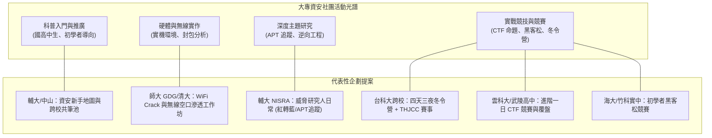

# 🛡️ 全台大專資安社團企劃成果發表精華：12組社團營隊、工作坊與黑客松提案總評

> **活動名稱**：教育部 AIS3 資安社團幹部研習營（社團企劃成果發表會）  
> **活動日期**：2026-09-12  
> **與會團隊**：台師大 GDG、清華大學、海洋大學、竹科實中、台北科大、輔仁大學 NISRA、中山大學、台灣科大、雲林科大、武陵高中等 12 組跨校大專資安幹部  
> **研習核心**：大專資安社團營運策略、無線安全實作坊、APT 威脅研究社課、四天三夜高中職資安冬令營、THJCC 競賽命題與跨校共筆傳承  
> **完整逐字**：詳見 [完整原話逐字稿](20260912-01-全台大專資安社團企劃成果發表.full.md)

---

## 🗺️ 12 組資安社團企劃向度與活動光譜

---

## 📋 關鍵企劃提案精要彙整表

| 組別與代表學校 | 活動名稱與形式 | 目標受眾與規模 | 核心技術與特色 | 經費與資源來源 |
| :--- | :--- | :--- | :--- | :--- |
| **第一組** 師大 GDG / 清大 | **WiFi Crack 與無線安全工作坊** (單日實體工作坊) | 全校學生、不限背景 (30~40 人) | • 自備支援 Monitor Mode 無線網卡 • Kali Linux、Wireshark 封包監聽 • WPA2/WPA3 握手包抓取與破解防禦 | 學生社員社費自籌 |
| **第二組** 海大 / 竹科實中 / 北科大 | **跨校初學者黑客松競賽** (單日駭客松) | 大專程式與資安初學者 (40~50 人) | • 降低門檻，提供導師手把手輔導 • 團隊協作解決校園生活資訊痛點 | AIS3 補助 ＋ 學校社團專案 |
| **第三組** 輔仁大學 NISRA | **威脅研究人日常** (單日進階專題社課) | 具基礎之校內外學生 (30 人，輔大聖言樓) | • 邀請業界學長分享由紅隊轉藍隊歷程 • 威脅情資（CTI）、APT 追蹤分析 • 基礎逆向工程（Reverse Engineering）實作 | 輔仁大學內部計畫 ＋ KKTIX 報名押金 |
| **第四組** 輔大 NISRA / 中山資安 | **資安新手入門地圖與共筆傳承** (系列社課 ＋ 線上平台) | 高中生 30 人 ＋ 大學新生 15 人 (共 45 人) | • 破除資安學習高門檻迷思 • 建立跨校共享共筆資源池 • 「回娘家任務卡」制度鼓勵擔任助教 | AIS3 培育計畫 ＋ 兩校社費 |
| **第五組** 台科大跨校聯盟 | **高中職資安聯合冬令營** (四天三夜全住宿營隊) | 國高中職學生 40 人 ＋ 工人 20 人 (共 60 人，台科大) | • 循序漸進：Linux、Web 滲透、逆向 • 結合 THJCC 競賽實戰體驗 • 夜間學員小聚與業界專家主題講座 | 營隊報名費（8,000~9,000 元）＋ 企業贊助 |
| **第六組** 雲科大 / 武陵高中 | **進階一日 CTF 競賽與深度覆盤營** (單日競賽 ＋ 工作坊) | 具競賽經驗之進階高中/大專人才 (雲科大電腦教室) | • 解決過去競賽覆盤時間不足痛點 • 邀請出題者與業界專家全題型深度拆解 • 大學專業機房支援，學員免自備電腦 | AIS3 經費 ＋ 學校機房場地 |

---

## 💡 研習營導師講評與社團經營關鍵心法

1. **法律合規與倫理界線（Ethics & Compliance）**：
   * 辦理無線網路（WiFi）或 Web 滲透實作時，**嚴禁對校園真實網路或未授權基地台進行發包攻擊**。必須由主辦方架設封閉式隔離靶機與專用測試熱點，事前簽署法律免責聲明。
2. **傳承機制與共筆池（Knowledge Continuity）**：
   * 社團幹部更迭頻繁，強烈肯定第四組提出的「跨校共筆池」與「任務回娘家卡」，使社課講義與 Lab 靶機能代代延續，避免每年重新造輪子。
3. **跨校聯盟與北部 SCIST 資源對接**：
   * 導師呼籲各校幹部善用北部 SCIST（高中職資安社群聯盟）與大專資安聯合網絡，跨校合辦冬令營與 CTF 競賽，共享出題資源與業界講師人脈。
