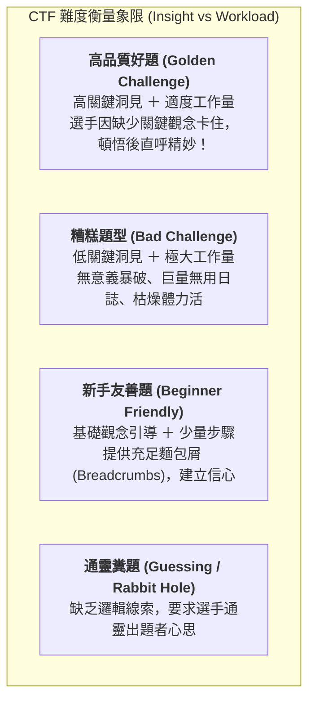

# 🚩 CTF 題目設計與競賽營運實務指南：出題心法、防範非預期解與實戰工作坊

> **活動名稱**：教育部 AIS3 資安社團幹部研習營（CTF 命題技術與賽事營運實務）  
> **授課講師**：清華大學資工博一 / 新竹女中資訊科老師（推理遊戲詭計顧問、AIS3 Junior 講師）  
> **研習學員**：全台大專資安社團社長、幹部與教學團隊  
> **講授核心**：推理解謎與駭客技術融合、難度衡量象限（關鍵洞見 vs 工作量）、反模式警示（杜絕通靈腦洞）、盲測驗題機制、防範非預期解與分組命題實作  
> **完整逐字**：詳見 [完整原話逐字稿](20260912-02-CTF題目設計與競賽營運實務.full.md)

---

## 🧭 CTF 題目難度衡量矩陣與設計象限

---

## 🔬 出題六大核心原則與避坑指南

### 1. 什麼是優秀的 CTF 題目？
* **核心本質**：CTF 是「**推理解謎遊戲 ＋ 駭客技術**」的綜合體。娛樂性與頓悟感（Aha! Moment）是題目成功的靈魂。
* **衡量標準**：
  * **好的難度**：讓選手因為缺少某個**關鍵資安洞見（Key Insight）**而暫時卡住；一旦參透該觀念，解題路徑豁然開朗。
  * **壞的難度**：選手已知道解法，但必須寫腳本爆破 5 小時，或是從 10GB 垃圾日誌中找雜湊值。

### 2. 徹底杜絕四大出題反模式（Anti-Patterns）
1. **拒絕通靈腦洞（No Guessing / Telepathy）**：
   * 題目必須具備完整的**線索鏈條（Clue Chain）**與提示麵包屑（Breadcrumbs），嚴禁無邏輯的密碼猜測或隱寫藏檔。
2. **防範非預期解（Unintended Solutions）**：
   * 許多出題者精心設計了複雜的逆向邏輯，卻忘記關閉伺服器目錄瀏覽（Directory Listing），導致選手直接下載源碼秒殺。
   * **驗題規範**：出題後必須交給**未參與命題的第三方高手進行「盲測（Blind Testing）」**，以客觀視角挖掘防禦漏洞。
3. **避免過度依賴 AI 弱點或無意義混淆**：
   * 設計題目時應兼顧 AI 時代防禦：若題目丟入 LLM 能直接一鍵給出 Flag，代表題目缺乏多步驟上下文推理；好的題目應具備情境綁定與動態互動。
4. **控制分析時間與賽程匹配**：
   * 題目逆向或分析時間絕不可遠超出賽程。避免為了炫技而堆疊過度肥大的二進位檔案。

---

## 🛠️ 各領域題型設計與驗題守則

| 題型分類 | 推薦出題思維與切入點 | 容易出現之非預期解與防範措施 |
| :--- | :--- | :--- |
| **Web 網頁安全** | • 資訊洩漏、邏輯驗證繞過、注入攻擊 • 結合真實現代框架（如 JWT 偽造、原型鏈污染） | • 漏開除錯介面或未過濾檔案讀取造成直接讀 Flag • **防範**：Docker 容器隔離、唯讀檔案系統掛載 |
| **Reverse 逆向** | • 將謎題包裝在小遊戲中（如互動 RPG 攻略破關） • 引導選手觀察動態記憶體或關鍵條件跳躍 | • 符號未剝離（Symbols Not Stripped）導致字串直出 • **防範**：正確 Strip、適度混淆、動態解密 Flag |
| **Pwn 二進位** | • 經典 Stack / Heap 漏洞利用 • 限制指令長度與 Shellcode 構造技巧 | • 本地環境與遠端 libc 版本差異造成非預期崩潰 • **防範**：提供完整 Dockerfile 與對應 libc.so |
| **Crypto 密碼** | • 具備明確數學幾何直覺之現代密碼缺陷 • 重放攻擊、弱隨機數產生器（PRNG） | • 參數過小導致通用 SageMath 腳本直接分解 • **防範**：精確計算密鑰長度與攻擊複雜度 |
| **Forensics / Misc** | • 真實事件日誌追蹤、流量封包還原 • 具備故事性之情境式解謎挑戰 | • 隱寫工具（Stegsolve / Binwalk）一鍵直接提取 • **防範**：自訂隱寫協議，回歸數據結構本質分析 |

---

## 👥 現場工作坊分組出題任務指引

1. **目標受眾定義**：明確定位本題是針對「大專初學者（Easy）」、「社團常規培訓（Medium）」還是「菁英選拔（Hard）」。
2. **預期解（Intended Path）書寫**：出題團隊必須完整寫出 Step-by-Step Writeup，明確標註每一個步驟預計考驗選手何種觀念。
3. **互換驗題**：各組出題初稿完成後，與相鄰組別交換題目光碟/代碼進行交叉盲測。
