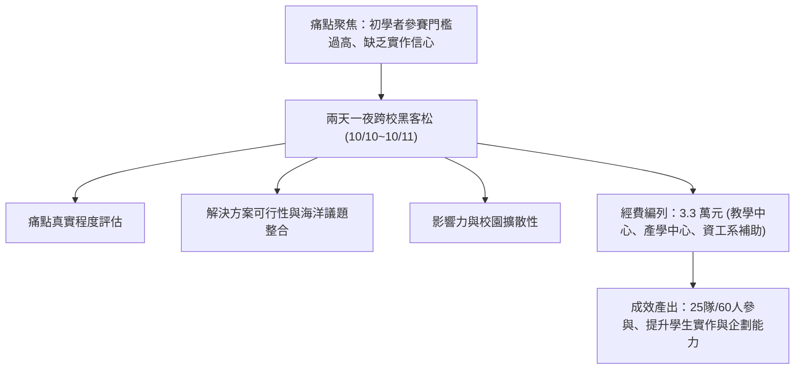

# 🛡️ AIS3 社團成果提案：海洋大學跨校初學者黑客松競賽企劃 (海大 / 竹科實中)

> **活動名稱**：教育部 AIS3 資安社團幹部研習營（社團企劃成果發表）  
> **提案團隊**：海洋大學網路發展學會、竹科實中、台北科大  
> **核心主題**：跨校初學者黑客松、海洋永續資訊痛點、贊助經費預算與導師手把手輔導  
> **關聯文件**：[📄 完整原話逐字稿 (20260912-02-跨校初學者黑客松競賽企劃.full.md)](./20260912-02-跨校初學者黑客松競賽企劃.full.md)

---

## 🏛️ 核心架構與概念流轉圖

---

## 🔑 重點提要 (Key Takeaways)

1. **降低門檻引導參與**：針對非資工或初學背景學員提供導師手把手支援，早鳥免費報名以提高擴散率。
2. **結合多元經費與產學資源**：串聯校內教學與產學資源籌措經費，透過明確評審標準與獎金激勵學員完成 MVP 實作。
