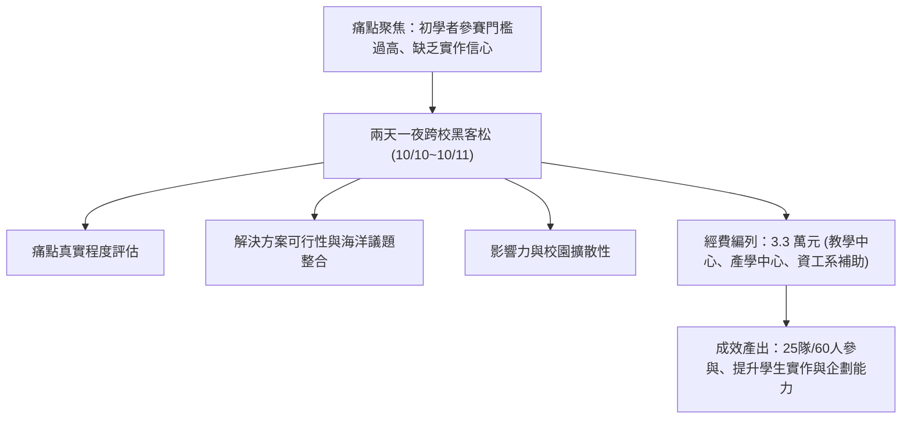

# 🛡️ AIS3 社團成果提案：海洋大學跨校初學者黑客松競賽企劃 (海大 / 竹科實中)

> **活動名稱**：教育部 AIS3 資安社團幹部研習營（社團企劃成果發表）  
> **提案團隊**：海洋大學網路發展學會、竹科實中、台北科大  
> **核心主題**：跨校初學者黑客松、海洋永續資訊痛點、贊助經費預算與導師手把手輔導  
> **關聯文件**：[📄 完整原話逐字稿 (20260912-02-跨校初學者黑客松競賽企劃.full.md)](./20260912-02-跨校初學者黑客松競賽企劃.full.md)

---

## 🏛️ 核心架構與概念流轉圖

---

## 🔑 重點提要 (Key Takeaways)

1. **降低門檻引導參與**：針對非資工或初學背景學員提供導師手把手支援，早鳥免費報名以提高擴散率。
2. **結合多元經費與產學資源**：串聯校內教學與產學資源籌措經費，透過明確評審標準與獎金激勵學員完成 MVP 實作。

---

## 📊 兩日跨校初學者黑客松賽程規劃、五維度評分指標與預算編列

| 企劃核心模組 | 具體執行內容與時程安排 | 資源整合與場地硬體配置 | 預期量化效益與後續推廣 |
| :--- | :--- | :--- | :--- |
| **五維度企劃與評分架構** | 涵蓋：(1) 痛點真實程度、(2) 解決方案設計、(3) 技術可行性、(4) 海洋永續與校園議題整合、(5) 成果擴散影響力 | 提前一個月確認電腦教室與過夜場地、備妥高密度無線 AP 設備與電力配置，防止競賽期間網路斷線 | 預計吸引跨校 **25 支隊伍（約 60 名初學者）**參與，早鳥報名免收報名費以降低跨領域學員門檻 |
| **Day 1 破冰團康與劇情解謎競賽** | 結合小隊大地遊戲破冰與電腦教室「劇情式資安解謎（Story-driven CTF）」引導新手進入狀況 | 由海大網路發展學會、竹科實中與北科大幹部擔任隨隊導師（Mentor），手把手協助非資工背景學員卡關除錯 | 讓零基礎學員在第一天即能體驗解出題目之成就感，消除對程式與資安競賽之恐懼 |
| **Day 2 逆向工程工作坊與實戰驗收** | 上午講授網路安全基礎與 Reverse Engineering（逆向工程）入門，下午進行正式 CTF 驗收賽與成果發表頒獎 | 總預算編列 **33,000 元**，串聯學校教學中心、產學合作中心與資工系經費補助支應講師費、餐費與獎品 | 賽後將優秀解題 Write-up 與活動紀錄公開至社群，作為次學年度跨校招新與贊助商洽談之實績 |

