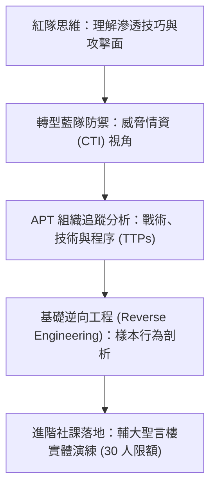

# 🛡️ AIS3 社團成果提案：威脅研究人日常——APT 追蹤與逆向工程社課 (輔大 NISRA)

> **活動名稱**：教育部 AIS3 資安社團幹部研習營（社團企劃成果發表）  
> **提案團隊**：輔仁大學 NISRA 資安社團  
> **核心主題**：威脅情資 (CTI)、紅隊轉藍隊思維、APT 攻擊特徵追蹤與逆向工程基礎  
> **關聯文件**：[📄 完整原話逐字稿 (20260912-03-APT追蹤與逆向工程社課提案.full.md)](./20260912-03-APT追蹤與逆向工程社課提案.full.md)

---

## 🏛️ 核心架構與概念流轉圖

---

## 🔑 重點提要 (Key Takeaways)

1. **紅藍視角整合**：邀請業界學長剖析從單純工具攻擊轉向防禦情資與 APT 追蹤的實務歷程。
2. **深化社課含金量**：打破基礎入門重複開課模式，以進階逆向分析吸引具備基本功之社員持續深造。

---

## 📊 「威脅研究人日常」社課設計、紅藍思維轉換與實作環境規劃

| 課程設計維度 | 傳統大專資安社課痛點 | 輔大 NISRA 創新社課設計 | 實務落地與學員能力培養目標 |
| :--- | :--- | :--- | :--- |
| **從紅隊攻擊轉向藍隊威脅情資（CTI）** | 多數初階社課過度集中於 Web 滲透或現成工具操作，學員缺乏對真實世界國家級 APT 攻擊鏈之宏觀理解 | 邀請業界資深威脅研究員學長返校，以「威脅研究人的一天」為題，剖析如何從零散告警中還原攻擊者戰術、技術與程序（TTPs） | 培養學員建立 MITRE ATT&CK 威脅建模思維，理解紅隊攻擊手法如何映射至藍隊偵測規則 |
| **惡意樣本逆向工程（Reverse Engineering）入門** | 大一、大二社員面對組合語言與二進位分析常因門檻過高而半途而廢 | 於輔大聖言樓電腦教室舉辦 **30 人小班制實體工作坊**，由講師帶領學員逐步靜態拆解脫敏後之真實惡意程式樣本結構 | 掌握基礎 PE/ELF 標頭檢視、字串解密與 API 呼叫鏈追蹤，銜接高年級專題研究與企業資安實習需求 |
| **社團技術能量留存與進階分流** | 學期中後段具備基礎能力之社員容易因課程重複而流失 | 將本課程定位為「進階核心社課」，與基礎入門班分流授課，並鼓勵完訓社員組隊參與全國性金盾獎與 AIS3 暑期課程 | 建立輔大 NISRA 內部「基礎科普 -> 逆向實作 -> 威脅情資研究」之完整人才培育階梯 |

