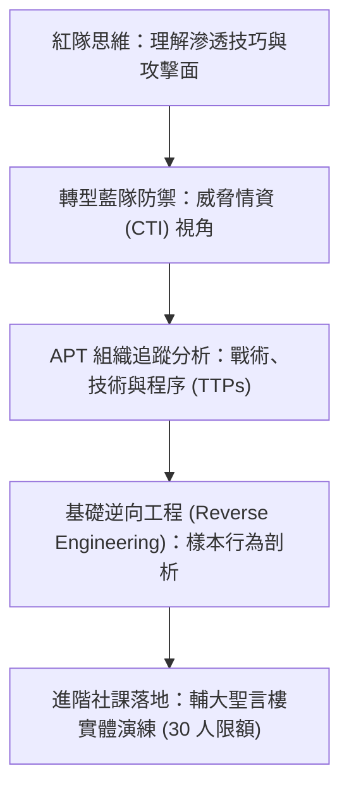

# 🛡️ AIS3 社團成果提案：威脅研究人日常——APT 追蹤與逆向工程社課 (輔大 NISRA)

> **活動名稱**：教育部 AIS3 資安社團幹部研習營（社團企劃成果發表）  
> **提案團隊**：輔仁大學 NISRA 資安社團  
> **核心主題**：威脅情資 (CTI)、紅隊轉藍隊思維、APT 攻擊特徵追蹤與逆向工程基礎  
> **關聯文件**：[📄 完整原話逐字稿 (20260912-03-APT追蹤與逆向工程社課提案.full.md)](./20260912-03-APT追蹤與逆向工程社課提案.full.md)

---

## 🏛️ 核心架構與概念流轉圖

---

## 🔑 重點提要 (Key Takeaways)

1. **紅藍視角整合**：邀請業界學長剖析從單純工具攻擊轉向防禦情資與 APT 追蹤的實務歷程。
2. **深化社課含金量**：打破基礎入門重複開課模式，以進階逆向分析吸引具備基本功之社員持續深造。
