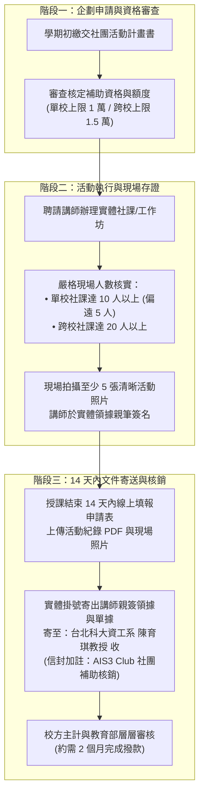

# 📑 教育部 AIS3 資安社團補助申請指南與經費核銷規範手冊

> **活動名稱**：教育部 AIS3 資安社團幹部研習營（社團補助計畫說明會）  
> **主講人員**：國立台北科技大學資訊工程系 陳育琪教授（AIS3 計畫主持人）  
> **與會受眾**：全台大專院校資安社團社長、副社與財務行政幹部  
> **規範核心**：單校/跨校補助額度上限、實體出席人數門檻、講師鐘點費與交通費報支標準、競賽場地專案補助、14 天核銷送件與發票抬頭統編規定  
> **完整逐字**：詳見 [完整原話逐字稿](20260912-04-教育部資安社團補助說明與經費核銷規範.full.md)

---

## 🧭 社團補助申請與經費核銷標準作業程序 (SOP)

---

## 📊 補助額度、人數門檻與講師費標準對照表

| 申請類別 | 每學期補助上限 | 實體出席人數門檻 | 講師鐘點費支給標準 | 備註與附加條件 |
| :--- | :---: | :---: | :--- | :--- |
| **單一社團社課** | **新台幣 10,000 元** | **10 人以上** (偏遠地區學校放寬至 5 人) | • **外聘企業專家**：2,000 元 / 小時 • **學生講師**（大專/碩博）：1,500 元 / 小時 | 人數未達標難以向教育部核銷；講師交通費可依實報銷，但計入 1 萬元總額上限內。 |
| **跨校聯合社課** | **新台幣 15,000 元** | **20 人以上** | 同上標準 | 須為兩所（含）以上大專資安社團聯合辦理，鼓勵跨校資源整合。 |
| **競賽與場地專案** | 依專案實報實銷 | 視競賽規模核定 | • CTFd 平台建置與伺服器費用 • 活動實體場地租借費用 | **與常規社課補助獨立計算**；每社團每學期以申請 **2 次** 為限。 |

---

## 📮 實體單據寄送與報帳發票注意事項

1. **嚴格核銷時限**：
   * 課程結束後 **14 天內** 必須於專屬表單完成登錄並寄出實體文件，逾期主計系統將關閉結報。
2. **寄件資訊與信封備註**：
   * **收件地址**：`10608 台北市大安區忠孝東路三段一號 國立台北科技大學 資訊工程系`
   * **收件人**：`陳育琪 教授 收`（切勿僅寫助理姓名，以免郵件轉發遺失）
   * **信封背面特別註記**：必須以正楷清楚加註 **`AIS3 Club 社團補助核銷`**，便於研究室專案助理分類分流。
3. **發票買受人抬頭與統一編號**：
   * 發票或電子收據抬頭：**`國立台北科技大學`**
   * 專案核銷統一編號：請依研習營公告之學校統一編號開立，打錯統編將無法受理核銷。
4. **撥款審查時程預期**：
   * 學校主計室與教育部審查程序約需 **2 個月**，請各社團幹部提前做好社費周轉與財務規劃。
