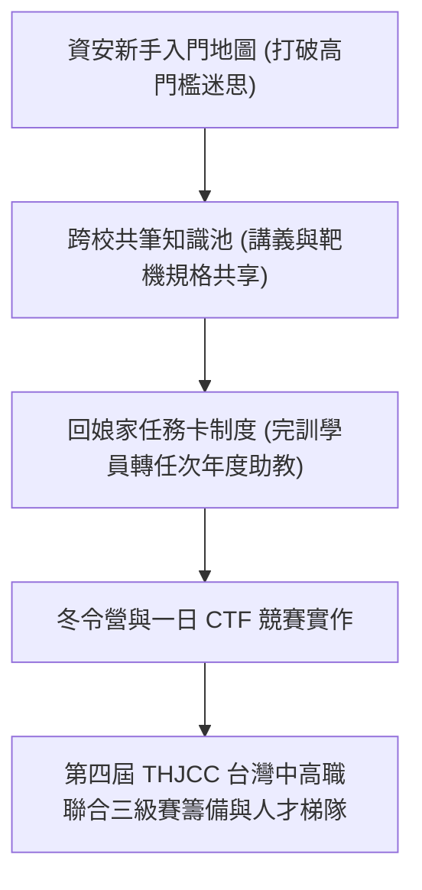

# 🛡️ AIS3 社團成果提案：資安新手入門地圖與跨校共筆傳承機制 (輔大 / 中山)

> **活動名稱**：教育部 AIS3 資安社團幹部研習營（社團企劃成果發表）  
> **提案團隊**：輔仁大學 NISRA、中山大學資安團隊、雲科大、武陵高中  
> **核心主題**：新手入門地圖、跨校共筆池、回娘家任務卡機制、THJCC 跨校招募  
> **關聯文件**：[📄 完整原話逐字稿 (20260912-04-資安新手入門地圖與跨校共筆傳承.full.md)](./20260912-04-資安新手入門地圖與跨校共筆傳承.full.md)

---

## 🏛️ 核心架構與概念流轉圖

---

## 🔑 重點提要 (Key Takeaways)

1. **破除社團斷代危機**：大專資安社團幹部更迭快，透過跨校建立標準化共筆資源與任務卡機制，確保社課教材能長遠傳承。
2. **大專與高職深度對接**：雲科大專業機房與武陵高中社團合作一日進階 CTF，並對接中高職聯合三級賽招募。

---

## 📊 跨校四組聯合提案對照：輔大／中山新手營、雲科／武陵 CTF 與駭客社六堂課

| 提案組別與合作學校 | 活動定位與目標受眾 | 課程／競賽核心機制與時程預算 | 跨校資源共享與傳承創新亮點 |
| :--- | :--- | :--- | :--- |
| **輔仁大學 x 中山大學組** | 大專資安新手一日入門營（輔大電腦教室，每人報名費 200 元現場繳交） | 結合《資安攻防》、《紅藍隊誰是臥底》桌遊化互動教學，至下午 17:00-17:30 舉行頒獎閉幕；經費涵蓋講師費、餐費與宣傳品 | 結合 **AIS3 權威背書 + 校園社群擴散力**，於簡報結尾嵌入工作人員招募表單，將參加者直接轉化為下屆核心幹部 |
| **雲林科大 x 武陵高中組（含 THJCC 推廣）** | 半年期籌備之跨級距 CTF 實戰營隊（串聯高中職與科技大學） | 將課堂所學直接轉化為當期 CTF 競賽題目進行即時驗收；現場導師同步宣傳正在招募工作人員之 **THJCC 台灣中高職聯合賽** | 打通高中職資安社團與大專院校專業機房資源，解決高中端缺乏靶機伺服器與進階出題人力之困境 |
| **第九組（進階人才業界交流 & 駭客社 6 堂課）** | 針對已具基礎之進階社員舉辦業界工程師面對面交流，並規劃 15-1 學期「駭客 ID 社」六堂帶狀社課 | 編列 6 小時共三位業界講師鐘點費（約 10,000-12,000 元預算）；六堂社課涵蓋資安導論、Linux 基礎至簡易 Web Security 滲透實作 | 運用大學與高中社團既有之 Instagram 與 Discord 頻道跨校聯合推播，建立低成本高觸及之常態化社課體系 |

3. **「駭客 ID 社」六堂帶狀社課與業界導師銜接**：第九組透過三位曾任駭客社幹部之經驗，設計從零認識資安、Linux 基礎操作到 Web Security 簡易滲透之六堂結構化社課，並結合業界在職工程師交流，協助進階社員提前對接實習與就業職涯。
4. **SWOT 組織優劣勢評估與社群矩陣擴散**：針對草創期資安社團常見之知名度不足問題，善用 AIS3 品牌公信力結合大學與高中職既有之 Instagram、Discord 社群頻道同步推播，達成跨校聯合招新與教材永續共編。

