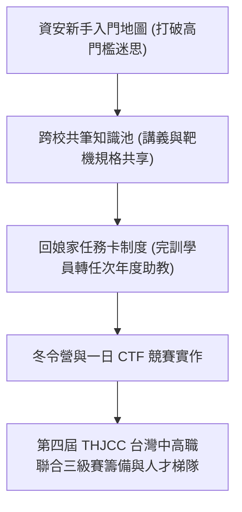

# 🛡️ AIS3 社團成果提案：資安新手入門地圖與跨校共筆傳承機制 (輔大 / 中山)

> **活動名稱**：教育部 AIS3 資安社團幹部研習營（社團企劃成果發表）  
> **提案團隊**：輔仁大學 NISRA、中山大學資安團隊、雲科大、武陵高中  
> **核心主題**：新手入門地圖、跨校共筆池、回娘家任務卡機制、THJCC 跨校招募  
> **關聯文件**：[📄 完整原話逐字稿 (20260912-04-資安新手入門地圖與跨校共筆傳承.full.md)](./20260912-04-資安新手入門地圖與跨校共筆傳承.full.md)

---

## 🏛️ 核心架構與概念流轉圖

---

## 🔑 重點提要 (Key Takeaways)

1. **破除社團斷代危機**：大專資安社團幹部更迭快，透過跨校建立標準化共筆資源與任務卡機制，確保社課教材能長遠傳承。
2. **大專與高職深度對接**：雲科大專業機房與武陵高中社團合作一日進階 CTF，並對接中高職聯合三級賽招募。
