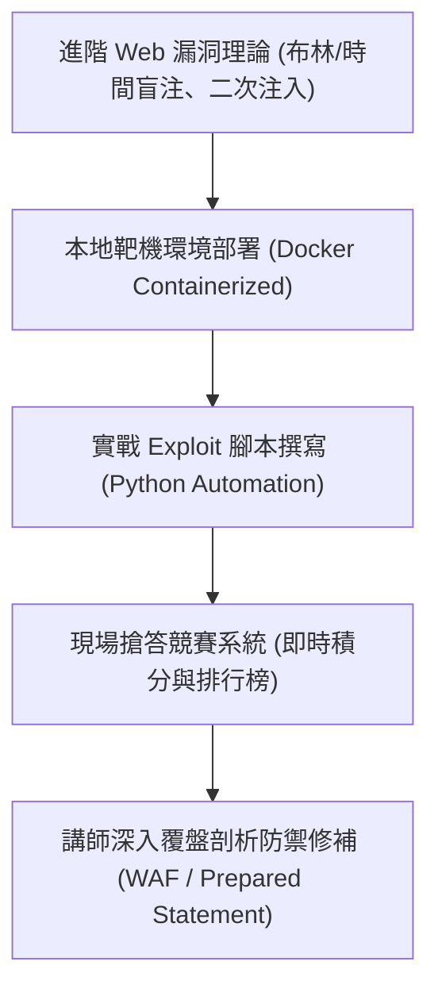

# 🛡️ AIS3 社團成果提案：各校進階 Web 漏洞盲注靶機社課與知識搶答賽 (跨校進階組)

> **活動名稱**：教育部 AIS3 資安社團幹部研習營（社團企劃成果發表）  
> **提案團隊**：大專資安研習營跨校進階 Web 小組  
> **核心主題**：SQL 盲注 (Blind Injection)、Web 漏洞利用鏈、互動式搶答靶機、跨校競賽機制  
> **關聯文件**：[📄 完整原話逐字稿 (20260912-05-Web漏洞盲注靶機社課與知識搶答賽.full.md)](./20260912-05-Web漏洞盲注靶機社課與知識搶答賽.full.md)

---

## 🏛️ 核心架構與概念流轉圖

---

## 🔑 重點提要 (Key Takeaways)

1. **理論與即時反饋結合**：透過自動化搶答系統將枯燥的盲注原理轉化為競技實作，大幅提升課堂互動率。
2. **攻防雙向覆盤**：不僅演示利用鏈，亦深入講授參數化查詢與輸入驗證等根本防禦之道。

---

## 📊 全日 SQL Injection 盲注實作課表、小組協作機制與活動經費結構

| 規劃維度 | 時程與配置細節 | 教學與競賽互動設計 | 經費來源與行政結案配套 |
| :--- | :--- | :--- | :--- |
| **全日四階段課程與實作時程** | 08:30 報到與流程說明；上午兩堂理論與基礎語法課（10:15-11:30 聚焦 SQL 基礎語法）；午休供餐；下午兩堂進階盲注實作加 Q&A 搶答賽 | 針對尚未熟悉資料庫查詢之新手，刻意拉長上午 SQL 語法打底時間，確保下午進入 Boolean-based / Time-based 盲注時全員皆能理解 Payload 構造邏輯 | 活動結束後由主辦單位統一核發**電子版完訓與參賽證書**，提升高中與大專學員之學習歷程誘因 |
| **2-3 人小組制靶機攻防與知識搶答** | 採 2 至 3 人一組之小隊協作模式，共同攻略容器化 Web 靶機並參與現場知識搶答 | 鼓勵學員在解題過程中互相討論並嘗試參與簡易 CTF 題目設計，透過同儕互助降低單人卡關挫折感 | 結合即時積分榜激發良性競爭，並在賽後由講師逐題拆解盲注自動化腳本與參數化查詢（Prepared Statement）防禦寫法 |
| **場地租借與跨校贊助預算編列** | 事先查核商業與校園場地租借行情（約 15,500 元），餐飲與獎品依 **50 名學員 + 10 名工作人員（共 60 人份）**規模精算 | 清楚區分固定場地支出、講師交通鐘點費與非計畫性彈性支出 | 由**復興高中白帽社**協助支應講師費、交通費與場地費，並結合數位志工贊助非計畫支出，實現財務自給自足 |

