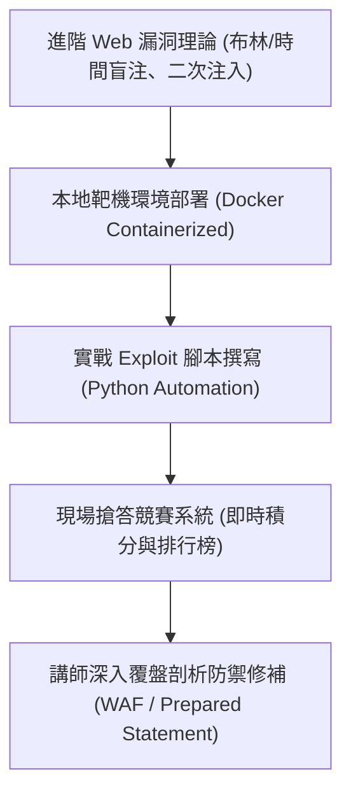

# 🛡️ AIS3 社團成果提案：各校進階 Web 漏洞盲注靶機社課與知識搶答賽 (跨校進階組)

> **活動名稱**：教育部 AIS3 資安社團幹部研習營（社團企劃成果發表）  
> **提案團隊**：大專資安研習營跨校進階 Web 小組  
> **核心主題**：SQL 盲注 (Blind Injection)、Web 漏洞利用鏈、互動式搶答靶機、跨校競賽機制  
> **關聯文件**：[📄 完整原話逐字稿 (20260912-05-Web漏洞盲注靶機社課與知識搶答賽.full.md)](./20260912-05-Web漏洞盲注靶機社課與知識搶答賽.full.md)

---

## 🏛️ 核心架構與概念流轉圖

---

## 🔑 重點提要 (Key Takeaways)

1. **理論與即時反饋結合**：透過自動化搶答系統將枯燥的盲注原理轉化為競技實作，大幅提升課堂互動率。
2. **攻防雙向覆盤**：不僅演示利用鏈，亦深入講授參數化查詢與輸入驗證等根本防禦之道。
