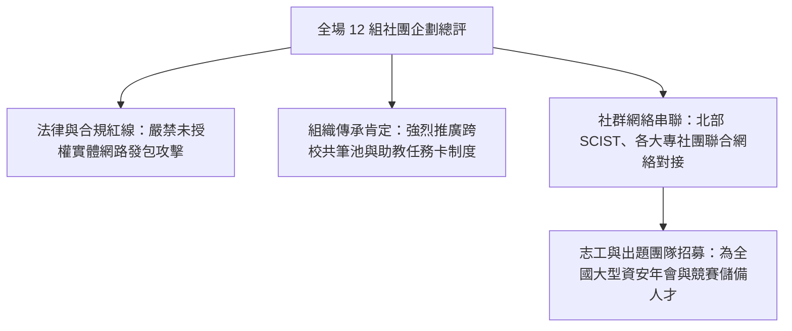

# 🛡️ AIS3 社團成果發表：研習營導師講評、跨校社團聯盟合作與志工招募總結

> **活動名稱**：教育部 AIS3 資安社團幹部研習營（社團企劃發表總結）  
> **點評導師**：AIS3 研習營專業導師群、大會司儀  
> **核心主題**：資安活動法律邊界、跨校共筆制度肯定、北中南大專社群聯盟對接與志工招募  
> **關聯文件**：[📄 完整原話逐字稿 (20260912-06-研習營導師講評與跨校志工招募.full.md)](./20260912-06-研習營導師講評與跨校志工招募.full.md)

---

## 🏛️ 核心架構與概念流轉圖

---

## 🔑 重點提要 (Key Takeaways)

1. **法律合規是社團生存第一要務**：實體網路工作坊切忌踩線，必須由主辦方提供專用封閉靶機並嚴格簽署免責宣告。
2. **跨校生態圈協同效應**：大專與高中職社團聯合辦營隊與 CTF 能有效共享講師出題人脈，解決單一學校資源不足痛點。

---

## 📊 導師團對各組社團企劃之深度講評、法規紅線提醒與全國社群對接

| 講評與總結維度 | 現存社團經營盲點與風險 | 研習營導師團具體指導建議 | 後續跨校合作與行動指標 |
| :--- | :--- | :--- | :--- |
| **實體攻防工作坊之法律與授權紅線** | 部分社團企劃涉及 WiFi 破解、封包監聽或真實網站漏洞探測，若未嚴格隔離環境極易觸犯《刑法》妨害電腦使用罪 | 導師再三強調：**所有實機滲透教學必須 100% 限制於封閉靶機或自建測試熱點**，且開課前務必請學員簽署合規切結書並留存紀錄 | 各校社團幹部於新學期開課前，須先完成靶機容器化封裝與社課法律免責聲明範本建置 |
| **跨校共筆知識庫與「回娘家任務卡」傳承** | 大專資安社團普遍面臨「大四核心幹部畢業後，社課講義與靶機設定隨之失傳」之斷代危機 | 高度肯定輔大、中山等組提出之**跨校共筆池與完訓學員回娘家擔任助教制度**，建議將教材托管於公開 GitHub 組織長期維護 | 透過標準化教案降低新任幹部備課負擔，讓中小型學校社團也能直接重用頂大與指標性社團之成熟教材 |
| **北中南學生資安聯盟（SCIST / THJCC）與年會志工招募** | 單一學校社團經費、講師人脈與出題能量有限，難以獨立舉辦大型黑客松或高水準 CTF | 鼓勵各校主動對接南部 SCIST、北部大專社團聯盟與 THJCC 籌備團隊，並踴躍報名 HITCON / CYBERSEC 等大型年會志工與出題組 | 藉由跨校聯辦營隊分攤場地與講師成本，並為台灣資安社群持續輸送具備實戰經驗之年輕幹部梯隊 |

