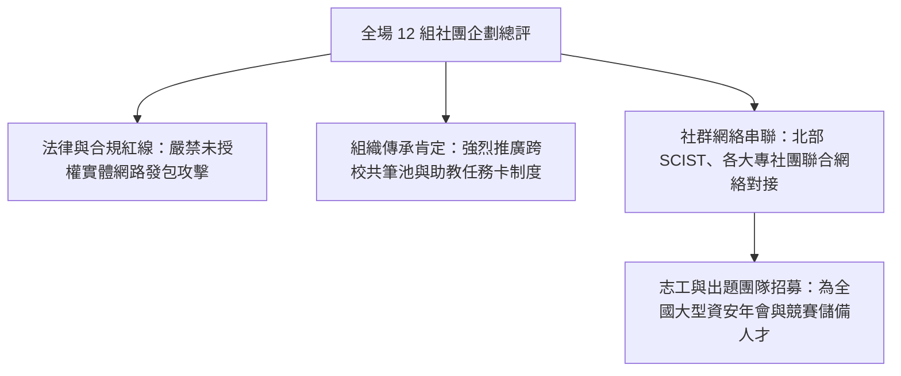

# 🛡️ AIS3 社團成果發表：研習營導師講評、跨校社團聯盟合作與志工招募總結

> **活動名稱**：教育部 AIS3 資安社團幹部研習營（社團企劃發表總結）  
> **點評導師**：AIS3 研習營專業導師群、大會司儀  
> **核心主題**：資安活動法律邊界、跨校共筆制度肯定、北中南大專社群聯盟對接與志工招募  
> **關聯文件**：[📄 完整原話逐字稿 (20260912-06-研習營導師講評與跨校志工招募.full.md)](./20260912-06-研習營導師講評與跨校志工招募.full.md)

---

## 🏛️ 核心架構與概念流轉圖

---

## 🔑 重點提要 (Key Takeaways)

1. **法律合規是社團生存第一要務**：實體網路工作坊切忌踩線，必須由主辦方提供專用封閉靶機並嚴格簽署免責宣告。
2. **跨校生態圈協同效應**：大專與高中職社團聯合辦營隊與 CTF 能有效共享講師出題人脈，解決單一學校資源不足痛點。
