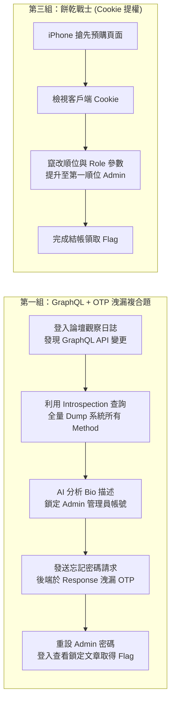

# 🌐 CTF 題目設計發表演練精華：GraphQL 內省、Cookie 提權、ZIP 偽加密與 IDOR 實戰

> **活動名稱**：教育部 AIS3 資安社團幹部研習營（分組命題成果發表與 Review）  
> **活動日期**：2026-09-12  
> **發表團隊**：研習營各組幹部（涵蓋 Web、Misc 與 OSINT 題型）  
> **研習核心**：攻擊鏈（Exploit Chain）構造、GraphQL 內省漏洞、回應封包 OTP 洩漏、Cookie 順位竄改、ZIP 偽加密逆向解鎖、IDOR 越權與靶機隔離防護  
> **完整逐字**：詳見 [完整原話逐字稿](./20260912-08-CTF題目設計發表演練-Web安全.full.md)

---

## 🎯 代表性題目攻擊鏈流程剖析

---

## 🧩 現場各組題目架構與弱點解析

| 組別與題型 | 題目名稱與情境 | 核心安全漏洞與考察知識點 | 解題攻擊鏈與預期解路徑 | 導師講評與題目改進建議 |
| :--- | :--- | :--- | :--- | :--- |
| **第一組** Web 安全 | **技術論壇的秘密** (黑箱 Web 滲透) | • **GraphQL Introspection Enabled**（內省未關閉） • **OTP 敏感資訊洩漏於 Response 封包** | 1. 透過 GraphQL Console 執行內省查詢取得全部 Schema。 2. 透過 AI 或腳本解析 User Bio 定位管理員帳號。 3. 點擊「忘記密碼」，攔截 HTTP 回應封包直接取得 OTP。 4. 重設管理員密碼並登入讀取 Flag。 | **靶機隔離問題**：多位選手同時解題可能互相覆寫密碼。建議**每個隊伍動態生成專屬 Docker 容器**，避免重設狀態互相干擾。 |
| **第三組** Web 安全 | **餅乾戰士** (電商預購平台) | • **缺乏後端驗證之客戶端 Cookie 信任** • 垂直越權（Privilege Escalation） | 1. 前往 iPhone 預購排隊登記頁。 2. 攔截請求並發現未簽名之 Cookie 存有排隊序號與角色。 3. 修改序號為 1 號並將角色改為 Admin，重新整理即可領取 Flag。 | 題目具備幽默感，但 Cookie 缺乏加密/雜湊容易被直觀猜解。可適度增加 HMAC 簽名或弱密鑰破解關卡以提升深度。 |
| **第四組** Misc 雜項 | **被鎖住的圖片** (ZIP 偽加密) | • **ZIP 檔案標頭加密標記位元操作** • 010 Editor 二進位結構修改 | 1. 開啟 ZIP 提示輸入密碼，但實際上未真正加密。 2. 使用 Hex Editor 將標頭與核心目錄（Central Directory）的加密 Flag 從 `01 00` 改為 `00 00`。 3. 存檔後無密碼正常解壓縮，取得包含 Flag 之圖片。 | 經典新手題型。建議在題幹中加入「解壓縮軟體行為差異」的引導，避免新手卡在特定不支援偽加密的解壓軟體。 |
| **第二組** Web / OSINT | **社群蹤跡與個人檔案** (IDOR 越權) | • **不安全直接物件參照 (IDOR)** • 社群帳號藏頭詩（OSINT） | 1. 訪問個人檔案頁面，點選 Instagram 連結。 2. 閱讀貼文並依提示取各篇貼文首字組成藏頭字串 `JONAS`。 3. 於 URL 路徑將 User ID 改為目標帳號，觸發越權存取取得 Flag。 | 新手友善題，結合社群情報蒐集與 Web 漏洞，非常適合大專資安社課首堂練習。 |

---

## 💡 導師總評與命題實戰避坑守則

1. **題目環境隔離性（Container Isolation）**：
   * 第一組的忘記密碼修改密碼題是典型的「破壞性狀態（Destructive State）」題目。若放在公用靶機，第一位選手改完密碼後，後續所有選手將徹底無法解題。
   * **最佳實踐**：結合 CTFd ＋ CTFd-Whale 插件，為每支參賽隊伍啟動獨立的動態 Docker 容器，設定 15~30 分鐘自動過期銷毀。
2. **多步驟線索鏈條之自然過渡**：
   * 肯定各組在題目中設計的「技術文章與更新日誌」背景鋪陳，使解題過程貼近真實滲透情境，而非生硬無脈絡的 CTF 旗標競猜。
