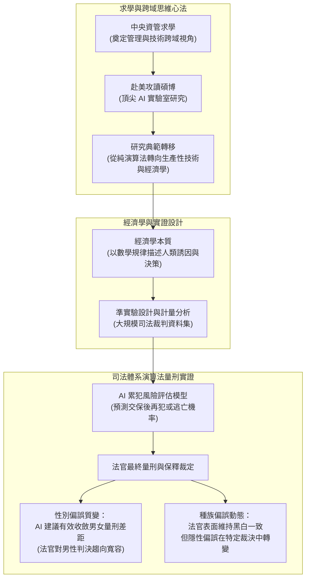

# 🏛️ 何毅仁教授特邀演講：從資管思維到 AI 前沿研究——演算法輔助司法量刑之偏誤與社會衝擊

> **演講主題**：從資管跨域思維到 AI 經濟學前沿研究（演算法量刑之性別與種族實證分析）  
> **主講貴賓**：何毅仁 教授（美國 Auburn University 特聘教授、中央資管傑出系友）  
> **演講日期**：2026-09-16  
> **主辦單位**：國立中央大學資訊管理學系大師專題講座  
> **研究核心**：演算法在美國司法體系（保釋金裁定、累犯風險評估、量刑建議）之應用、人類法官面對 AI 建議之行為決策偏誤、性別與種族偏誤如何隨 AI 介入產生動態質變  
> **完整逐字**：詳見 [完整原話逐字稿](./20260916-01-何毅仁教授特邀演講-從資管思維到AI前沿研究.full.md)

---

## 🗺️ 講座整體知識架構與研究脈絡

---

## 📋 講座關鍵主題精要彙整表

| 主題向度 | 核心概念與講者洞察 | 實務案例與研究發現 | 資管與研究啟示 |
| :--- | :--- | :--- | :--- |
| **中央資管思維傳承** | • 技術與管理的平衡藝術 • 從工程「造工廠」思維轉向「服務與價值創造」 | 講者從自然組轉入中央資管，後赴美進入頂尖 AI 實驗室，深刻體會資管人的獨特優勢在於整合技術與組織情境。 | 不要將自己侷限於純技術實現，需理解技術導入如何重塑人類組織與社會行為。 |
| **經濟學視角的 AI 研究** | • 經濟學是用數學描述人類如何做出決策與分配資源 • 技術不是孤立的演算法，而是重塑市場誘因的生產力工具 | 以諾貝爾經濟學獎「美麗境界」賽局理論、MIT 配偶配對實驗舉例，闡述誘因機制如何決定最終社會均衡。 | 資管領域的 AI 研究不僅是開發模型，更需探討「AI 介入對人類決策體系的衝擊與回饋」。 |
| **生成式 AI 與獨立思考** | • 警惕過度依賴大語言模型帶來的認知退化 • 「科技始終來自於人性」的本質在於人類自主思考 | 碩士與博士研究生應善用 AI 延伸自身認知，而非讓 AI 取代自主批判與邏輯推演；要訓練「屬於自己的專屬 AI」。 | 研究生需培養從複雜現象中提煉核心問題（Research Questions）的抽象化能力。 |
| **演算法量刑之實證研究** | • 美國司法體系每年耗費巨大社會成本監禁人犯 • 引入演算法預測再犯風險，輔助法官決定保釋與刑期 | 實證分析數十萬筆司法案件：探討法官是否採納 AI 建議，以及 AI 建議是否降低社會整體再犯風險與監禁成本。 | 演算法可能存在資料偏誤（Data Bias），但法官個人決策同樣充滿主觀與認知偏見。 |
| **性別與種族偏誤實證發現** | • **性別維度**：原始判決中法官傾向對女性更寬容；引入客觀 AI 建議後，男性獲得減刑機會顯著增加，**性別差距被有效彌平**。 • **種族維度**：法官高度警惕表面種族歧視，但在深層自由裁量權中，演算法介入引發非對稱行為反應。 | 實證揭示客觀演算法介入能作為「外部錨定」，在一定程度上矯正法官潛意識中的主觀同理心偏差。 | 評估 AI 系統的公平性不能只看演算法內部權重，必須將「人機協同」之終端決策結果納入計量評估。 |

---

## 💡 何毅仁教授分享之學術研究心法

1. **多維視角審視 AI（Multi-Perspective AI Studies）**：
   * 工學院著重開發新算法、提升準確率（Accuracy）；管理學院則需探討 AI 導入組織後的「社會經濟衝擊」、「信任建立」、「人機協同決策」與「倫理合規」。
2. **研究問題的一致性推導（Hierarchy of Research Questions）**：
   * 一篇頂尖研究必須從大問題（Big Question: AI 是否重塑司法公平？）層層拆解至具體實證假設（AI 建議如何改變男女量刑之邊際效應？）。
3. **客觀基礎（Objective Basis）矯正人類主觀偏差**：
   * 司法三審制度與外部客觀指標的初衷皆為防範人類裁決之不可控偏差；演算法的角色非取代人類法官，而是提供量化基線以降低任性與判決漂移。
