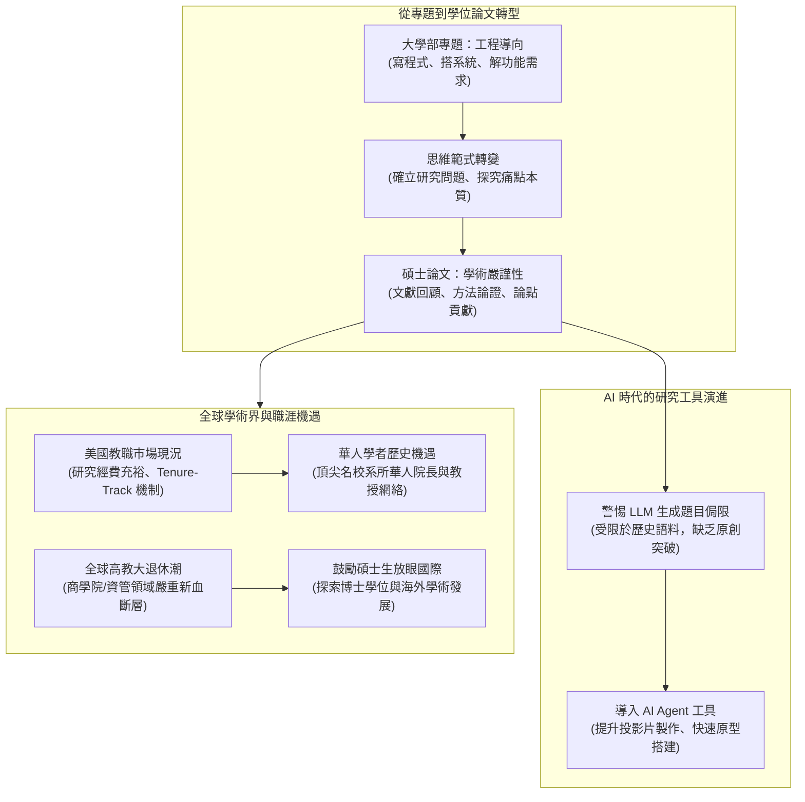

# 🎓 資管專題與學位論文研究方法論：從系統組實作到學術研究、AI 代理工具與赴美學術生涯心法

> **課程名稱**：中央大學資訊管理學系碩士班專題研討與論文研究課程  
> **授課日期**：2026-09-16  
> **與會師長**：李教授（中央資管專任教授）、何毅仁 教授（美國 Auburn University 特聘教授、傑出系友）、中央資管系統組碩二研究生  
> **研討核心**：碩士論文與大學部專題之本質差異（從工程實作走向學術問題意識與嚴謹論證）、AI 時代下的文獻回顧與研究題目發想、AI Agent 輔助系統開發趨勢、赴美攻讀博士與學術教職薪酬環境、全球高教退休潮下華人青年學者之歷史機遇  
> **完整逐字**：詳見 [完整原話逐字稿](./20260916-02-資管專題與學位論文研究方法論.full.md)

---

## 🗺️ 碩士論文研究方法與學術生涯發展架構

---

## 📋 研討關鍵主題精要彙整表

| 主題向度 | 核心概念與師長觀點 | 實務指導與學員情境 | 關鍵啟示與行動準則 |
| :--- | :--- | :--- | :--- |
| **論文 vs 專題之本質區隔** | • 大學專題多為「功能實現」導向 • 碩士論文要求「問題意識（Problem Formulation）」與理論貢獻 | 系統組同學多具優秀編程實作能力，但易落入「做完一套系統就當成論文」的盲點。李老師強調必須具備嚴謹研究方法。 | 寫論文不是比誰程式碼寫得多，而是比「發現了什麼前人未見的現象與規律」。 |
| **AI 時代下的題目探索與工具** | • 警惕直接問 ChatGPT 找題目（語料陳舊且平庸） • 鼓勵期末專案運用最新 AI Agent 進行系統原型開發 | 邀請具備 AI Agent 實戰經驗之博士生開課，示範如何以自然語言與 Agent 協同在數日內完成完整系統。 | 讓 AI 接管繁重底層代碼編寫，研究生將心力集中於高階邏輯架構與研究設計。 |
| **學術產品與思維磨練** | • 大學教授的兩大產品：研究（Paper）與人才（Student） • 做研究本質是磨練「嚴謹客觀的批判性思維」 | 何毅仁教授分享：嚴謹的科學方法能陪伴一生，使人在面對海量資訊與複雜決策時保持理性洞察。 | 即使畢業後不走學術，碩士研究訓練所建立的方法論，在企業界高階管理與架構規劃同樣關鍵。 |
| **美國學術市場與薪資現況** | • 美國商學院/工學院資管領域教職待遇優厚 • 充沛的研究經費（Research Grant）與自由研究環境 | 美國頂尖大學助理教授起薪與研究啟動金遠高於一般認知，且在多數城市享有極高生活品質與學術自由。 | 打破「讀博士一定窮苦」的刻板印象，鼓勵有潛力的學生積極爭取全額獎學金赴美深造。 |
| **高教退休潮與青年學者機遇** | • 早期赴美留學的頂尖華人學者紛紛接任院長與系主任 • 全球商學院面臨嬰兒潮世代教授大退休潮，新血嚴重不足 | 李老師回顧當年碩士班時，海外教授返台招生之機遇；指出當前華人學者在北美與亞太高教影響力處於歷史高峰。 | 目前正是具備資訊與管理跨領域背景之優秀碩士生進軍全球學術界的黃金窗口期。 |

---

## 💡 李教授與何毅仁教授的研究心法提煉

1. **從研究中展現個人風格（Personality in Research）**：
   * 一篇優秀的學位論文能反映出作者的個性：沈穩、精準、批判性或具突破性。論文與發表的簡報是研究生展現專業素養的第一張名片。
2. **與指導教授的互動磨合（Mentorship Dynamics）**：
   * 研究生應主動定期與指導教授對齊進度，在反覆思辨中淬鍊題目，勇於嘗試前沿方向，而非被動等待指令。
3. **把學術研究當作人生選項（Keep Academic Career as an Option）**：
   * 碩一階段不必過早自我設限；在碩士兩年的論文寫作中檢驗自己對探索未知的熱情，若適合則大膽邁向國際博士殿堂。
