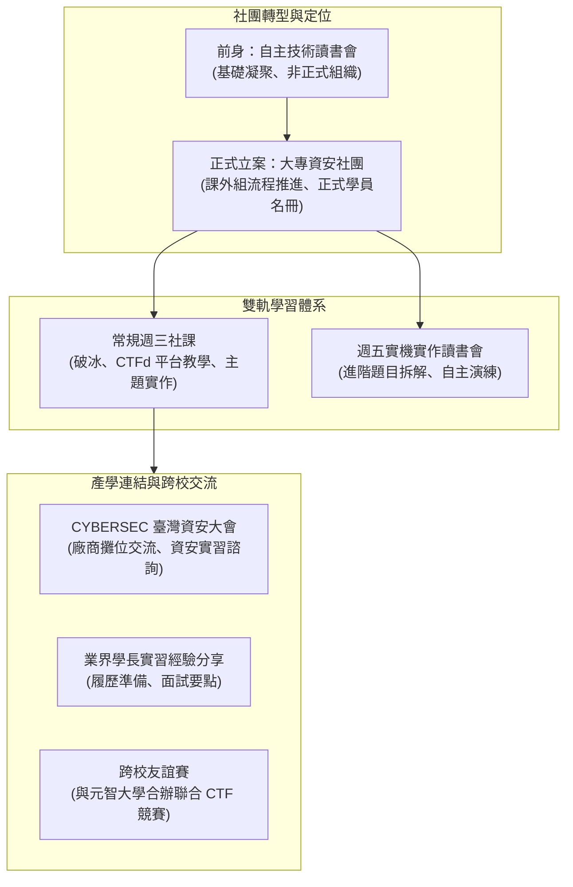

# 🛡️ 大專資安社團成立大會與社員迎新說明：從讀書會轉型正式社團、CTFd 靶場演練與學期規劃

> **活動名稱**：大專資安社團迎新與成立大會  
> **活動日期**：2026-09-16  
> **與會人員**：社團社長、副社長、課程與技術幹部、大一新生與新進社員  
> **社團核心**：從自主技術讀書會正式轉型為學校課外活動組立案社團、自建 CTFd 攻防演練平台、CYBERSEC 臺灣資安大會參訪與業界實習心得分享、週五進階實機演練讀書會、與元智大學資安社團合辦跨校 CTF 競賽  
> **完整逐字**：詳見 [完整原話逐字稿](./20260916-03-大專資安社團成立大會與社員迎新說明.full.md)

---

## 🗺️ 社團組織架構與學期培訓路徑

---

## 📋 迎新大會關鍵主題彙整表

| 主題向度 | 核心規劃與說明內容 | 實施細節與平台工具 | 社員權益與收穫 |
| :--- | :--- | :--- | :--- |
| **打破駭客刻板迷思** | • 電影中「敲敲鍵盤直接破防火牆」為戲劇效果 • 真實資安需要紮實的網路、作業系統與密碼學底層功底 | 透過 Slido 即時互動工具，調查新生對資安與駭客技術的想像與痛點。 | 建立正確的資訊安全道德倫理與循序漸進的技術觀念。 |
| **自建 CTFd 攻防靶場** | • 採用業界與國際競賽主流之 CTFd 平台 • 幹部群親自命題架設 Web、Reverse、Crypto 等靶機 | 社員於平台連線測試環境，透過逆向或漏洞挖掘取得 Flag 並提交計分。 | 結合理論與動手做，快速培養實戰解題與滲透測試思維。 |
| **社課與讀書會雙軌制** | • **週三常規社課**：觀念講授、基礎 CTF 導讀、企業講師專題 • **週五實作讀書會**：自備筆電實機演練、幹部手把手 Debug | 解決初學者進度落差問題，讀書會提供高度互動的自習與討論空間。 | 兼顧零基礎入門者與想打競技賽事的進階社員需求。 |
| **業界對接與就業實習** | • 邀請已在資安業界實習或任職的學長姐回娘家分享 • 組織參訪每年規模最大的 CYBERSEC 臺灣資安大會 | 直接向知名資安大廠（如趨勢、奧義、DEVCORE 等）攤位了解實習招募條件。 | 提早掌握企業所需之資安職能，拓展業界人脈網絡。 |
| **跨校競賽與行政點交** | • 規劃與鄰近之元智大學資安社團合辦友誼型聯合 CTF • 填寫線上入社表單，正式點交課外活動組學員名單 | 友誼賽設計新手友善題型，提供完賽榮譽與交流機會。 | 正式登錄學校社團系統，享有社辦空間、社團服務時數與活動認證。 |

---

## 💡 社長給新進社員的建議與叮嚀

1. **多問多嘗試，不怕卡關**：
   * 資安技術學習曲線陡峭，遇到看不懂的 Payload 或環境報錯時，務必在社課或 Discord 群組向幹部提問，避免單打獨鬥灰心放棄。
2. **遵守法律與道德邊界（White Hat Ethics）**：
   * 所有學習到的攻擊手法僅限於社團 CTFd 靶場或合法授權環境練習，嚴禁對學校內部系統或校外未授權主機進行掃描發包。
3. **積極把握實務交流機會**：
   * 鼓勵社員熱情參與大會參訪與跨校競賽，資安圈高度看重社群參與度與開源貢獻經驗。
