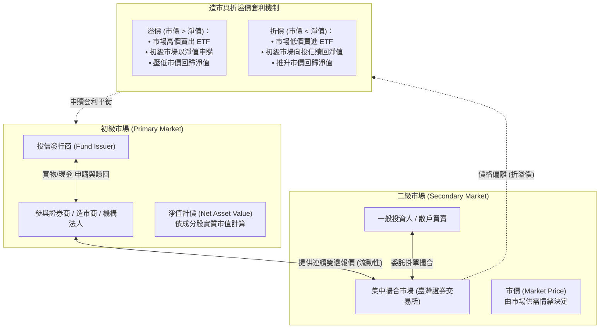

# 📊 智慧金融與投資實務：ETF 造市商機制、初級二級市場折溢價套利、槓桿損耗與主動型 ETF 投資心法

> **課程主題**：智慧金融與 ETF 交易實務（造市機制、折溢價套利、槓桿損耗與主動型投資）  
> **授課日期**：2026-09-19  
> **與會專家**：套利交易實務業師、證券投信高階副總經理、金融研習學員  
> **實務核心**：初級市場（申購/贖回、淨值 NAV）與二級市場（公開撮合、市價）雙軌運作架構、造市商（Market Maker）報價與流動性提供、折溢價套利方程式與摩擦成本（交易稅 0.1%、手續費、管理費）、00887 永豐中國科技50 飆漲 322% 溢價怪象深度拆解、槓桿反向型 ETF 之波動損耗數學本質、主管機關鬆綁主動型 ETF 後之選股與資產配置策略  
> **完整逐字**：詳見 [完整原話逐字稿](./20260919-ETF造市商機制與折溢價套利實務.full.md)

---

## 🗺️ ETF 雙軌市場架構與造市套利運作圖

---

## 📋 講座關鍵主題精要彙整表

| 主題向度 | 核心概念與金融機制 | 實務案例與市場現象 | 投資人關鍵啟示與風險控制 |
| :--- | :--- | :--- | :--- |
| **初級 vs 二級市場機制** | • **初級市場**：機構法人與投信以**淨值（NAV）**進行大額申購與贖回。 • **二級市場**：一般投資人在集中市場以**市價**即時撮合交易。 | 淨值由各成分股市值加權計算，代表 ETF 的真實內在價值；市價則反映市場當前情緒與資金供需。 | 交易前必須使用券商軟體（如代碼後加 N）查詢即時預估淨值，避免盲目買在高溢價區。 |
| **造市商與折溢價套利** | • 造市商負責掛出買賣雙邊報價，提供流動性以貼近淨值。 • 折溢價幅度 > 交易成本時，套利資金進場推動價格回歸。 | 套利成本包含：ETF 證券交易稅（0.1%）、券商手續費、借券利息與申贖作業時間差風險。 | 當市場出現劇烈單邊追價時，造市商券源可能耗盡，導致折溢價短期嚴重失控。 |
| **00887 飆漲 322% 案例解構** | • 2024 年底中國人行祭出降準降息刺激政策，適逢「十一長假」中國休市。 • 台股照常開盤，資金瘋狂湧入 00887，數日內將淨值 10 餘元拉抬至 30 多元。 | 兩地市場休市時差造成初級市場無法申贖套利；陸股開盤後行情未如預期，市價雪崩式暴跌，散戶面臨腰斬慘劇。 | **重大示警**：切勿在跨國連動 ETF 暫停申贖或長假期間盲目追買海外題材，溢價終將無情收斂。 |
| **槓桿/反向型 ETF 的數學損耗** | • 槓桿型（如 2X、-1X）目標是追蹤「單日倍數」，而非長期倍數。 • 在盤整或高波動行情下，**波動度損耗（Volatility Drag）**與複利效應將迅速侵蝕淨值。 | 標的指數若連續兩天「漲 10% 再跌 10%」，原指數為 0.99；兩倍槓桿指數變動為 +20% 與 -20%，結果為 0.96，損耗加速擴大。 | 槓桿與反向型 ETF 僅適用於短線明確單邊趨勢之策略交易，**絕對不適合作為長期定期定額投資標的**。 |
| **主動型 ETF 與資產配置思維** | • 臺灣主管機關開放主動型 ETF，結合封閉型基金之專業選股與 ETF 高流動性優勢。 • 台股躍居全球第四大市值市場，被動市值型（如 0050）與主動型並行。 | 統一 00981A、群益 00982A 等主動式 ETF 登場，考驗經理人能否於高估值環境下創造超額 Alpha 報酬。 | 年輕投資人宜以大盤市值型 ETF 定期定額建立長期核心資產；高通膨環境下應審慎評估長天期公債的配置比例。 |

---

## 💡 業師與副總經理之投資智慧金句

1. **市價終將回歸淨值（Gravity of NAV）**：
   * 股票市場上的市價宛如被牽著的小狗，時而跑前時而落後，但主人（淨值）所在的真實內在價值才是最終的錨定點。溢價過大時買進，如同花 150 元購買裝著 100 元現金的錢包。
2. **複利是把雙面刃，震盪是槓桿殺手**：
   * 很多人誤以為「看好台股翻倍，就買兩倍槓桿放著」，卻忽略盤整震盪中的每日重置損耗。時間是長期投資者的朋友，卻是盤整槓桿持有者的毒藥。
3. **專注長期市場 Beta，避免短期投機踩踏**：
   * 散戶在金融市場的最大優勢是「時間維度」。定期定額投資涵蓋前五十大權值股之核心指數，參與國家整體經濟成長，才是勝率最高的致富之道。
