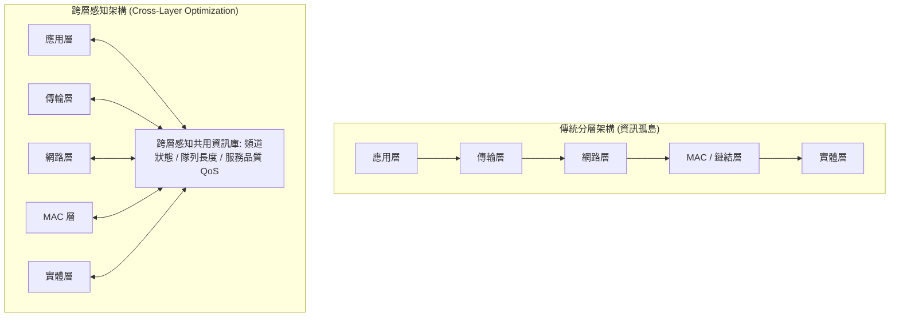

# 📋 無線網路協定分層限制與跨層感知架構研討 — 執行摘要

> **活動場次**：碩二秋季學期 高等電腦網路與通訊架構研討
> **錄音日期**：2026-10-06
> **發言講者**：授課教授 / 報告學員 / 課堂學員
> **對應完整逐字稿**：[`20261006-無線網路協定分層限制與跨層感知架構研討.full.md`](./20261006-無線網路協定分層限制與跨層感知架構研討.full.md)

---

## 📌 核心議題與課程提要

本場研討深入探討傳統 OSI 與 TCP/IP 嚴格分層架構在現代無線通訊環境中的瓶頸。報告學員分析了實體層（Physical Layer）與資料鏈結層（Data Link / MAC Layer）的介面特性，說明傳統分層雖具備標準化與模組化優勢，但因「相鄰層資訊傳遞隔離」特性，在動態拓撲、頻寬抖動及具備移動性的無線環境中，極易引發嚴重的次最佳化排程問題。

課程後半段探討了結合跨層感知設計（Cross-Layer Design）與現代 AI 資源排程之演進方向，並由授課教授提出背景交代與實際應用情境的改進反饋。

---

## 🏛️ 傳統分層架構 vs 跨層感知排程

---

## 🔑 關鍵重點整理 (Key Takeaways)

### 1. 傳統分層的無線適應困境
- 在有線網路中，各層封裝獨立運作良好；但在無線通道易受干擾、封包遺失不等於壅塞（Congestion）的情況下，缺乏跨層感知會導致 TCP 錯誤啟動壅塞控制機制。

### 2. 跨層感知與動態排程優勢
- 藉由讓傳輸層與應用層感知實體層的訊雜比（SNR）或 MAC 層的退避（Backoff）狀態，系統可動態調整視窗大小與 QoS 優先等級，大幅降低延遲。

### 3. 課堂反饋與報告建議
- 教授提醒後續報告應加強背景動機的鋪陳，舉出具體的產業網路情境（如車聯網 V2X 或無人機自組網），使理論架構與實務案例更具體連結。

---

## 📊 跨層設計（Cross-Layer Design）三種耦合模式、功率控制案例與 AI Agent 延伸

| 跨層架構維度 | 設計機制與層間互動方向 | 具體技術案例與評估指標 | 授課教授課堂講評與修正指示 |
| :--- | :--- | :--- | :--- |
| **三種跨層耦合模式分類** | (1) 向上資訊傳遞（實體/MAC 層向高層通報通道狀態）；(2) 向下策略控制（應用層向底層指定 QoS 優先權）；(3) **無新介面之設計耦合（Design Coupling without New Interfaces）** | 當實體層支援多封包同時接收（Multi-packet Reception）時，MAC 層排程演算法直接針對該物理特性預先最佳化，無須新增額外執行期介面 | 肯定分類架構清晰，但提醒需先交代「為何傳統嚴格分層在當時是成功的，而到了現代無線環境卻成為限制」 |
| **重傳次數觸發之跨層功率控制** | 當 MAC 層偵測到封包重傳次數達 3 次以上時，跨層讀取節點地理位置計算距離，並查詢實體層當前發射功率以動態調升能量 | 有效區分「因距離過遠／訊號衰減導致之掉包」與「因節點競爭碰撞導致之掉包」，避免盲目啟動 TCP 壅塞視窗減半 | 教授指出：課堂口頭舉例（網卡收不到無線訊號自動切換介面）與前面功率控制投影片存在斷裂感，應將兩者邏輯串聯一致 |
| **跨層感知延伸至 AI Agent 系統** | 將使用者體感需求轉化為系統可量測指標：(1) 回應是否過晚出現（Latency）、(2) 運算能耗與模型大小動態切換 | 如同底層網卡感知訊號品質，AI 系統可依據終端硬體負載與網路延遲，透過明確介面動態切換輕量或高階推論模型 | 建議補充車聯網或行動邊緣運算（MEC）之具體數據圖表，讓聽眾能直觀感受跨層感知帶來的量化增益 |

