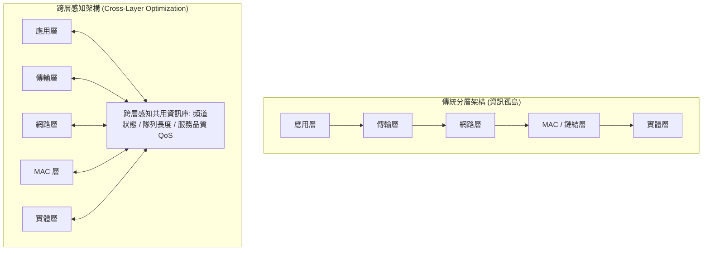

# 📋 無線網路協定分層限制與跨層感知架構研討 — 執行摘要

- **活動場次**：碩二秋季學期 高等電腦網路與通訊架構研討
- **錄音日期**：2026-10-06
- **發言講者**：授課教授 / 報告學員 / 課堂學員
- **對應完整逐字稿**：[`20261006-無線網路協定分層限制與跨層感知架構研討.full.md`](./20261006-無線網路協定分層限制與跨層感知架構研討.full.md)

---

## 📌 核心議題與課程提要

本場研討深入探討傳統 OSI 與 TCP/IP 嚴格分層架構在現代無線通訊環境中的瓶頸。報告學員分析了實體層（Physical Layer）與資料鏈結層（Data Link / MAC Layer）的介面特性，說明傳統分層雖具備標準化與模組化優勢，但因「相鄰層資訊傳遞隔離」特性，在動態拓撲、頻寬抖動及具備移動性的無線環境中，極易引發嚴重的次最佳化排程問題。

課程後半段探討了結合跨層感知設計（Cross-Layer Design）與現代 AI 資源排程之演進方向，並由授課教授提出背景交代與實際應用情境的改進反饋。

---

## 🏛️ 傳統分層架構 vs 跨層感知排程

---

## 🔑 關鍵重點整理 (Key Takeaways)

### 1. 傳統分層的無線適應困境
- 在有線網路中，各層封裝獨立運作良好；但在無線通道易受干擾、封包遺失不等於壅塞（Congestion）的情況下，缺乏跨層感知會導致 TCP 錯誤啟動壅塞控制機制。

### 2. 跨層感知與動態排程優勢
- 藉由讓傳輸層與應用層感知實體層的訊雜比（SNR）或 MAC 層的退避（Backoff）狀態，系統可動態調整視窗大小與 QoS 優先等級，大幅降低延遲。

### 3. 課堂反饋與報告建議
- 教授提醒後續報告應加強背景動機的鋪陳，舉出具體的產業網路情境（如車聯網 V2X 或無人機自組網），使理論架構與實務案例更具體連結。
