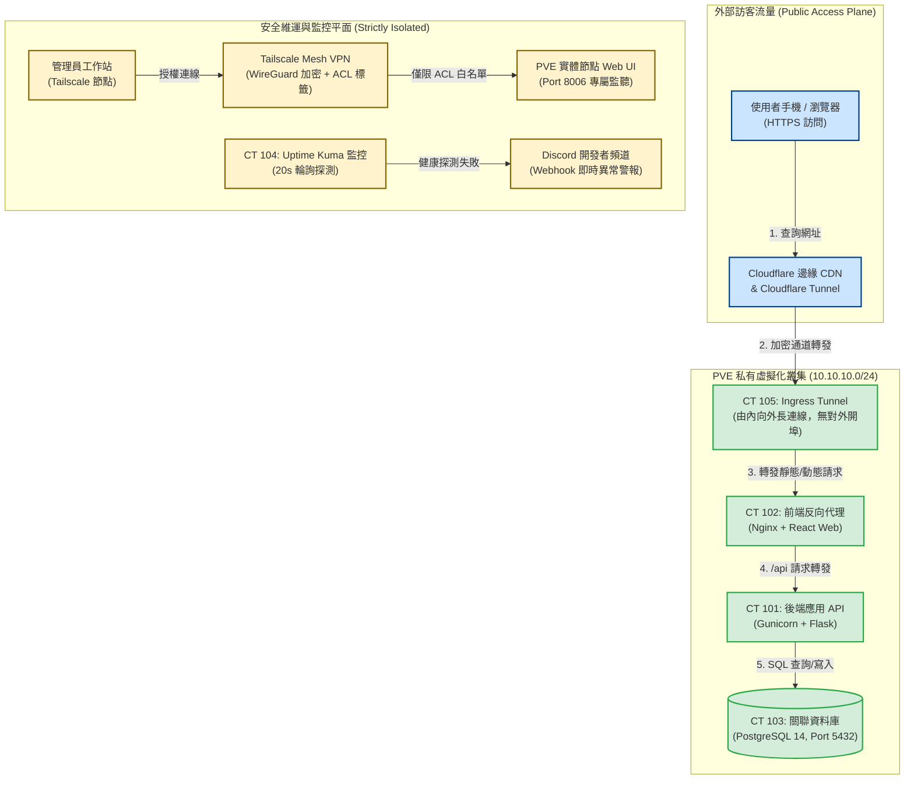

# 📋 Proxmox VE 虛擬化平台架構、校園失物招領系統實作與交換機轉發表機制研討 — 執行摘要

> **活動場次**：碩二秋季學期 網路架構
> **錄音日期**：2026-10-20
> **發言講者**：授課教師 / 學生報告者 / 現場學員
> **對應完整逐字稿**：[`20261020-01-PVE虛擬化平台實作與交換機轉發表機制研討.full.md`](./20261020-01-PVE虛擬化平台實作與交換機轉發表機制研討.full.md)

---

## 執行摘要 (Executive Summary)

本堂課涵蓋「學生專題：Proxmox VE 虛擬化與微服務系統實踐」與「教師講授：二層交換機轉發表與樹狀拓撲尋徑」兩大核心範疇：

1. **Proxmox VE (PVE) 企業級架構與選型策略**：
   - 博通收購 VMware 後全面改為昂貴訂閱制，促使中小企業轉向開源免費的 PVE（Debian Linux + AGPLv3）。
   - 對比 KVM 全虛擬化（硬體隔離、跨平台 OS、資源開銷較大）與 LXC 容器化（核心共享、秒級啟動、高密度低開銷）之應用場景。
2. **校園失物招領系統微服務工程落地**：
   - 拆解為四大獨立 LXC 容器：CT 105（Cloudflare Tunnel 安全通道）、CT 102（Nginx + React）、CT 101（Gunicorn + Flask API）、CT 103（PostgreSQL 資料庫）。
   - 網路邊界與管理隔離：採用 Cloudflare Tunnel 由內向外建立長連線，免除校園路由器開埠風險；管理流量嚴格限制透過 Tailscale WireGuard Mesh VPN 及 ACL 標籤存取 8006 Web UI。
   - 監控與運維：部署 Uptime Kuma 實施 20 秒週期健康檢查與 Discord Webhook 告警；使用 Hey 進行壓力測試（外網 10k/hr，內網 400k 筆無崩潰）。
   - 資料保護：深度剖析 Snapshot（秒級回滾但無容災）與 VZDump 備份三模式（Snapshot、Suspend、Stop）及 Corosync Quorum 多數決防腦裂。
3. **二層交換機轉發機制與樹狀無環拓撲**：
   - 剖析交換機轉發表（Switch Table）由「連接埠（Port）」與「目的 MAC 地址」組成之查表轉發原理。
   - 確立拓撲唯一路徑準則：二層網路必須呈現樹狀（Tree）無環結構，確保任意兩點間路徑唯一，根絕廣播風暴。

---

## 系統網路拓撲與交換轉發架構圖

---

## 質詢與深度探討分析矩陣 (QA Critique Matrix)

| 序號 | 提問與質詢主體 | 核心問題與焦點 | 課堂回答與論證脈絡 | 理論與防護意涵 |
| :---: | :--- | :--- | :--- | :--- |
| 1 | **學生報告者** ➜ 課堂研討 | 中小型企業近年為何大幅從 VMware vSphere 遷移至 Proxmox VE？ | 博通（Broadcom）收購 VMware 後取消買斷制，強制改為昂貴年費訂閱；PVE 為基於 Debian 的開源平台（AGPLv3），功能內建完整且無授權授課限制。 | 揭示企業軟體供應鏈風險與開源基礎設施選型趨勢。 |
| 2 | **學生報告者** ➜ 課堂研討 | KVM 完整虛擬機器與 LXC 容器在系統架構設計上有何取捨？ | KVM 模擬完整硬體與獨立核心，隔離度高但開銷大；LXC 共享宿主機 Linux 核心，資源消耗低且秒級啟動。專案服務皆為 Linux 原生，故全數選用 LXC 以節省資源。 | 建立依據工作負載特性（Workload）精準配置虛擬化層級之準則。 |
| 3 | **學生報告者** ➜ 課堂研討 | 校園私有雲系統如何兼顧外網存取需求與內部網路安全？ | 採用 Cloudflare Tunnel 由內向外建立長連線，校園邊界路由器無需開放任何埠號；外部駭客無法發起端口掃描，徹底杜絕外網直接滲透。 | 實踐現代零信任（Zero Trust）邊界收斂與反向通道保護。 |
| 4 | **學生報告者** ➜ 課堂研討 | PVE 快照（Snapshot）能否替代常規備份（Backup）？ | 否！快照與原虛擬機共存於同一個儲存池中，僅供短暫回滾；若實體磁碟損毀，快照隨之消失。企業必須使用 VZDump 將資料備份至異地實體媒介。 | 釐清儲存狀態回滾（Rollback）與災難復原（Disaster Recovery）的本質界線。 |
| 5 | **授課教師** ➜ 課堂學生 | 本專案在資安架構上的最大亮點為何？ | 管理平面與服務平面徹底分離。Web 管理埠（8006）絕不對外開放，僅允許通過 Tailscale Mesh VPN 搭配 ACL 白名單存取，展現專業的縱深防禦思維。 | 強調生產環境基礎架構存取控制的實務鐵律。 |
| 6 | **授課教師** ➜ 課堂學生 | 二層交換機轉發表（Switch Table）具備何種數學幾何特性？ | 表格中每個目的 MAC 地址在任一給定時刻具有唯一對應之輸出埠；整網拓撲在邏輯上必須形成無環的「樹狀拓撲」，確保任兩節點間具備唯一路徑。 | 奠定二層網路尋徑、防環路與生成樹協定（STP）的理論基礎。 |

---

## 虛擬化平台技術規格深度對比表

| 評估維度 | Proxmox VE (PVE) | VMware vSphere (ESXi + vCenter) |
| :---: | :--- | :--- |
| **底層作業系統** | Debian Linux (開源且可完全掌控底層) | 專有微核心 VMkernel (封閉原始碼) |
| **授權與成本** | 免費開源 (AGPLv3)，付費僅購買技術支援 | 博通收購後全面強制訂閱制，授權費極其高昂 |
| **虛擬化引擎** | KVM（虛擬機器）+ LXC（原生 Linux 容器） | ESXi Hypervisor（VM）+ Tanzu（容器需額外付費） |
| **管理介面** | 內建開源 Web GUI (HTML5 + REST API) | 單機 ESXi 網頁，多節點必須購買 vCenter Server |
| **高可用叢集** | 內建 Corosync + Quorum，三節點即可組建 HA | vSphere HA / DRS，需進階授權支援 |
| **備份生態** | 內建 VZDump (支援 PBS 增量去重複備份) | 依賴第三方商用工具（如 Veeam Backup） |

---

## 核心結論與行動要點

1. **落實網路管理平面嚴格隔離**：企業機房與虛擬化平台（如 PVE、ESXi、iLO、IPMI）之管理介面絕對禁止直接映射至公網；必須強制要求透過具備身分認證之加密 VPN（如 WireGuard / Tailscale）或跳板機（Bastion Host）連線。
2. **二層網路嚴禁任何未受控之物理環路**：在搭建交換機拓撲時，若存在多重備援鏈路，必須強制啟用生成樹協定（STP/RSTP），否則交換機將持續漫灌廣播封包引發廣播風暴。
