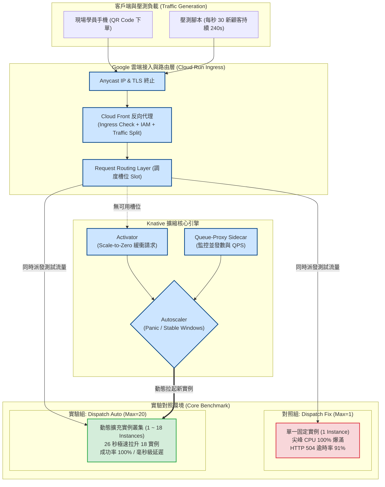

# 📋 Google Cloud Run 自動伸縮架構、Knative 請求驅動擴縮與外送排單壓測實證 — 執行摘要

> **活動場次**：碩二秋季學期 網路架構
> **錄音日期**：2026-10-20
> **發言講者**：授課教師 / 學生報告者（江榮輝等） / 現場學員
> **對應完整逐字稿**：[`20261020-02-Cloud-Run自動伸縮架構與外送排單壓測實證.full.md`](./20261020-02-Cloud-Run自動伸縮架構與外送排單壓測實證.full.md)

---

## 執行摘要 (Executive Summary)

本堂課聚焦於現代雲端原生核心架構——**Serverless 容器自動伸縮（Auto Scaling）**，由學生團隊以 Google Cloud Run 為基底完成外送排單系統之壓測實證，並由授課教師針對系統邊界與極端高並發架構進行深度講評：

1. **Auto Scaling 四世代演進體系**：
   - 實體機房（數週採購上架、無彈性） ➜ AWS EC2（2009，虛擬機單位、分鐘級啟動、小時計費） ➜ K8s HPA（2014，Pod 單位、CPU/Memory 指標） ➜ Serverless Container（Cloud Run，HTTP 並發驅動、百毫秒級擴縮、縮容至零 Scale-to-Zero、毫秒計費）。
2. **Knative 請求驅動自動擴縮（KPA）底層架構**：
   - 深入剖析 **Activator**（冷啟動請求緩衝）、**Queue-Proxy**（Sidecar 即時回報並發數）與 **Autoscaler** 之協同運作。
   - 解決容量邊界震盪之關鍵：結合「穩定視窗（Stable Window）」與「恐慌視窗（Panic Window）」，根絕傳統 HPA 的系統顛簸（Thrashing / Flapping）缺陷。
3. **外送排單模擬系統雙組壓測實證**：
   - 設計雙重運算負載：單次較重之「訂單派單」與每 2 秒高頻運算之「Dijkstra 最短路徑配送追蹤」。
   - 客戶端無狀態攜帶設計：刻意排除共用資料庫，避免 DB 瓶頸干擾 Max Instance 唯一控制變因。
   - 實測結果：在每秒 30 位新用戶湧入下，固定版（1 台）成功率崩跌至 9%（延遲 3.6 秒且大量超時）；自動擴充版（最大 20 台）在 26 秒內迅速拉升至 18 台實例，成功率保持 100% 且延遲維持毫秒級。
4. **雲端架構極限與教師講評**：
   - 公有雲通用 Auto Scaling 面對百萬級 QPS（如阿里雙十一、春節搶票）仍存在物理瓶頸，必須引入前置訊息佇列（Kafka/RocketMQ）削峰填谷與多層快取洗滌。

---

## Cloud Run 請求調度與外送排單壓測架構圖

---

## 質詢與深度探討分析矩陣 (QA Critique Matrix)

| 序號 | 提問與質詢主體 | 核心問題與焦點 | 課堂回答與論證脈絡 | 理論與防護意涵 |
| :---: | :--- | :--- | :--- | :--- |
| 1 | **學生報告者** ➜ 課堂全體 | 搶票系統與外送平台在突發流量下面臨之傳統配置困境為何？ | 依離峰配置則尖峰必崩（504 超時、顧客流失）；依歷史峰值配置則平時需承擔巨額閒置租金。Auto Scaling 藉由動態伸縮化解此兩難。 | 確立高可用架構與成本最佳化（FinOps）之核心交集。 |
| 2 | **學生報告者** ➜ 課堂研討 | 現代 Serverless 容器（Cloud Run）相比早期 VM 與 K8s HPA 之技術突破為何？ | 以請求並發量（Concurrency）為指標而非 CPU，支援縮容至零（Scale-to-Zero），擴充時間由數分鐘縮短至百毫秒級，計費粒度精確至毫秒。 | 彰顯微服務架構中擴充粒度由粗到細、由慢到快的演進規律。 |
| 3 | **學生報告者** ➜ 課堂研討 | 本實驗為何刻意採用「無狀態客戶端攜帶資料」而不串接共享資料庫？ | 共享資料庫在尖峰並發時易率先成為全網瓶頸，進而遮蔽固定版與擴充版在算力層的伸縮效應。排除資料庫是為了保持「實例數量」為唯一控制變因。 | 展現嚴謹科學實驗控制變因（Control Variables）之工程素養。 |
| 4 | **學生報告者** ➜ 課堂研討 | Knative 如何有效防止自動擴縮在邊界來回震盪（Thrashing / Flapping）？ | 導入「穩定視窗（60s 平均）」與「恐慌視窗（6s 短期並發）」雙機制。只有在持續穩定滿足縮容條件時才逐步下線實例，避免過早縮容引發二度崩潰。 | 解決分散式自適應控制演算法穩定性之典型工程方案。 |
| 5 | **授課教師** ➜ 報告團隊 | 技術簡報在組織架構與受眾溝通上有何改進空間？ | 不應將具體展示拖至第 13 頁。應開門見山提出驗證目標並現場展示 1 台 vs. 18 台之震撼對比，再引導聽眾探究底層 Cloud Run 與 Knative 原理。 | 建立「以受眾為中心（Audience-Centric）」之技術領導力溝通原則。 |
| 6 | **授課教師** ➜ 課堂學生 | 公有雲 Auto Scaling 能否無條件解決所有極端流量（如雙十一、春節搶票）？ | 不能！面對數千萬級極端 QPS，公有雲通用調度器存在物理伺服器開機極限。巨型架構必須引入高效能訊息佇列（RocketMQ）削峰填谷與多層快取分流。 | 破除雲端銀彈迷信，確立極端分散式系統之容量邊界意識。 |

---

## 雲端運算自動伸縮技術四世代對照表

| 演進階段 | 代表技術與年份 | 擴展最小單位 | 擴展響應時間 | 觸發指標類型 | 計費粒度與特徵 |
| :---: | :--- | :---: | :---: | :---: | :--- |
| **第一代：實體機房** | 實體伺服器硬體 (1990s) | 實體機架 / 刀鋒 | 數天至數週 | 人工預測流量 | 資本支出（CapEx），完全無法應對突發流量 |
| **第二代：虛擬機器** | AWS EC2 Auto Scaling (2009) | 虛擬機器 (VM) | 3 ~ 5 分鐘 | CPU 利用率 / CloudWatch | 以小時計費，冷啟動延遲過長易導致崩潰 |
| **第三代：容器編排** | Kubernetes HPA (2014) | 容器組 (Pod) | 30 ~ 60 秒 | CPU / Memory / 自訂指標 | 依節點計費，受限於底層 Node 物理資源容量 |
| **第四代：Serverless 容器** | Google Cloud Run / Knative | 應用容器實例 | 100 ~ 500 毫秒 | 請求並發數 (Concurrency) | 毫秒級計費，支援縮容至零（Scale-to-Zero） |

---

## 核心結論與行動要點

1. **優先採納請求驅動擴縮模型**：對於 Web API 與微服務負載，應優先採用以「HTTP 並發量（Concurrency）」為基礎之擴縮指標，杜絕基於 CPU 造成的虛假擴容或反應延遲。
2. **容量架構分層防禦**：Auto Scaling 僅負責運算層算力彈性；面對突發洪峰，必須在架構入口處配置速率限制（Rate Limiting）與非同步訊息佇列（Message Queue），防止下游客戶端或資料庫遭受毀滅性衝擊。
