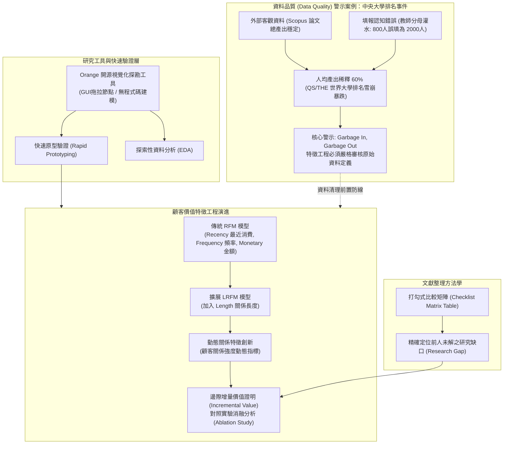

# 📋 研究方法：Orange 視覺化資料探勘工具、顧客價值特徵工程與大學排名資料品質啟示 — 執行摘要

> **活動場次**：碩二秋季學期 資訊管理研究方法論
> **錄音日期**：2026-10-14
> **發言講者**：授課教師 / 學員
> **對應完整逐字稿**：[`20261014-01-研究方法-Orange資料探勘工具與顧客價值特徵工程.full.md`](./20261014-01-研究方法-Orange資料探勘工具與顧客價值特徵工程.full.md)

---

## 🏗️ 核心架構概念圖

---

## 🎯 核心技術概念與研究方法學指引

### 1. 簡報發表規範：五分鐘提煉核心價值
- **嚴格時限**：研究生報告應由過去拖沓的十分鐘壓縮至精準的 5 分鐘。必須在 300 秒內清楚交代三個關鍵支柱：鎖定何種產業痛點、提出何種特徵工程或演算法創新、實證產出何種具體價值。
- **Orange 視覺化探勘工具定位**：作為免安裝、拖拉節點的 GUI 工具，Orange 適合碩士生在研究初期進行探索性資料分析（EDA）與快速原型驗證（Rapid Prototyping），確認特徵可行性後再行撰寫 Python 深度學習腳本。

### 2. 特徵工程的學術創新邏輯：邊際增量價值（Incremental Value）
- **模型演進脈絡**：
  - 傳統 **RFM 模型**：由最近消費時間（Recency）、消費頻率（Frequency）、消費金額（Monetary）構成客戶價值分析基礎。
  - **LRFM 模型**：引入關係長度（Length），評估客戶往來跨度。
  - **動態特徵擴展（如 GOLI 指標）**：捕捉物流業中客戶委託頻率的動態波動。
- **論文發表門檻**：學術期刊絕不接受「僅將現成 RFM 套用至新資料集」的無效灌水研究。論文核心在於提出新特徵，並透過嚴格消融對照實驗（Ablation Study），量化證明加入新特徵後在 AUC、準確率上具備顯著邊際增量。

### 3. 資料品質（Data Quality）災難：中央大學世界排名暴跌事件啟示
- **事件經過**：中央大學在 QS 與泰晤士（THE）全球排名曾由四五百名暴跌至千名之外，經研發處數年深入追查，確認研究論文總產出維持穩定，主因竟是「校內填報分母錯誤」。
- **錯誤核心**：全校專任教師約 700 多位、專任研究人員約 800 位，填報同仁誤將兼任與行政人員全部算入，分母錯填為近 2,000 位，導致「每師平均引用數（Citations per Faculty）」被腰斬稀釋，造成世界排名暴跌。
- **資料科學警示**：做資料探勘與機器學習，垃圾進垃圾出（Garbage In, Garbage Out）。特徵工程的第一步必須是嚴謹審核原始資料欄位與母體定義，杜絕任何口徑不一造成的虛假預測。

---

## 💬 授課教師提問質詢與研討攻防矩陣

| 質詢向度 | 授課教師核心質詢與指導論點 | 研討答辯與方法學解析 | 實務研究與論文發表啟示 |
| :--- | :--- | :--- | :--- |
| **簡報效率與問題聚焦** | 為什麼要求碩士生必須將報告限縮在 5 分鐘以內？長篇大論拖延十幾分鐘的問題在哪裡？ | 長時間報告往往暴露出研究者尚未釐清問題核心。限時 5 分鐘迫使報告者提綱挈領，直指研究痛點、特徵創新與預期產出。 | 學術研討會或企業高層匯報均具備嚴格時限，能在短時間內講明研究貢獻是研究生的核心專業素養。 |
| **特徵創新的立論標準** | 碩論如果單純使用前人現成的 RFM 模型套在新資料上跑預測，審查委員為何會給予極低評價？ | 單純套用現成指標屬於實習作業而非學術研究。必須提出具備領域洞察的新特徵（如 LRFM 或動態關係指標），證明對預測模型帶來顯著的邊際增量。 | 論文發表講求學術貢獻（Academic Contribution），消融實驗（Ablation Study）是論證特徵有效性的黃金標準。 |
| **資料品質與分母陷阱** | 中央大學全球排名暴跌的根本原因是什麼？這對資料科學研究帶來什麼根本啟示？ | 客觀論文產量維持正常，但校內填報將兼任與行政人員算入分母（800 誤填為 2,000），導致每師平均產出被嚴重稀釋。 | 演算法再精密也無法挽救失真的原始數據（GIGO）。特徵工程與資料清理必須先徹底檢驗欄位定義與統計口徑。 |
| **文獻整理表格的呈現技巧** | 為什麼許多學生的文獻回顧被批評為「模糊散亂、毫無參考價值」？應如何改進？ | 傳統條列或流水帳文字難以進行橫向對比。應採用結構化「打勾式比較矩陣（Checklist Table）」，明確標示各篇研究之方法、變數與資料集。 | 視覺化矩陣能直觀凸顯「前人皆未涵蓋、而本研究涵蓋」的研究缺口（Research Gap），是說服審查委員的關鍵支撐。 |

---

## 🛠️ 實踐決策與研究建議
1. **初期採用 Orange 快速試錯**：在撰寫繁複代碼前，先用 Orange 視覺化節點跑通特徵工程與基礎分類模型，驗證資料可行性。
2. **嚴格把關原始數據品質**：執行資料探勘前，對所有變數進行分佈檢驗、極端值過濾與口徑定義校對，避免陷入「分母膨脹」式的資料陷阱。
3. **期末專題導入標準矩陣**：文獻回顧一律採用打勾式特徵矩陣，明確標定專案創新點。
