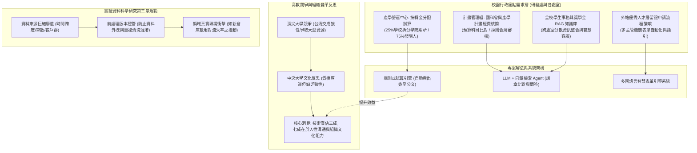

# 📋 期末專案題目發想、中央大學研發處行政業務 AI 轉型媒合與實證資料工程 — 執行摘要

> **活動場次**：碩二秋季學期 資訊管理研究方法論
> **錄音日期**：2026-10-14
> **發言講者**：授課教師 / 學員
> **對應完整逐字稿**：[`20261014-02-研究方法-期末專案題目發想與行政業務AI轉型媒合.full.md`](./20261014-02-研究方法-期末專案題目發想與行政業務AI轉型媒合.full.md)

---

## 🏗️ 核心架構概念圖

---

## 🎯 核心技術概念與研究方法學指引

### 1. 期末專題定位：拒絕閉門造車，扎根真實場域痛點
- **走出象牙塔**：研究生選題應避免憑空捏造無意義的玩具玩具模型，校園內部的真實行政痛點即是絕佳實證場域。
- **三大精選專案題目**：
  1. *產學營運中心技轉金分配自動化*：將複雜的法規拆帳邏輯（學校抽 25% 拆分學院、系所與中心；75% 分配發明人團隊）程式化，一鍵生成合規公文簽呈。
  2. *計畫經費核銷合規審核 Agent*：利用大型語言模型（LLM）配合檢索增強生成（RAG），將計畫核定清單與報銷單據進行自動化比對，秒級識別未編列項目。
  3. *跨處室獎學金與學務智慧客服*：整合全校分散網站公告，建立統一的自然語言學生諮詢 Agent。

### 2. 組織變革與高教競爭力省思：缺乏「狼性」的體制困境
- **頂大競爭格局**：面對高教經費緊縮，台清交成在爭取教育部與國科會大型旗艦計畫時展現強烈狼性；中央大學同仁雖務實肯幹，但因缺乏主動出擊的狼性文化，往往在大型資源分配中處於劣勢。
- **變革推動核心瓶頸**：在行政體系導入 AI 與自動化系統，最大障礙絕非資訊技術，而是基層人員的抗拒變革心態。資訊專業人才必須理解「技術只佔三成，其餘七成在於人性洞察與組織溝通」。

### 3. 資料科學實證論文方法學：資料來源、版本控管與領域洞察
- **研究方法章節要求**：實證資料來源必須精確交代時間跨度（如連續 30 個月）、資料筆數、資料表關聯架構與清理過濾規則。
- **版本控管（Version Control）至關重要**：特徵工程與前處理經常經歷十幾版迭代，必須建立嚴密的版本紀錄與快照機制，避免資料外洩或混淆。
- **領域真實事件影響（Domain Event Analysis）**：實證模型表現不如預期時，切忌盲目調參，應回歸產業營運歷史（例如新竹物流於 2011 年啟用新物流倉庫導致短期配送延誤），將真實環境衝擊納入特徵分析。

---

## 💬 授課教師提問質詢與研討攻防矩陣

| 質詢向度 | 授課教師核心質詢與指導論點 | 研討答辯與方法學解析 | 實務研究與校務轉型啟示 |
| :--- | :--- | :--- | :--- |
| **實務選題價值與求職優勢** | 為什麼鼓勵碩士生選做校內行政 AI 系統，而非單純寫演算法模擬論文？ | 真實上線運作的系統具有無可替代的說服力。畢業求職面試時能證明自身具備「對接真實需求、落地完整系統」的實戰工程能力。 | 產學脫節是碩士就業痛點，具備生產級實務專案經驗是頂尖企業青睞的核心亮點。 |
| **校園行政文化與狼性省思** | 中央大學在爭取大型資源時面臨什麼瓶頸？推動行政轉型的核心阻力在哪裡？ | 中大校風淳厚但缺乏搶佔資源的「狼性」；行政改革的最大阻力是基層人員習慣舊流程、抗拒科技賦能的人性惰性。 | 技術導入必須配合流程再造與激勵機制，無法單靠工具強加推動。 |
| **計畫核銷 Agent 之技術可行性** | 國科會計畫經費報銷規則繁瑣晦澀，LLM Agent 能否達成可靠審查？ | 採用 RAG 架構結合向量資料庫檢索精確法規條款，再由 LLM 執行合規性語意比對，能精準過濾「未列於計畫書」之非合規單據。 | 領域特定法規審核是 LLM 在辦公自動化領域中最具商業價值與落地前景的場景。 |
| **實證資料異常與領域洞察** | 實證預測模型表現欠佳時，研究生最常犯的錯誤是什麼？正確解法為何？ | 學生常誤以為是演算法不夠高深而盲目硬調超參數。正確解法是深入領域營運脈絡（如新竹物流新倉庫上線），尋找真實擾動因子。 | 深入理解領域業務邏輯（Domain Knowledge）遠比盲目更換模型演算法更能解決根本問題。 |

---

## 🛠️ 實踐決策與專案推動建議
1. **期末專案直接對接處室痛點**：鼓勵各小組選擇產學技轉、計畫核銷或獎學金客服作為期末系統實作標的，爭取於校內正式環境驗證。
2. **落實資料前處理版本快照**：資料科學實驗強制導入版本編號管理（如 DVC 或 Git-LFS），詳實記錄每一次特徵增刪與清洗邏輯。
3. **深入考察營運歷史背景**：在分析產業時間序列資料時，必須繪製重大營運事件時序圖，校正外在衝擊對模型的干擾。
