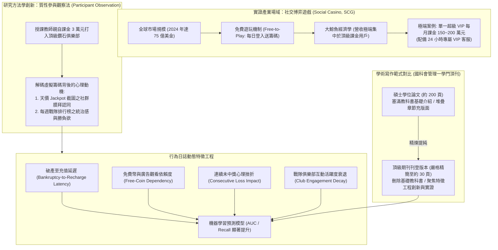

# 📋 研究方法：國科會期刊評析、博弈手遊大鯨魚玩家流失預測與實證模型研究 — 執行摘要

> **活動場次**：碩二秋季學期 資訊管理研究方法論
> **錄音日期**：2026-10-14
> **發言講者**：授課教師 / 學員
> **對應完整逐字稿**：[`20261014-03-研究方法-國科會期刊評析與顧客流失預測實證模型.full.md`](./20261014-03-研究方法-國科會期刊評析與顧客流失預測實證模型.full.md)

---

## 🏗️ 核心架構概念圖

---

## 🎯 核心技術概念與研究方法學指引

### 1. 碩論與期刊投稿之結構性精煉：拒絕教科書充版面
- **篇幅與受眾落差**：學生碩士論文常達兩百頁，第二章慣性塞入大量「教科書級」的基礎定義（如 Data Mining 演算法原理、傳統產業通論），往往被學術期刊審查委員視為刻意充版面的冗贅內容。
- **期刊發表標準**：國科會推薦頂級期刊篇幅精縮至約 30 頁，要求作者預設審查者具備高階專業知識，篇幅應全面集中於「核心理論缺口、特徵工程創新、研究假設與消融對照實證」。

### 2. 社交博弈遊戲（SCG）產業特性與大鯨魚經濟學（Whale Economy）
- **商業模式矛盾**：SCG 手遊在台灣受限法規「嚴禁虛擬幣兌現法幣」，且絕大多數休閒玩家均為零付費（無課金）；但全球市場產值卻高達 75 億美元，展現極端的長尾與頭部集中現象。
- **超級 VIP 極端案例**：實證合作對象（向上國際《老子有錢》）資料庫顯示，頂級大鯨魚玩家單人每月穩定課金達 150 萬至 200 萬元新台幣，迫使遊戲公司配置專屬 24 小時真人客服。

### 3. 研究方法創新：量化資料探勘結合質性「參與觀察法」
- **研究者親歷現場**：授課教師為解開「不能換錢為何月砸兩百萬」的黑箱心理，親自課金約 3 萬元新台幣打入頂級俱樂部，實施「參與觀察法（Participant Observation）」。
- **核心心理學機制**：頂級玩家付費的核心驅動力為「社群認同與虛擬成就感」——藉由在戰隊群組展示天價 Jackpot 截圖收穫膜拜，並在每週全服排行榜中確立霸主地位，彌補現實生活中的精神空虛。

### 4. 領域驅動的動態特徵工程（Domain-Driven Feature Engineering）
- **超越靜態指標**：傳統以登入次數、遊玩時長等靜態特徵預測流失已失去鑑別度。
- **高階動態行為特徵設計**：
  1. *破產至儲值延遲（Bankruptcy-to-Recharge Latency）*：衡量籌碼輸光至掏錢儲值的心理冷卻期變化。
  2. *免費籌碼依賴比率*：觀察玩家是否轉向依賴觀看廣告或簽到維持遊戲。
  3. *連輸心理挫折衝擊*：捕捉長週期未觸發獎勵對回訪意願的非線性損害。
  4. *戰隊互動衰減率*：評估社群黏著度脫鉤之早期警訊。

---

## 💬 授課教師提問質詢與研討攻防矩陣

| 質詢向度 | 授課教師核心質詢與指導論點 | 研討答辯與方法學解析 | 實務研究與頂刊發表啟示 |
| :--- | :--- | :--- | :--- |
| **論文篇幅精簡哲學** | 碩論寫了兩百頁，為什麼投稿國際頂級期刊時必須砍掉將近八成篇幅？審查委員的核心關注點是什麼？ | 碩論需向口委證明通盤基礎知識；期刊審查委員則是資深同行，不需要閱讀教科書基礎教學。精煉至 30 頁才能突出特徵工程與實證架構的學術邊際貢獻。 | 學術發表講求高密度價值傳遞，刪除無關冗贅、凸顯核心創新是期刊錄取的關鍵指標。 |
| **虛擬遊戲課金心理本質** | 社交博弈手遊既不能兌換現金，富豪玩家每月課金一兩百萬的根本動機為何？ | 其本質在於購買「社群認同與階層統御感」。透過巨額下注獲得天價大獎截圖並分享至專屬社群，換取成員膜拜與排行統治感，填補現實心理空缺。 | 資料科學家必須具備深厚的消費者心理洞察，才能設計出具備行為解釋力的特徵。 |
| **質性方法與量化探勘之融合** | 為什麼做大數據預測模型，教授還需要親自花 3 萬元儲值去做「參與觀察法」？ | 純數據日誌只能呈現「做了什麼（What）」，無法解釋「為什麼做（Why）」。唯有親身進入玩家社群與排位機制，才能發掘破產延遲、戰隊互動等高階特徵。 | 「質性洞察賦能特徵工程，量化模型驗證質性假設」，是跨越平庸數據分析的頂級研究範式。 |
| **VIP 玩家流失預警實務價值** | 針對佔據九成營收的少數大鯨魚玩家，流失預測模型在企業運營中有何實戰價值？ | 藉由破產間隔拉長與社群互動衰退等早期特徵，系統可在 VIP 徹底棄坑前 7 至 14 天觸發專屬真人客服介入（贈送客製虛寶或心理關懷），實質挽回數百萬營收。 | 預測模型必須緊密結合企業營運干預措施（Actionable Insights），方能展現商業智慧的核心價值。 |

---

## 🛠️ 實踐決策與研究建議
1. **期刊投稿嚴格剔除教科書內容**：學術投稿嚴格精縮篇幅，全面聚焦特徵工程之新穎性與消融對照驗證。
2. **導入動態心理特徵設計**：行為分析模型應納入時間延遲、破產恢復週期與社群參與衰退等動態特徵，提升對高價值客戶的預警靈敏度。
3. **質化觀察輔助量化特徵提取**：在進入資料建模前，分析人員應實地進行使用者訪談或親歷業務場景，確保特徵具備深厚領域解釋力。
