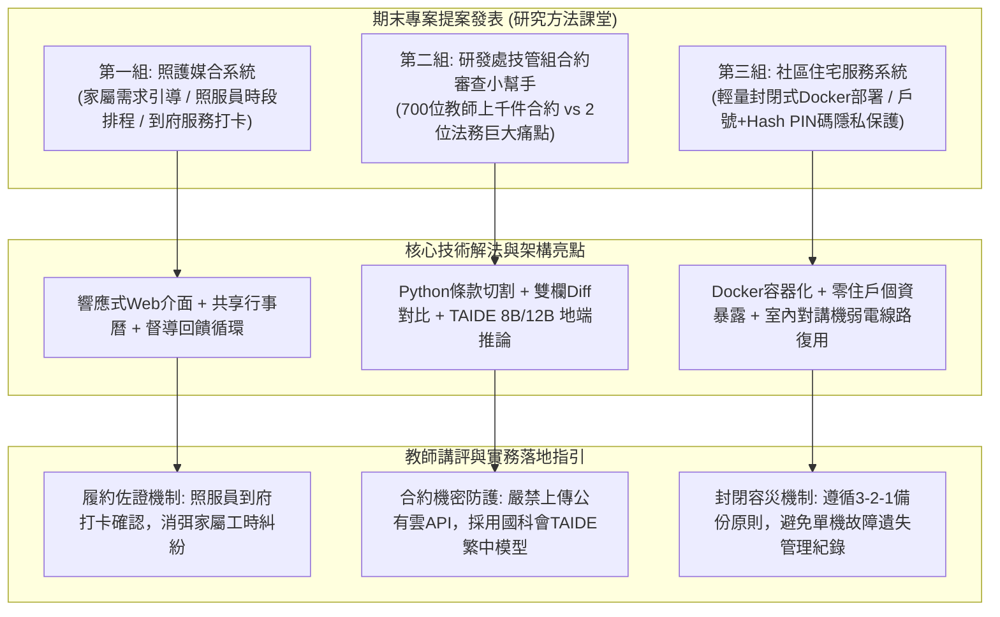

# 📋 期末專案提案評析：照護媒合系統、研發處技管組產學合約審查小幫手與社區住宅服務系統 — 執行摘要

> **活動場次**：碩二秋季學期 資訊管理研究方法論
> **錄音日期**：2026-10-21
> **發言講者**：授課教師 / 學員
> **對應完整逐字稿**：[`20261021-01-研究方法-照護媒合系統與技管組產學合約審查小幫手提案.full.md`](./20261021-01-研究方法-照護媒合系統與技管組產學合約審查小幫手提案.full.md)

---

## 🏗️ 核心架構概念圖

---

## 🎯 核心技術概念與提案分析

### 1. 照護媒合系統：長照痛點與雙邊平台排程設計
- **角色三方協同**：明確劃分「家屬」（需求填寫、評價回饋）、「照服員」（時段排程、接案履約）與「機構督導」（帳號稽核、異常介入）。
- **服務打卡信任機制**：授課教師指引導入行動定位或抵達/結案打卡機制，有效解決居服長照常見的工時認定糾紛。
- **輕量化部署**：採用響應式 Web 介面，免去長輩與照服員安裝 App 的技術門檻。

### 2. 研發處技管組「產學合約審查小幫手」：高價值行政轉型實踐
- **極端人力痛點**：中央大學全校 700 位教師每年產出上千件國科會與企業產學計畫，全校僅配屬 2 位專業法務，平均每份合約需往返攻防 3～5 次。
- **條款階層切割與語意比對**：利用 Python 將長篇合約逐條剖析，避免整篇丟入 LLM 造成 Context Window 記憶漂移或幻覺。
- **地端推論與 TAIDE 模型**：因產學合約涉及高度商業與技術機密，嚴禁串接外部公有雲 API；推薦採用國科會開發之繁體中文開源大語言模型 **TAIDE 8B / 12B**，研發處專案經費全力奧援運算資源。

### 3. 社區住宅服務系統：Docker 容器化與極致隱私保護
- **挑戰既有壟斷產品**：針對市佔第一的「智生活」App 廣告臃腫、個資雲端化與高維護費用進行反思，定位微型公寓封閉式系統。
- **零個資與安全憑據**：僅使用戶號搭配單次雜湊 PIN 碼，不記錄姓名與身分證號；投票單次即作廢，修繕案件支援私密/公開分流。
- **實體弱電架構延伸**：教師建議復用社區現有室內對講機獨立配線網段，配合單機定期加密備份（3-2-1 原則），確保系統長久穩定。

---

## 💬 師生問答與關鍵審查意見對焦 (QA Critique Coverage Matrix)

| 提案專案 | 授課教師核心質詢 / 講評重點 | 學生團隊技術回應與架構調整 | 實務落地改善措施 |
| :--- | :--- | :--- | :--- |
| **照護媒合系統** | 推薦演算法初期複雜度、照服員可用時段管理、居服員到府服務之履約佐證與工時爭議防範。 | 第一階段採問卷規則特徵篩選，照服員提供個人排程日曆勾選，後續考慮定位打卡。 | 增加照服員「抵達打卡」與「結案打卡」時間戳記，即時推播通知家屬並供督導追蹤。 |
| **合約審查小幫手** | 產學機密與個資嚴禁上傳公有雲；廠商多次往返修改（前後版本 Diff）；最終簽核責任在人。 | 全面規劃地端伺服器（on-premise）部署，合約做條目階層化切割，定位為輔助工具。 | 採用國科會 **TAIDE 8B/12B** 地端模型推論，研發處經費支援運算資源，並支援 Version 1 vs 2 差異比對。 |
| **社區住宅服務** | 封閉式區域網路在住戶間的實體佈線限制；單機運作下硬體損毀之資料遺失與容災風險。 | 初期鎖定 10～20 戶小型公寓以長距離 Wi-Fi 涵蓋；住戶以瀏覽器 IP 登入。 | 研討復用社區室內對講機弱電線路；強制加入定時加密異地備份機制（3-2-1 備份原則）。 |
