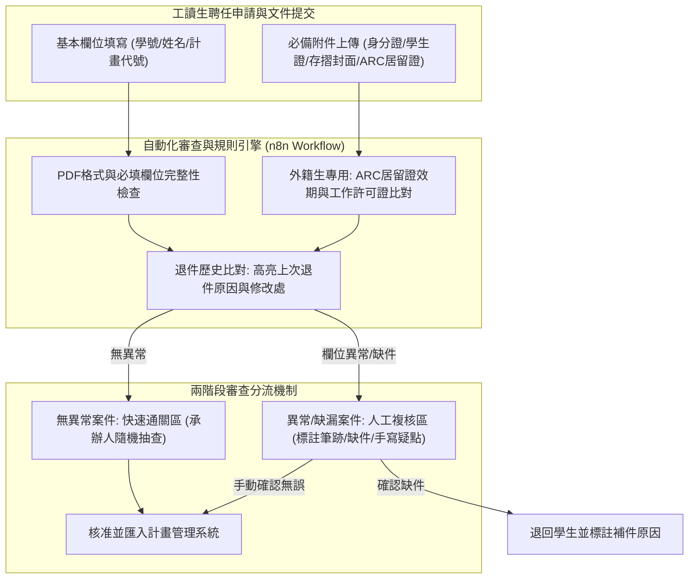

# 📋 研發處專案計畫工讀生聘任申請自動審查與流程自動化 — 執行摘要

> **活動場次**：碩二秋季學期 資訊管理研究方法論
> **錄音日期**：2026-10-21
> **發言講者**：授課教師 / 學員
> **對應完整逐字稿**：[`20261021-02-研究方法-研發處工讀生聘任申請資料自動審查與流程自動化.full.md`](./20261021-02-研究方法-研發處工讀生聘任申請資料自動審查與流程自動化.full.md)

---

## 🏗️ 核心架構概念圖

---

## 🎯 核心技術概念與流程自動化分析

### 1. 研發處工讀生審查業務痛點
- **雙重身分核驗負擔**：全校國科會與產學計畫專案工讀生數量龐大，外籍生需嚴格檢核外僑居留證（ARC）及勞動部工作許可證，本國生需對驗身分證與在學身分。
- **跨系統頁面切換耗損**：現行作業需在多個獨立視窗中來回對照附件圖檔與登錄表單，人工比對極易疲勞導致疏漏。

### 2. 兩階段智慧分流與退件追蹤機制
- **自動標註與異常分流**：系統預處理解析 PDF 檔案，若有缺件、日期不符或格式錯誤直接分流至「人工複核區」；無異常者進入「快速通關區」，大幅減少 80% 重複性全人工檢查。
- **退件修訂歷史對照**：重新送件之申請案自動標示前次退件原因與修訂對比，加速承辦人重點複核。

### 3. 工作流技術選型與實務考量
- **n8n 開源工作流整合**：教師建議運用 n8n 串接表單事件、Webhook、PDF 欄位萃取與條件路由，避免大量硬編碼以利彈性調整法規規則。
- **手寫簽名邊界界定**：指導教授簽名與手寫塗鴉仍須保留人工檢視環節，AI 聚焦於可結構化之文字、日期與身分字號驗證。

---

## 💬 師生問答與關鍵審查意見對焦 (QA Critique Coverage Matrix)

| 審查維度 | 授課教師核心質詢 / 講評重點 | 學生團隊技術回應與架構調整 | 實務落地改善措施 |
| :--- | :--- | :--- | :--- |
| **業務範圍界定** | 研發處計畫管理組僅審查專案/研究計畫兼任助理與工讀生，需確認具體表單內容。 | 專案範圍明確限縮於研發處計畫專案工讀生，針對計畫編號、身分證影本、存摺對驗。 | 協調窗口取得申請端與審核端之系統欄位畫面，建立完整的表單欄位對應矩陣。 |
| **手寫簽名與塗鴉** | 學生與教授手寫簽名、筆跡潦草或掃描模糊時之自動化限制與處理方式。 | 承認純 OCR 辨識手寫筆跡有極限，規劃手寫簽名與塗鴉列為異常人工複核觸發點。 | 系統僅檢查簽名欄位是否為空（是否有墨跡/圖檔覆蓋），筆跡真偽與內容由人工抽核。 |
| **技術選型與時程** | 業務流程自動化（BPA）之後端架構與快速落地時限。 | 預估 2 個月內完成 MVP 原型，規劃導入外掛標註與分流佇列。 | 採納教師建議導入開源 **n8n** 流程引擎降低開發維護成本，加速串接雙階段審核。 |
