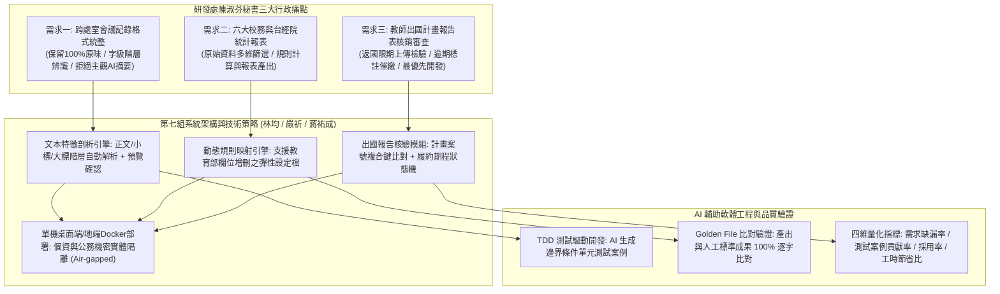

# 📋 研發處出國報告核銷、跨單位會議記錄統整與統計報表 AI 轉型需求對焦 — 執行摘要

> **活動場次**：碩二秋季學期 資訊管理研究方法論
> **錄音日期**：2026-10-21
> **發言講者**：授課教師 / 林均 / 嚴祈 / 蔣祐成
> **對應完整逐字稿**：[`20261021-03-研究方法-研發處出國報告與會議記錄AI轉型需求對焦.full.md`](./20261021-03-研究方法-研發處出國報告與會議記錄AI轉型需求對焦.full.md)

---

## 🏗️ 核心架構概念圖

---

## 🎯 核心技術概念與系統工程分析

### 1. 研發處資深秘書三大實務需求與開發排程
- **需求一（會議記錄統整）**：拒絕傳統 LLM 潤飾或過度摘要的通病，恪守「保留原貌、原汁原味」，透過字數密度與字級大小自動化辨識階層（大標、小標、正文），匯出標準化版型。
- **需求二（統計報表轉換）**：涵蓋台經院、校務統計等六類法定報表。教師特別提醒教育部法規常變更欄位，架構設計須引入動態規則映射（Schema Mapping），杜絕硬編碼。
- **需求三（出國報告核銷）**：全校教師出國補助計畫核銷之關鍵瓶頸，牽涉主計結案時效。以計畫案號為複合鍵（Composite Key）自動比對返國日期與心得報告上傳狀態，自動產出催繳與合規清冊，列為全案最優先開發項目。

### 2. AI 賦能軟體工程（AI-assisted SE）實踐體系
- **TDD（測試驅動開發）**：由 AI 根據業務規則率先產出各項邊界條件與負面測試案例（Corner Cases），再行撰寫商業邏輯程式碼，確保程式碼強健度。
- **Golden File 黃金標準驗證**：向業務單位索取歷史人工核定成果作為 Ground Truth，進行自動化逐格比對，確保演算法精準度無漂移。
- **四維軟體工程量化評估**：設定「需求缺漏發現率」、「測試案例貢獻率」、「AI 生成程式碼採用率」與「開發時數差異」等四項指標，建立可重複驗證之方法學。

### 3. 公務機密與個資隔離（PII Air-gapping）
- 鑑於校務公文、教師出國經費與差旅紀錄具有法定機密性，全面摒棄公有雲 API，規劃單機版（Standalone Desktop App）或地端 Docker 隔離部署，恪守公務機密資安防護規範。

---

## 💬 師生問答與關鍵審查意見對焦 (QA Critique Coverage Matrix)

| 審查面向 | 授課教師核心質詢 / 講評重點 | 第七組團隊技術回應與架構調整 | 實務落地改善措施 |
| :--- | :--- | :--- | :--- |
| **開發優先序對焦** | 研發處陳淑芬秘書業務極其龐雜，確認哪項需求最具急迫性與結案效益。 | 依訪談決議將「需求三：出國報告核銷檢查」列為第一優先，10月底前完成對焦。 | 先行交付出國報告逾期檢查與案號比對模組，滿足主計室即將到來的年度結案時限。 |
| **報表格式動態變更** | 教育部校務統計常隨政策增減欄位，若採硬編碼開發將在半年後隨格式變更而失效。 | 認同教師見解，避免將 Excel 欄位對應關係寫死在程式內。 | 導入動態規則映射設定檔（JSON/YAML Schema），允許秘書未來透過介面自主增修欄位。 |
| **個資與公務資安紅線** | 嚴禁將未脫敏之公務資料、手寫簽名、差旅明細上傳至公有雲 Commercial LLM API。 | 系統全線採取單機版桌面應用程式或內網 Docker 部署，個資不離地端。 | 嚴格執行 PII 去識別化過濾器，敏感出國核銷數據完全在本地環境完成比對與運算。 |
| **會議記錄版型異質性** | 各處室與學院公文會議記錄版型樣態繁雜，正規化特徵抽取難度高。 | 採用字數統計最大區塊為內文、較大字級為小標之啟發式演算法，並提供雙欄即時預覽。 | 下午二次會議向秘書索取至少 5 種過往跨處室實際樣例文檔，強化樣式解析覆蓋率。 |
