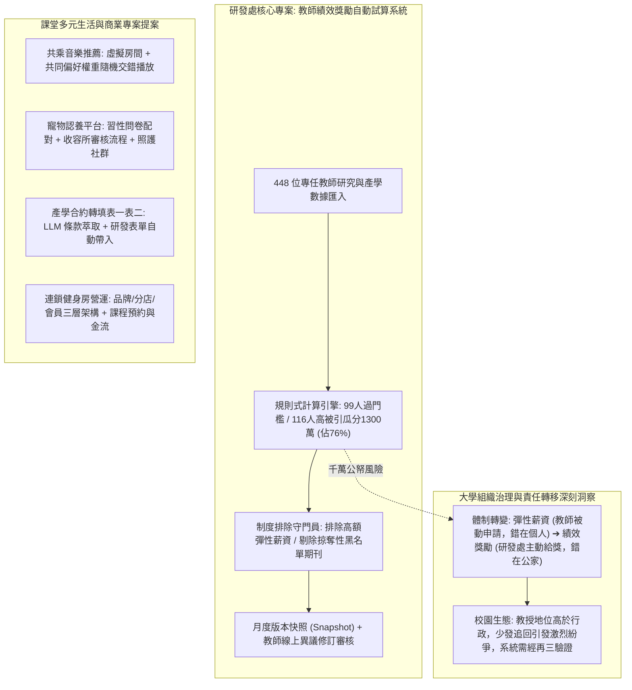

# 📋 教師產學績效獎勵自動計算、共乘音樂推薦與產學表單小幫手專案評析 — 執行摘要

> **活動場次**：碩二秋季學期 資訊管理研究方法論
> **錄音日期**：2026-10-21
> **發言講者**：授課教師 / 學員
> **對應完整逐字稿**：[`20261021-04-研究方法-教師產學績效獎勵自動計算與文獻指標排程系統.full.md`](./20261021-04-研究方法-教師產學績效獎勵自動計算與文獻指標排程系統.full.md)

---

## 🏗️ 核心架構概念圖

---

## 🎯 核心技術概念與高教體制深度剖析

### 1. 教師產學績效獎勵自動計算系統
- **規模與金額衝擊**：全校 448 位專任教師，試算涵蓋 1,700 多萬元獎勵預算，高被引論文獎勵佔 1,300 多萬（佔比達 76%）。
- **體制轉向與行政風險**：以往「彈性薪資」為教師被動申請，填報不實責任自負；現行「主動給獎」將完全責任轉嫁至研發處同仁。計算演算法一旦有絲毫閃失（不當發放追回或應發漏發），將引發教授巨大反彈。
- **複雜法規與跨院差異**：必須動態排除已獲彈性薪資（講座教授每月加給 6～15 萬元）者，並動態過濾各學院自主訂定之「掠奪性期刊排除清單」，系統需具備月度版本凍結與動態規則設定能力。

### 2. 產學合約後續銜接：表一表二轉填小幫手
- 與簽約前合約審查小幫手呼應，聚焦「簽約後」教授填報繁雜研發系統行政表單之痛點，運用 NLP 萃取核心案由與金額，自動化帶入系統，免除教授頻繁向行政人員求助。

### 3. 多人共乘與商業營運專案
- **共乘音樂清單媒合**：運用 Spotify Web API 建立虛擬房間，結合車內乘客偏好進行權重混洗，解決單一駕駛壟斷曲風之社交尷尬。
- **連鎖健身房多店架構**：以品牌總部、分店與會員三層授權模型，打通傳統破碎之課程預約與預收款核銷系統。

---

## 💬 師生問答與關鍵審查意見對焦 (QA Critique Coverage Matrix)

| 專案範疇 | 授課教師核心質詢 / 講評重點 | 學生團隊技術回應與架構調整 | 實務落地改善措施 |
| :--- | :--- | :--- | :--- |
| **教師獎勵金試算** | 主動給獎責任重大，全校 1700 萬獎金不容出錯；各學院掠奪性期刊清單與彈薪資格每年變動。 | 採取敏捷開發，將系統分析溝通佔比提升至 80%，資料庫採非結構化與結構化混和設計。 | 系統第一階段定位為研發處內部比對稽核工具而非直接全校開放；支援各年度法規動態配置。 |
| **合約轉填表一表二** | 教授普遍缺乏耐心理解行政系統模式，如何降低操作阻力？ | 透過 LLM 解析合約內容，將關鍵資訊結構化自動填入草稿表單。 | 直接產出符合研發系統規範之範例 PDF 或一鍵匯入腳本，極致簡化操作。 |
| **共乘音樂平台** | Spotify API 之第三方權限控制、非付費會員存取限制與車載網路連線穩定性。 | 規劃以 Web 端房主授權機制為核心，利用權重演算法在待播清單做動態平衡。 | 前期聚焦於標準 Web API 調用，加入離線歌曲快取與網路中斷恢復機制。 |
