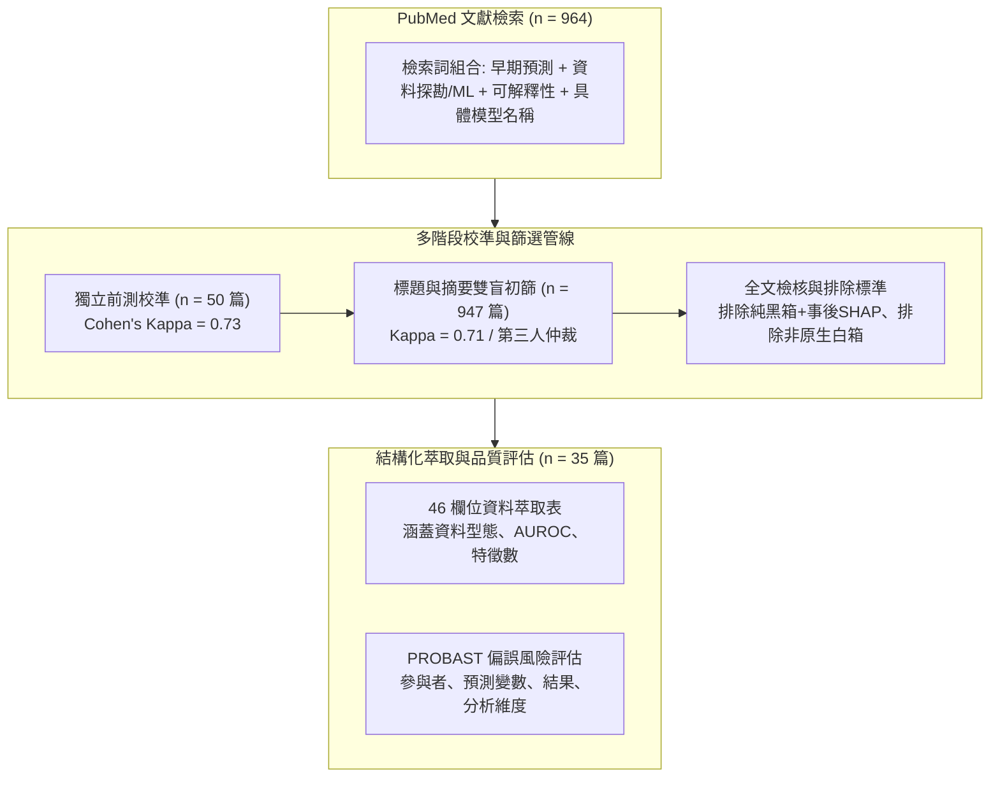

# 📋 敗血症早期預警之可解釋 AI 模型 PRISMA 系統性文獻回顧 — 執行摘要

> **活動場次**：碩二秋季學期 資訊管理研究方法論
> **錄音日期**：2026-10-27
> **發言講者**：授課教師 / 報告研究生 / 學員
> **對應完整逐字稿**：[`20261027-01-敗血症早期預警之可解釋AI模型PRISMA文獻回顧.full.md`](./20261027-01-敗血症早期預警之可解釋AI模型PRISMA文獻回顧.full.md)

---

## 📌 核心議題與文獻回顧架構

本場研討為碩士班《資訊管理研究方法論》專題文獻回顧發表，報告團隊針對急重症醫療領域中之**敗血症（Sepsis）早期預警模型**展開嚴謹的 PRISMA 系統性文獻回顧（Systematic Review）。全球每年敗血症病例高達 4,890 萬例，死亡率接近 20%，臨床搶救時機具備高度時間敏感性；然而現行臨床評分工具（SOFA、qSOFA）單獨使用時準確度有限，促使大量研究轉向電子病歷（EHR）機器學習模型。

報告團隊指出，既有機器學習研究多採用梯度提升樹（GBDT）或深度神經網路等黑箱架構，在前線急診與加護病房（ICU）決策中缺乏可信透明度。本研究聚焦於**內建白箱可解釋模型（Inherently Interpretable Models，如邏輯迴歸、決策樹、規則評分表）**，系統性檢驗其在敗血症早期預警中相較於黑箱模型之鑑別力、可解釋性呈現方式及方法學偏誤風險。

---

## 🏛️ PRISMA 系統性篩選與可解釋決策框架

---

## 🔬 四大核心研究問題與實證發現

| 研究問題（RQ） | 檢驗維度與焦點 | 納入 35 篇文獻實證發現 | 臨床決策意涵與限制 |
| :--- | :--- | :--- | :--- |
| **RQ1：模型架構與分佈** | 內建可解釋模型種類與臨床資料分佈 | 絕大多數文獻採用邏輯迴歸（Logistic Regression）或單一決策樹；完全無文獻採用複雜規則系統（Rule-based Models）。 | 模型形式高度集中於傳統統計模型，缺乏新型可解釋架構探索。 |
| **RQ2：預測鑑別力差距** | 相同資料集下白箱 vs 黑箱 AUROC 表現 | 在同一資料集上，白箱模型 AUROC 中位數與黑箱機器學習幾無顯著差異（差距在 0.01 以內）。 | 證實高風險臨床決策並非必須依賴黑箱，白箱可兼顧效能與透明度。 |
| **RQ3：可解釋性呈現** | 解釋結構視覺化與臨床前線人員評估 | 多數文獻僅宣稱具備可解釋性，未將模型內部決策邏輯完整呈現，且完全缺乏前線醫護可用性實測。 | 可解釋性多停留在學術宣稱（Lip Service），未落實於臨床驗證。 |
| **RQ4：偏誤風險與完整度** | PROBAST 評估指引與報告品質檢核 | 納入研究有超過 90% 被評定為高偏誤風險（High Risk of Bias），主因在於資料選樣偏差與驗證不全。 | 現有文獻方法學嚴謹度不足，外部推廣應用需極度審慎。 |

---

## 💬 授課教師講評、同儕攻防與 AI 協同實務

### 1. 關鍵字迷思與學術本質探討
授課教師深入指出，近年「可解釋 AI（XAI）」成為熱門詞彙，許多文獻本質上僅是套用傳統邏輯迴歸或決策樹，並未提出新型可解釋機制，純粹因應投稿潮流將 XAI 列入關鍵字。研究者在進行系統性文獻回顧時，必須穿透名詞表象，嚴格檢視其方法創新度與本質差異。

### 2. 46 欄位資料萃取表與簡報投影片指引
授課教師肯定研究團隊建立 46 欄位資料萃取表的細緻度，但提醒在課堂簡報與學術報告中，應避免在投影片上密密麻麻堆疊原始表格，應提煉出高對比度的綜合分析圖表，並配合光筆輔助說明，引導聽眾迅速捕捉核心發現。

### 3. Claude 提示詞工程協同實驗
報告團隊分享了使用 Claude 輔助文獻回顧的完整歷程：自初篩檢索式設計、納入排除規則書擬定，至資料萃取表結構定義與多輪仲裁。授課教師對此展開教學實驗：要求各組將與 Claude 互動的完整提示詞流程與邏輯架構匯出為 Markdown（.md）文檔並上傳至作業區，透過跨組別交叉比對，檢驗 AI 工具是否會收斂學生的研究思維，抑或是學生能夠主導 AI 產出具備獨創邏輯之研究架構。

---

## 📋 待辦事項與行動清單

- [ ] **完善投影片圖表呈現**：將 46 欄位萃取表精簡為關鍵特徵對照圖，強化視覺對比與易讀性。
- [ ] **繳交 AI 協同 Markdown 紀錄**：將 Claude 提示詞工程對話紀錄、規則書制定與萃取流程完整整理為 `.md` 檔案上傳至課程作業區。
- [ ] **深化期刊論文第二章**：依據 PROBAST 四大面向補強文獻回顧論述，為後續論文撰寫奠定紮實方法論基礎。
