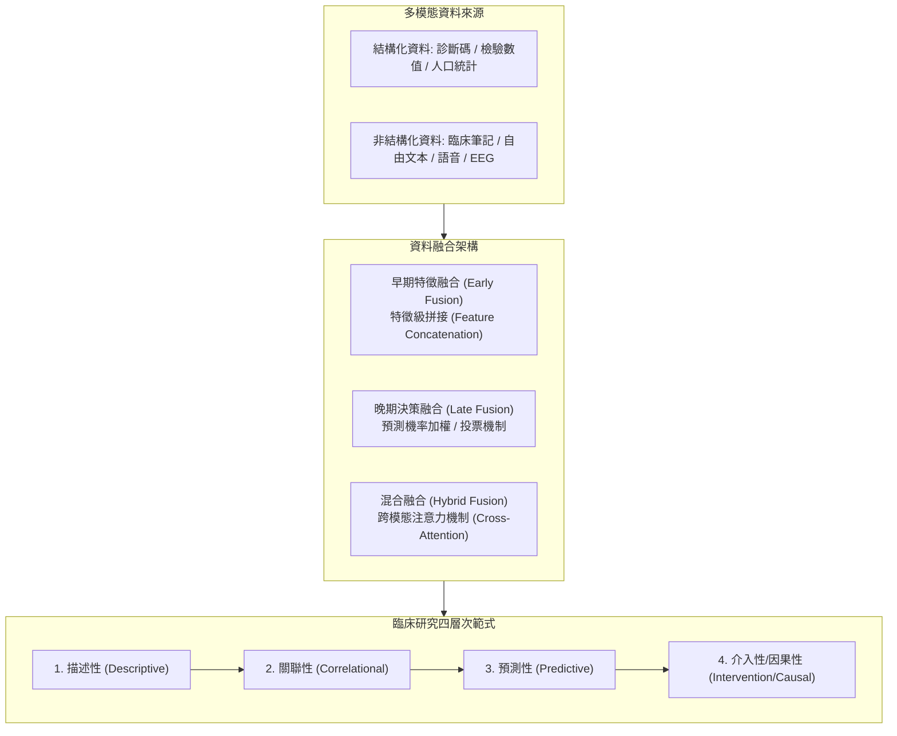

# 📋 多模態憂鬱症預測模型與 PRISMA 2020 系統性文獻回顧 — 執行摘要

> **活動場次**：碩二秋季學期 資訊管理研究方法論
> **錄音日期**：2026-10-27
> **發言講者**：授課教師 / 報告研究生 / 學員
> **對應完整逐字稿**：[`20261027-02-多模態憂鬱症預測模型與PRISMA文獻回顧.full.md`](./20261027-02-多模態憂鬱症預測模型與PRISMA文獻回顧.full.md)

---

## 📌 核心議題與文獻回顧背景

世界衛生組織（WHO）統計顯示全球約有 3.22 億人受憂鬱症影響，佔成年人口約 5.2%，對全球公衛體系與醫療資源配置造成沉重壓力。在智慧醫療與健康資訊學領域中，電子病歷（Electronic Health Records, EHR）資料通常包含兩大異質維度：
1. **結構化資料（Structured Data）**：如 ICD 疾病診斷碼、常規檢驗數值、量表問卷分數（PHQ-9、BDI）及人口統計學特徵，格式固定且易於演算法批次處理。
2. **非結構化資料（Unstructured Data）**：如醫師臨床護理記錄（Clinical Notes）、病患主訴描述、語音及腦電訊號（EEG），蘊含病患自殺意念、情緒低落與快感缺失等關鍵語意線索。

報告團隊依循 PRISMA 2020 指引，針對現有文獻開展系統性回顧，核心研究問題為：「**在憂鬱症預測中，同時結合結構化與非結構化多模態資料，相較於單一模態是否具備統計顯著之額外增量價值（Incremental Value）？**」

---

## 🏛️ 多模態資料融合架構與臨床研究範式

---

## 📊 文獻回顧實證發現與方法學評析

| 分析維度 | 預測型研究（Predictive, n = 8） | 分類性研究（Classification, n = 18） | 系統性文獻回顧綜合洞察 |
| :--- | :--- | :--- | :--- |
| **目標任務定義** | 評估未來時間窗內憂鬱症新發或復發風險 | 區分既有病患是否罹患憂鬱症（當前狀態分類） | 多數研究混淆「事前預測」與「事後分類」，減損臨床預警價值。 |
| **多模態增量效益** | 結合文字筆記後 AUROC 平均提升 0.03～0.08 | 結合多模態後 F1-score 提升約 5%～12% | 非結構化文本對捕捉隱蔽情緒（如自殺傾向）具顯著增益。 |
| **特徵抽取與校準** | 多採用預訓練語言模型（BERT/ClinicalBERT） | 傳統 TF-IDF、詞袋模型與結構化特徵拼接 | 缺乏外部資料集跨院驗證，普遍存在過度擬合與校準度不足。 |
| **資料偏誤與外推性** | 資料集高度集中於歐美少數大型醫療中心 | 樣本規模偏小，遺漏值處理機制多未詳述 | 亞洲與台灣本土臨床資料缺乏，跨族群泛化能力存疑。 |

---

## 💬 授課教師講評焦點與課後硬體選型研討

### 1. 臨床研究之四階段層次劃分
授課教師引導學生梳理臨床醫學研究的階梯思維：
- **描述性與關聯性研究**：檢驗特定變數（如血液指標、文字情緒）與憂鬱症之統計相關。
- **預測性研究**：設定明確時間截點，利用前期特徵預測未來事件發生。
- **介入性與因果推論（Causal Inference）**：如雙盲對照臨床試驗（RCT），檢驗給藥組與對照組之因果效應。教師提醒研究團隊必須嚴格審核文獻中的時間視窗定義，避免產生資料洩漏（Data Leakage）。

### 2. 檢索條件與本土文獻覆蓋
教師提問檢索策略是否過度限縮，以致台灣本土具有代表性之憂鬱症多模態研究未被收錄；建議在檢索詞庫中補充多樣化同義詞與縮寫，並於討論章節交代地域選樣限制。

### 3. 課後交流：硬體配置與資管思維
課後師生針對研究生筆記型電腦選型進行輕鬆交流：針對學員筆記型電腦之微信通訊反饋、使用者截圖便利性、Intel 第 16 代 CPU 與獨立顯卡（GPU）對電池續航力與移動辦公之影響進行討論；進而反思資管系（IM）與資工系（CS）之核心差異——資管核心在於「系統架構與業務流程設計」，非單純編寫底層程式碼。

---

## 📋 待辦事項與行動清單

- [ ] **釐清預測 vs 分類邊界**：在投影片與文獻回顧中明確區隔前瞻預測（Prospective）與事後分類（Retrospective）文獻。
- [ ] **擴充本土文獻對照**：補充台灣本土醫療機構於 EHR 結構化與非結構化資料整合之相關研究。
- [ ] **落實 PRISMA 2020 偏誤評估**：針對納入之 26 篇文獻完成標準偏誤風險檢核表。
