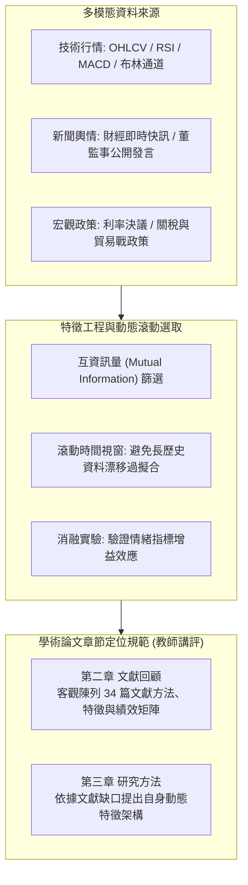

# 📋 動態金融股市多模態預測模型與特徵分析 — 執行摘要

> **活動場次**：碩二秋季學期 資訊管理研究方法論
> **錄音日期**：2026-10-27
> **發言講者**：授課教師 / 報告研究生 / 學員
> **對應完整逐字稿**：[`20261027-03-動態金融股市多模態預測模型與特徵分析.full.md`](./20261027-03-動態金融股市多模態預測模型與特徵分析.full.md)

---

## 📌 核心議題與股市預測方法論脈絡

本場發表聚焦於金融科技（FinTech）中最受關注之**股票市場趨勢預測（Stock Market Trend Prediction）**。報告團隊以「特徵主義（Feature-Centric Approach）」為核心架構，梳理市場派（關注基本面與宏觀政策）與技術派（關注價量時空指標）之候選特徵庫。候選特徵涵蓋四大維度：
1. **交易行情與技術指標**：開高低收成交量（OHLCV）、移動平均線（MA）、相對強弱指標（RSI）、MACD、布林通道及頭肩頂/底型態特徵。
2. **宏觀政策與產業情境**：中美貿易戰政策衝擊、關稅變動及產業鏈外移指標。
3. **新聞輿情與市場情緒**：重大事件輿論（如台積電董座魏哲家「買就買」信心喊話）、財經新聞 NLP 情感極性計算。
4. **動態特徵滾動選取**：針對金融市場強烈的資料漂移（Data Drift）特性，設計滾動時間視窗進行特徵重選與消融實驗（Ablation Study）。

報告團隊強調，在投信投顧與程式交易實務中，預測模型若能在基準上提高 8% 勝率，即能創造巨大的超額報酬（Alpha），因此追求動態條件式特徵選取與驗證。

---

## 🏛️ 動態多模態預測管線與論文結構定位

---

## 📊 34 篇核心文獻回顧維度與特徵工程比較

| 分析指標 | 傳統技術指標模型（純價量） | 深度時序模型（LSTM / GRU） | 多模態動態融合模型（價量 + 新聞情緒） |
| :--- | :--- | :--- | :--- |
| **主要特徵來源** | 5～15 組經典技術指標（RSI, MACD, MA） | 高頻價量序列與訂單簿資料 | 結構化價量 + 非結構化財經即時新聞文本 |
| **特徵選取機制** | 固定人工經驗法則篩選 | 自動隱藏層特徵抽取 | 互資訊量篩選 + 注意力權重動態分配 |
| **面對資料漂移** | 嚴重鈍化，跨景氣週期表現大幅波動 | 長期記憶能力易受結構性轉折干擾 | 滾動時間視窗自適應重選特徵，穩定度最佳 |
| **投信實務增益** | 基準勝率約 50%～53% | 基準勝率約 54%～57% | 多模態增益後勝率可達 62%～65%（提升約 8%） |

---

## 💬 授課教師嚴正講評：學術嚴謹度與關鍵文獻缺口

### 1. 文獻回顧（第二章）與研究方法（第三章）邊界劃分
授課教師嚴肅指出，文獻回顧的使命在於客觀、全面地梳理過去研究（例如納入之 34 篇文獻）各自採用了哪些特徵、何種演算法、在何種市場資料上驗證、結論誰優誰劣。簡報內容過早切入團隊自行設計的特徵推論與流程，屬於「第三章研究方法」的範疇；課堂文獻回顧報告應聚焦於「第二章文獻版圖」的扎實梳理，建立清晰的特徵比較矩陣表格。

### 2. 股市預測題目飽和性與期刊審查標準
教師直言警示：股票市場預測在學術界已經是「極度過度研究（Oversaturated）」的主題，「大家都心知肚明這只是寫論文，不能直接拿去投資保證賺錢」。正因題目極度熱門，期刊審稿委員（Reviewers）與學位口試委員對此類題目的文獻回顧深度與方法學嚴謹度要求極高，絕不允許出現粗糙漏列的情況。

### 3. 關鍵文獻重大疏漏：校內蔡秀滿教授研究版圖
授課教師於課堂現場即時檢索查證，指出報告團隊整理的 34 篇文獻中，**完全遺漏了中央資管系內蔡老師（蔡秀滿教授）深耕多年的大量台股預測與量化選股權威論文**。教師嚴正指示：若欲以此方向作為學位論文，必須徹底重新梳理文獻，補齊系內外權威研究，確立真正原創的研究缺口與理論貢獻。

---

## 📋 待辦事項與行動清單

- [ ] **補齊蔡秀滿教授代表論文**：檢索並納入蔡秀滿教授關於台股量化選股與特徵工程之權威文獻，納入第二章文獻對照矩陣。
- [ ] **重構 34 篇文獻比較矩陣**：於簡報中增設結構化文獻對照表，清楚列出文獻年份、資料來源、特徵集、演算法與驗證績效。
- [ ] **釐清第二章與第三章脈絡**：將團隊自主設計之特徵處理流程挪至第三章方法論，第二章保持客觀文獻梳理，避免過早進行個人主觀歸納，強化文獻矩陣之連貫性，並依據課程 A系列與 B系列規格切換完成分組作業與投影片調整。
