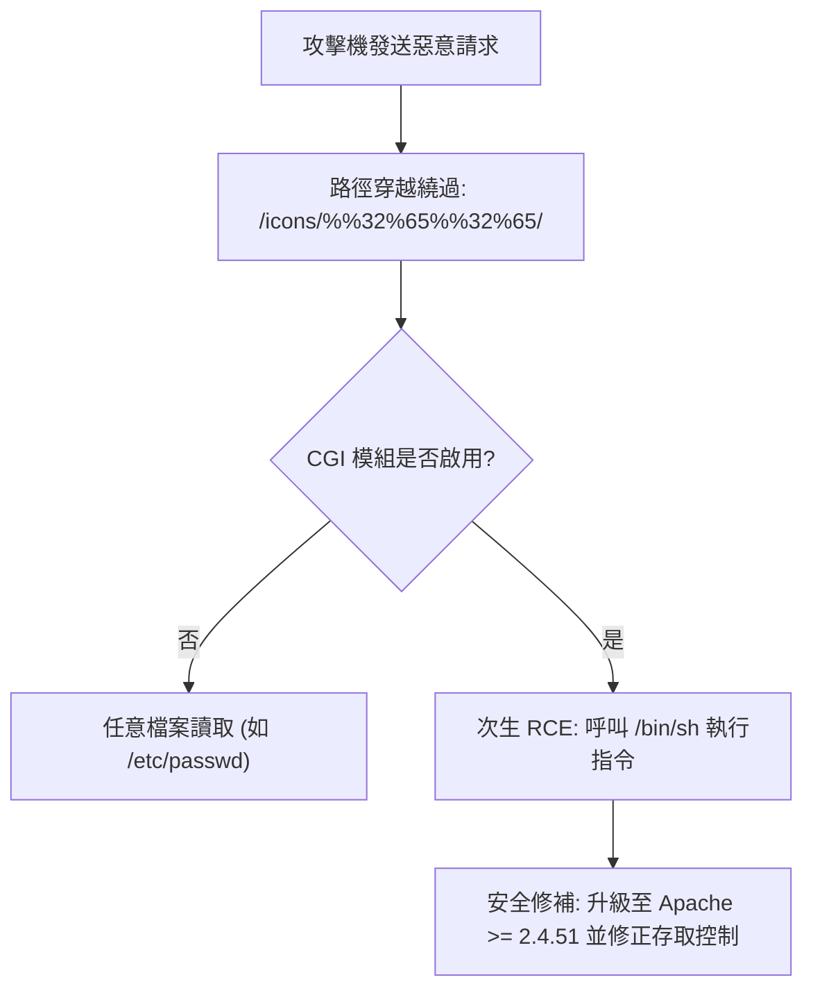

# 📋 Apache 2.4.49 路徑穿越與遠端命令執行 RCE 實機攻防演練 — 執行摘要

- **活動場次**：碩二秋季學期 資安攻防與系統安全實驗
- **錄音日期**：2026-10-02
- **發言講者**：授課教師 / 助教 / 學員
- **對應完整逐字稿**：[`20261002-Apache路徑穿越與遠端命令執行RCE實機攻防.full.md`](./20261002-Apache路徑穿越與遠端命令執行RCE實機攻防.full.md)

---

## 📌 核心議題與課程提要

本場實驗課程聚焦於 Apache HTTP Server 2.4.49 歷史重大漏洞（CVE-2021-41773）的原理剖析與攻防實作。課程由授課教師引言說明攻擊鏈脈絡，隨後由助教帶領學員登入靶場進行實際弱點驗證與命令執行打擊。

核心探討因 Apache 路徑正規化（Path Normalization）邏輯缺陷，攻擊者如何利用雙重編碼繞過目錄限制進行路徑穿越（Path Traversal），並在啟用 CGI 模組的特定配置下，進一步將任意檔案讀取升級為遠端命令執行（RCE）。

---

## 🏛️ 攻擊鏈與漏洞原理架構

---

## 🔑 關鍵重點整理 (Key Takeaways)

### 1. 漏洞根因：路徑正規化缺失
- Apache 2.4.49 在處理 URL 解碼時存在瑕疵，未對二次編碼或特定點號編碼（如 `%%32%65`）進行完整過濾，導致目錄限制被跳脫。

### 2. 從資訊洩漏升級至 RCE 實測
- 課堂實機演示從讀取系統敏感檔案，到藉由 POST 請求向 `/cgi-bin/` 傳遞命令參數呼叫 `/bin/sh`，成功在目標主機取得反彈 Shell 或執行系統命令。

### 3. 作業與防禦要求
- 授課教師要求學員於國慶連假前完成靶場環境的攻擊重現錄影，並撰寫修復報告（包含升級補丁至安全版本及設置嚴格的目錄存取權限 `Require all denied`）。
