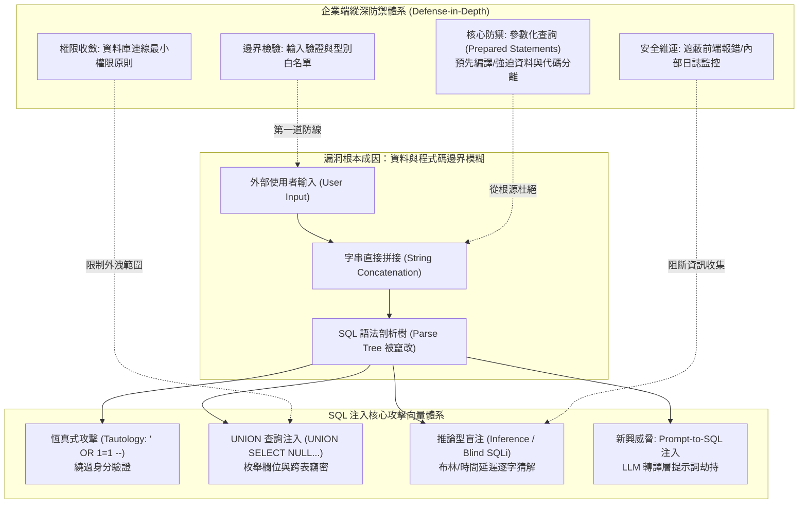

# 📋 SQL 注入攻防技術體系、實證靶場演練與資料隱碼命名哲學研討 — 執行摘要

> **活動場次**：碩二秋季學期 資安實務專題
> **錄音日期**：2026-10-13
> **發言講者**：授課教師 / 游昇翰 / 現場學員
> **對應完整逐字稿**：[`20261013-SQL注入攻防與自動化測試驗證.full.md`](./20261013-SQL注入攻防與自動化測試驗證.full.md)

---

## 🏗️ 核心架構概念圖

---

## 🎯 核心技術概念與研究方法學指引

### 1. SQL 注入的本質：語法樹邊界模糊（Boundary Confusion）
- **漏洞根源**：系統未嚴格區隔「控制指令（SQL Syntax）」與「受測資料（User Data）」，在動態字串拼接時，外部輸入跨越了資料欄位邊界，直接改變了 SQL 直譯器的剖析樹結構。
- **現代演進威脅**：隨著生成式 AI 廣泛應用於 Text-to-SQL 服務，攻擊者可藉由提示詞注入（Prompt Injection）欺騙大語言模型生成惡意 SQL 查詢，形成新型態的「Prompt-to-SQL」注入漏洞。

### 2. 攻防靶場演練關鍵技術與步驟
- **UNION 查詢注入四部曲**：
  1. *枚舉欄位數量*：使用 `ORDER BY N` 或逐步注入 `UNION SELECT NULL, NULL...`，直至網頁正常回傳確認欄位數（本案例靶機為 5 個欄位）。
  2. *確認回顯型態*：依序在各欄位測試字串回顯位置。
  3. *跨表資料提取*：將敏感資料（如 `displayName`, `employeeName`）映射至回顯欄位竊取資料庫內容。
- **身分驗證繞過原理**：在登入驗證中注入 `' OR 1=1 --`，單引號閉合原本常數，`1=1` 確保條件恆真，Double Dash（`--`）註解掉後端剩餘密碼比對邏輯，達成無密碼管理者登入。

### 3. 企業端縱深防禦實踐標準
- **唯二根本解法：Prepared Statements（參數化查詢）**：資料庫引擎先將 SQL 查詢骨架進行預先編譯（Pre-compilation），後續傳入的使用者變數嚴格被當作單純參數（Literal Value）綁定，永遠不會被直譯為指令。
- **多層輔助控制**：結合輸入白名單驗證、資料庫存取最小權限配置（禁用 DDL 與擴展預存程序如 `xp_cmdshell`）、以及遮蔽生產環境詳細報錯訊息。

---

## 💬 授課教師提問質詢與研討攻防矩陣

| 質詢向度 | 授課教師核心質詢與指導論點 | 研討答辯與方法學解析 | 實務研究與資安防禦啟示 |
| :--- | :--- | :--- | :--- |
| **教學引導與範例定位** | 授課教師開場說明為何以這組同學的實作示範作為課程第三章的經典範例介紹？對實務學習有何意義？ | 透過這組同學的實作演練，將原本抽象的資料庫安全理論轉化為生動具體的靶場攻防，為下一節第十章深入課程奠定紮實基礎。 | 實務攻擊示範比純理論講授更能讓學生直觀體會資料庫邊界防禦的重要性。 |
| **名詞哲學與本質認知** | 為什麼台灣在二十年前會將 SQL Injection 翻譯為「資料隱碼攻擊」？其命名背後的深刻技術哲學是什麼？ | 一般使用者與前端介面認為輸入的是單純的「資料（Data）」，但透過拼接漏洞，惡意輸入跨越邊界變成了底層直譯器的「程式碼（Code / 隱碼）」，將代碼隱藏在資料中執行。 | 資安的底層核心永遠在於「代碼與資料的邊界劃分」。此一原則貫穿 Web、作業系統乃至區塊鏈 EVM 智慧合約。 |
| **UNION 注入攻防邊界** | 靶場演練中為什麼必須先測試五個 NULL？直接查詢資料表欄位為何會失敗？ | SQL `UNION` 要求聯合查詢的前後欄位個數與資料型別必須完全一致。先使用型別相容性最高的 `NULL` 探測欄位數，確認底層回傳 5 欄後方能正確映射敏感欄位。 | 攻擊者在黑箱情境下需依賴嚴格的探測步驟；防禦端關閉詳細報錯與欄位提示即可大幅增加攻擊探測成本。 |
| **盲注（Blind SQLi）威脅等級** | 在前端完全不顯示資料庫報錯的情況下，系統是否就能高枕無憂？ | 不能。攻擊者可利用推論型盲注（Inference），透過注入 `WAITFOR DELAY` 觀察時間延遲，或以二分搜尋法比對布林真假反應，依然能逐字元將整個資料庫資料拖出。 | 關閉報錯僅能提高攻擊難度，絕不能視為安全性防禦；核心仍必須採用參數化查詢徹底杜絕注入點。 |
| **新興 AI 驅動架構隱患** | 當前企業導入 LLM 生成 SQL 查詢，傳統參數化查詢是否能完全防範？ | 若企業直接將 LLM 生成的 SQL 字串發送至資料庫執行，攻擊者只需透過 Prompt Injection 誘導 LLM 生成惡意語句，依然會形成嚴重的 SQL 注入旁路。 | 在 Text-to-SQL 架構中，LLM 生成結果必須經過語法白名單審查（AST Parsing）與最小權限資料庫連線隔離，不得無條件信任 AI 輸出。 |
| **整體實作成效講評** | 授課教師結語點評：這組同學的實作非常用心，將攻擊原理解釋透徹，下一節將接續第十章課程。 | 肯定小組將複雜攻擊原理與國網中心 CDX 靶場做緊密結合，鼓勵全班參考其攻防架構與投影片，提升整體資安實戰意識。 | 團隊攻防演練結合可重現的虛擬機靶場環境，是資安實驗室高規格驗證的最佳實踐。 |

---

## 🛠️ 實踐決策與資安落實建議
1. **全面禁用動態字串拼接**：全組織代碼庫強制導入 ORM（如 SQLAlchemy、Hibernate）或原生 Prepared Statements，並於 CI 流程配置 SAST 阻斷動態拼接代碼合併。
2. **生產環境關閉詳細報錯回傳**：前端統一攔截資料庫異常並回傳通用錯誤頁，避免攻擊者利用 Error-based 盲注探測資料庫綱要。
3. **資料庫帳號權限嚴格分級**：Web 應用程式帳號禁止擁有 `DROP`、`ALTER` 權限，並停用非必要之系統擴展預存程序。
