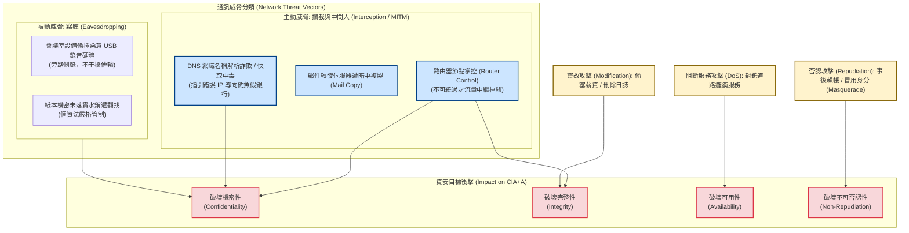

# 📋 通訊攔截與竊聽機制、常見網路攻擊型態分類及 picoCTF 解密實作 — 執行摘要

> **活動場次**：碩二秋季學期 資安實務
> **錄音日期**：2026-10-16
> **發言講者**：授課教師 / 林助教 / 王同學 / 現場學員
> **對應完整逐字稿**：[`20261016-02-通訊攔截與竄改攻擊分析及picoCTF解密實作.full.md`](./20261016-02-通訊攔截與竄改攻擊分析及picoCTF解密實作.full.md)

---

## 執行摘要 (Executive Summary)

本堂課系統性剖析了通訊威脅架構、經典網路攻擊型態與資安防護目標（CIA+A）之對應關係，並無縫銜接至 picoCTF 實機攻防實作：

1. **通訊威脅二分法：竊聽 vs. 攔截**：
   - **竊聽（Eavesdropping）**：被動旁路收音/窺探（如近期國際企業會議室電視後方偷插微型惡意 USB 錄音硬體事件），未直接介入通訊路由。
   - **攔截（Interception / MITM）**：主動切入傳輸鏈路必經之中繼節點（如郵件伺服器、路由器），封包經由中繼點時遭自動拷貝、解析甚至修改。
   - **地緣資安戰略意義**：路由器作為網路出口不可繞過之瓶頸節點，其韌體後門將徹底瓦解通訊機密性，此乃美國政府全面禁用華為路由器之核心技術根因。
2. **經典攻擊型態與安全目標（CIA+A）對應**：
   - **DNS 欺騙（DNS Spoofing / Phishing）**：以假旅客服務中心為喻，解析伺服器遭投毒後將使用者導引至山寨假銀行釣取身分憑證。
   - **竄改攻擊（Modification）**：涵蓋數值修改（轉帳加零）、惡意插入（偷塞薪資/加班清單）與日誌刪除，摧毀 **完整性（Integrity）**。
   - **阻斷服務（DoS）**：癱瘓關鍵伺服器與連線通道，摧毀 **可用性（Availability）**。
   - **否認攻擊（Repudiation）**：利用身分鑑別缺陷冒充（Masquerade）或事後賴帳，摧毀 **不可否認性（Non-Repudiation）**。
3. **picoCTF 實機解密實作**：
   - 樹立 **「編碼（Encoding）絕對不等於加密（Encryption）」** 之資安基本紀律。
   - 掌握資安瑞士刀 **CyberChef** 之 Recipe 操作邏輯，成功以「From Base64」解鎖第 1 題並提交標準格式 `picoCTF{...}` 旗標。

---

## 網路攻擊型態與通訊威脅架構圖

---

## 質詢與深度探討分析矩陣 (QA Critique Matrix)

| 序號 | 提問與質詢主體 | 核心問題與焦點 | 課堂回答與論證脈絡 | 理論與防護意涵 |
| :---: | :--- | :--- | :--- | :--- |
| 1 | **授課教授** ➜ 課堂全體 | 竊聽（Eavesdropping）與攔截（Interception）的本質差異為何？ | 竊聽為被動旁路偵聽（如電視後面插 USB 錄音），不介入傳輸鏈路；攔截則是攻擊者主動切入發送端與接收端中間的必經節點（如路由器），對通過封包進行複製甚至變造。 | 確立被動攻擊與主動中間人攻擊（MITM）在威脅模型上的分界。 |
| 2 | **授課教授** ➜ 王同學 | 網路通訊中，哪類關鍵設備最容易成為無可繞過的攔截節點？ | 王同學答出「路由器（Router）」。教授進一步補充郵件伺服器與郵局中繼比喻：郵件跨網傳送必經多個轉發節點，任何節點被掌控皆可暗中備份內容。 | 點明網路拓撲中「咽喉節點（Chokepoints）」的天生脆弱性。 |
| 3 | **授課教授** ➜ 課堂研討 | 美國等國家為何在國防與通訊基建中堅決封殺華為路由器？ | 路由器是所有網路封包通往網際網路的必經大門。若設備底層韌體留有後門，敵方可在中繼點無感鏡像全部機密流量，即使價格再便宜也涉及致命國安風險。 | 將底層網路通訊原理與跨國地緣政治資安防禦建立深度連結。 |
| 4 | **授課教授** ➜ 課堂研討 | DNS 欺騙（DNS Spoofing）的運作邏輯為何？如何達成釣魚目的？ | 教授以「山寨旅遊諮詢台故意指錯希爾頓飯店方向」為喻：DNS 解析遭下毒後，將合法網域名稱導向假冒之惡意 IP（如假臺灣銀行），誘騙使用者輸入機密帳密。 | 具象化網域名稱解析系統對身分真實性與連線導航之信任依賴。 |
| 5 | **授課教授** ➜ 課堂學生 | 什麼是「否認攻擊（Repudiation Attack）」？其根本成因為何？ | 學生回答「否認或抵賴」。教授說明即使用者在事後不承認自己的交易或簽署行為，成因在於系統身分鑑別缺乏不可否認性（缺少數位簽章與不可篡改稽核軌跡）。 | 建立資安目標中非抵賴性（Non-Repudiation）與鑑別授權之防禦價值。 |
| 6 | **林助教** ➜ 課堂學生 | 初學者面對雜亂字串時，常見的觀念誤區為何？ | 將「資料編碼（Encoding）」誤認為「加密（Encryption）」。編碼僅是為了通訊協定傳輸格式統一，演算法完全公開，無金鑰防護，任何人皆可透過工具一秒逆向還原。 | 樹立「編碼無機密性」之嚴格工程認知，防範虛假安全感。 |
| 7 | **林助教** ➜ 課堂學生 | CyberChef 工具如何在 picoCTF 實戰中協助逆向解題？ | 辨識密文字串結尾帶等號與字元集特徵（Base64），使用「From Base64」方塊建立配方鏈，輸入字串即時解碼還原明文，再包裝為 `picoCTF{...}` 格式提交。 | 傳授資安分析標準工具鏈之實操手法。 |

---

## 網路攻擊型態與資安目標（CIA+A）對應分析

| 攻擊型態 (Attack Type) | 攻擊手法實例 (Examples) | 破壞之資安目標 (Primary Impact) | 核心防護機制 (Defenses) |
| :---: | :--- | :---: | :--- |
| **竊聽 (Eavesdropping)** | 會議室電視偷插 USB 錄音、電磁波旁路洩漏 | **機密性 (C)** | 實體安檢、TEMPEST 電磁遮蔽 |
| **通訊攔截 (Interception)** | 惡意路由器鏡像封包、郵件伺服器暗中備份 | **機密性 (C)** | 端到端加密（TLS/E2EE）、可信硬體設備採購 |
| **DNS 欺騙 (DNS Spoofing)** | DNS 快取投毒、指引錯誤 IP 至釣魚網站 | **真實性 (Auth) / 機密性 (C)** | DNSSEC、HTTPS 憑證驗證與 HSTS |
| **竄改攻擊 (Modification)** | 篡改轉帳金額、偷塞加班費清單、刪除日誌 | **完整性 (I)** | 訊息鑑別碼（MAC）、數位簽章、WORM 唯讀日誌 |
| **阻斷服務 (DoS)** | 洪水封包塞爆頻寬、癱瘓應用程式核心程序 | **可用性 (A)** | 流量清洗（CDN/DDoS Scrubbing）、負載平衡與限流 |
| **否認攻擊 (Repudiation)** | 交易虧損後反悔賴帳、冒用假身分（Masquerade） | **不可否認性 (NR)** | 公開金鑰基礎設施（PKI）、非對稱數位簽章與安全稽核軌跡 |

---

## 核心結論與行動要點

1. **破除編碼神話**：在系統設計與前端開發中，絕對禁止以 Base64、URL 編碼或前端代碼混淆（Obfuscation）充當安全加密手段；敏感資料傳輸與儲存必須採用業界公認之高強度密碼學演算法（如 AES-GCM、ChaCha20-Poly1305）。
2. **通訊鏈路全面落實端到端加密**：假設底層所有路由設備、中繼交換器與 DNS 解析器皆為潛在不可信節點，應用層通訊必須強制啟用 TLS 1.3 並驗證憑證鏈，徹底遏止攔截與中間人攻擊。
