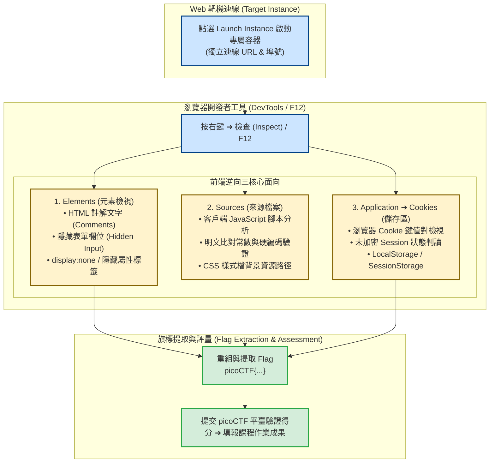

# 📋 前端開發者工具逆向技巧、Web 靶機資訊搜集與 picoCTF 實戰解題演練 — 執行摘要

> **活動場次**：碩二秋季學期 資安實務
> **錄音日期**：2026-10-16
> **發言講者**：授課教師 / 林助教 / 現場學員
> **對應完整逐字稿**：[`20261016-03-前端開發者工具逆向與picoCTF網頁靶場解題.full.md`](./20261016-03-前端開發者工具逆向與picoCTF網頁靶場解題.full.md)

---

## 執行摘要 (Executive Summary)

本節課為 10/16 實習課堂的實戰衝刺階段，聚焦於初階 Web 安全與前端逆向分析手法，建立從被動觀察到主動探測之標準作業流程（SOP）：

1. **動態靶機實例連線（Instance Launch）**：
   - 透過 picoCTF 雲端環境即時啟動獨立 Web 題目容器，取得專屬連線埠與 URL，杜絕多人間之狀態干擾。
2. **DevTools 前端逆向「三位一體」資訊搜集技術**：
   - **Elements 檢視**：挖掘 HTML 原始碼中遭隱藏之註解（`<!-- picoCTF{...} -->`）或 CSS 不可見屬性（`display:none`、`visibility:hidden`）。
   - **Sources 腳本分析**：深入檢視客戶端 JavaScript 原始碼，識別明文硬編碼之驗證邏輯、未混淆之常數陣列或除錯旗標。
   - **Application / Cookies 審查**：審視儲存於瀏覽器端的 Session Cookie、JWT Token 或特定自訂鍵值對，辨識未加密之認證狀態或敏感憑證。
3. **實習評量與階梯式技能拓展**：
   - 全班限時完成 6 道涵蓋編碼還原與前端資訊探測之基礎題型。
   - 確核作業繳交規範（平臺使用者名稱對齊 Classroom、通關查驗、解題思考申論）。
   - 導引學員自主探索 picoCTF 500+ 道中高階挑戰（Medium/Hard）與專業學習路徑（Learning Paths）。

---

## Web 前端逆向探測流程架構圖

---

## 質詢與深度探討分析矩陣 (QA Critique Matrix)

| 序號 | 提問與質詢主體 | 核心問題與焦點 | 課堂回答與論證脈絡 | 理論與防護意涵 |
| :---: | :--- | :--- | :--- | :--- |
| 1 | **授課教授** ➜ 課堂學生 | 進入 Web 滲透實習的第一步，開發者工具（DevTools）的核心價值為何？ | 開發者工具並非僅供網頁排版除錯，而是安全人員透視伺服器傳回客戶端之全部原始程式碼、資源引用與通訊狀態的「X光機」。 | 建立攻擊者視角（Attacker's Perspective），打破前端神秘感。 |
| 2 | **林助教** ➜ 課堂學生 | 在 Elements 標籤頁中，最常藏匿敏感資訊的區域為何？ | 開發者遺留的 HTML 註解（`<!-- ... -->`）、被 CSS 隱藏的元素（`display:none`）以及隱藏表單欄位（`<input type="hidden">`）。 | 點名「Security through Obscurity（隱匿性安全）」之無效性。 |
| 3 | **林助教** ➜ 課堂學生 | 為何 Sources 標籤頁是前端逆向不可或缺的分析環節？ | 前端所有 JavaScript 代碼均下載至使用者瀏覽器端本地執行。任何寫在 JS 中的判斷邏輯、API 密鑰或解密函式皆對使用者完全透明。 | 確立「永遠不要信任客戶端（Never Trust the Client）」之安全金科玉律。 |
| 4 | **林助教** ➜ 課堂學生 | Application 標籤頁中的 Cookies 選項在 Web 安全分析中有何特殊作用？ | 檢視伺服器寫入瀏覽器的 Cookie 內容。部分脆弱系統將權限狀態（如 `admin=0`）或未加密明文旗標直接置於 Cookie 中，可直接讀取甚至變造。 | 剖析狀態管理（State Management）與 Session 劫持/竄改之切入點。 |
| 5 | **授課教授** ➜ 課堂學生 | 面對 CTF 挑戰時，為何建議「非到萬不得已先不看 Hint（提示）」？ | 提示往往直接揭露解答方向與漏洞特徵，過早閱讀會剝奪建立「主動探測直覺」的機會；在真實滲透測試環境中，目標系統絕不會附帶任何提示。 | 鍛鍊自主漏洞探測與逆向直覺之工程心智模型。 |
| 6 | **林助教** ➜ 課堂學生 | 本次實習作業的繳交標準與評量依據為何？ | 需提交 picoCTF 帳號供後台 Classroom 比對通關記錄，並於校內作業區提交簡要分析報告，闡述 6 道題目的解法與底層安全原理。 | 確保動手實作（Hands-on）與理論理解（Theory）雙軌合一。 |

---

## Web 前端逆向探測三面向對照表

| 分析面向 | DevTools 標籤頁 | 關鍵檢查標的與手法 | 常見脆弱點與資安漏洞實例 |
| :---: | :---: | :--- | :--- |
| **結構與排版** | **Elements (元素)** | • 搜尋 `<!--` 註解關鍵字 • 檢查隱藏欄位 `type="hidden"` • 審視 `display:none` 標籤樣式 | 開發者註解中遺留測試帳密、內部 API 測試路徑、未發布功能特徵。 |
| **邏輯與腳本** | **Sources (來源)** | • 檢視載入之 `.js` 檔案清單 • Pretty Print 排版壓縮腳本 • 搜尋密碼驗證與 Flag 常數 | 前端直接以 `if (input == 'admin_pass')` 進行驗證，任何人皆可繞過。 |
| **儲存與狀態** | **Application ➜ Cookies** | • 檢視 Name、Value、HttpOnly 標籤 • 檢查 LocalStorage 鍵值對 • 嘗試修改 Cookie 數值重送請求 | Session Cookie 缺乏 HttpOnly 保護導致 XSS 竊取；未簽章之角色欄位（如 `is_admin=true`）遭竄改提權。 |

---

## 核心結論與行動要點

1. **客戶端資料零信任原則**：所有送往瀏覽器的 HTML、CSS、JavaScript 與 Cookie 皆處於攻擊者完全控制之下。任何商業邏輯驗證、身分判定與機密計算必須全部放在伺服器端（Backend）進行。
2. **防範資訊洩漏（Information Disclosure）**：產品上線前必須實施靜態掃描與構建管道清洗（Build Pipeline Clean-up），移除所有 HTML 開發註解、除錯資訊（Source Maps）與測試代碼，避免給予攻擊者低成本的偵察線索。
