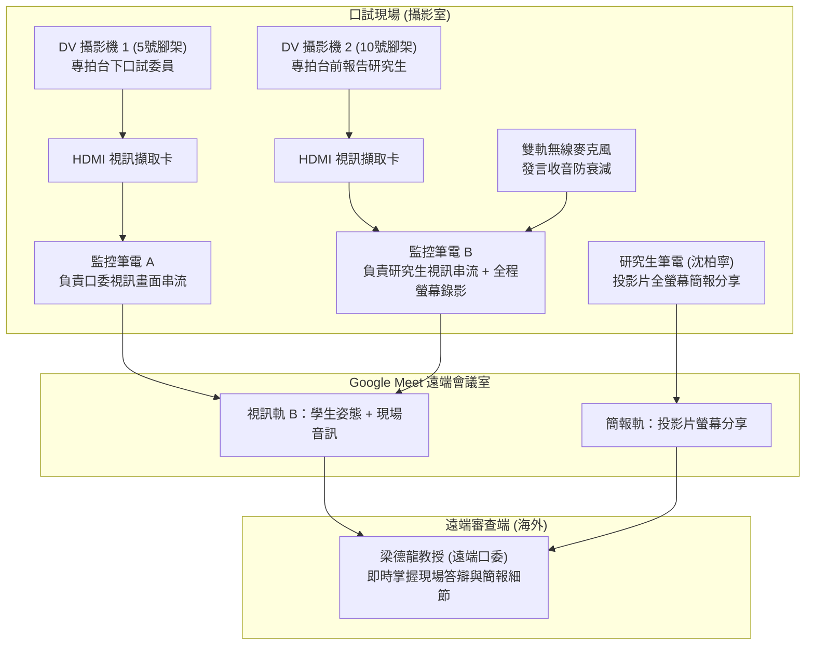

# 🎥 DRAVILaMA 碩士學位口試前夕視聽設備與雙軌連線架設實務

> **會議場次**：沈柏寧碩士學位論文口試（會前設備架設與視訊連線預演）  
> **協調人員**：研究生 沈柏寧、實驗室學弟、鄭博學長  
> **架設場地**：攝影室（口試正式借用時段：12:00 ~ 14:00）  
> **混合架構**：實體口試委員（現場 3 位）+ 國外口試委員（梁德龍教授，Google Meet 線上同步審查）  
> **完整逐字**：詳見 [完整原話逐字稿](20260713-01-DRAVILaMA口試前夕視聽設備與雙軌連線架設.full.md)

---

## 🛰️ 混合式學位口試雙軌視訊與收音拓撲

---

## 📋 關鍵設備器材與借用清單

| 器材項目 | 規格與編號 | 用途與配置位置 | 關鍵注意事項 |
| :--- | :--- | :--- | :--- |
| **攝影機腳架** | 五號腳架、十號腳架 | 分別架設於口委席前方與演講台側前方 | 鎖定雲台轉接座，確保俯仰角度穩定 |
| **高畫質 DV 攝影機** | DV 攝影機 2 部 | 軌道 A（口委全景）、軌道 B（學生特寫） | 電池充飽可錄 2 小時，現場強制插接電源線備援 |
| **視訊擷取卡** | HDMI 轉 USB 視訊擷取器 | 連接 DV HDMI 輸出至會議筆電 | 須預先測試驅動，確保 Google Meet 正確識別為攝影機輸入 |
| **無線麥克風模組** | 2 支無線 Mic ＋ 發射器/接收器 | 研究生演講席與口委答辯席收音 | 避免筆電內建麥克風距離過遠造成音質衰減與雜音 |
| **訊號與電源線材** | HDMI 延伸線、USB 延伸線、延長線 | 跨場地走線與插座電源配置 | 線材沿牆角固定，避免口試人員走動踢落斷訊 |

---

## ⚙️ 核心流程與現場配置細節

### 1. 場地確認與動線排定
* 原考量二二三影片室與攝影室，經確認英明教授指示借用攝影室進行。
* 正式口試時間為 12:00 至 14:00，團隊約定 11:00 提前一小時進場完成設備通電與視訊校正。

### 2. 雙重保險與全程錄影備援
* **供電保險**：雖然 DV 原廠電池充飽後可支撐 2 小時連續錄製，但為防止口試超時或突發斷電，現場一律連接市電電源線。
* **行政錄影存檔**：依教務處與研究所口試規範，全程由後方監控筆電啟用螢幕錄影（Screen Recording），完整保存簡報畫面、口委提問與學生答辯音訊。

### 3. 試音與論文題目預演
* 鄭博學長協助測試無線麥克風靈敏度與收音清晰度。
* 試講開場測試題：「各位評委好，我們是第七組。接下來報告的是：各基程式混淆，透過對比學習結合 GNN 來進行反混淆技術……」，確認麥克風無爆音與斷頻現象。
