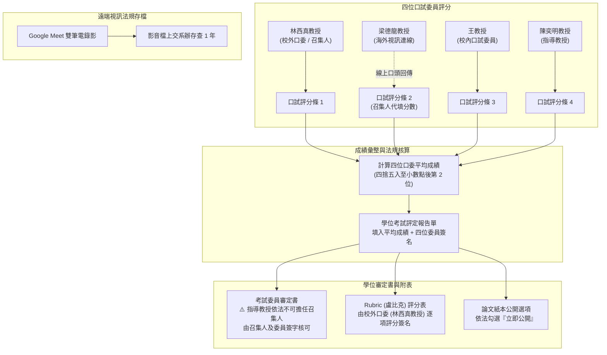

# 📑 DRAVILaMA 碩士學位口試行政表單、法規審查與評分點交指南

> **會議場次**：沈柏寧碩士學位口試（行政審查規範與表單點交）  
> **協調人員**：行政助教、實驗室學弟  
> **受審研究生**：沈柏寧（碩士候選人）  
> **口試委員組成**：林西真教授（校外口委兼召集人）、梁德龍教授（海外遠端口委）、王教授（校內口委）、陳奕明教授（指導教授）  
> **完整逐字**：詳見 [完整原話逐字稿](20260713-02-DRAVILaMA口試行政評分表單與審查規範點交.full.md)

---

## 🏛️ 口試行政表單審查與評分計算流程

---

## 📊 核心行政表單功能與填寫規範

| 表單名稱 | 簽署 / 填寫人 | 關鍵作業規範與法定要求 |
| :--- | :--- | :--- |
| **口試名牌與桌位** | 行政/實驗室學弟 | 現場 3 位口委名牌端正立於評審席桌上。 |
| **口試評分條 (4 份)** | 各口試委員一人一份 | 現場口委親簽評分；海外視訊委員（梁德龍教授）分數依規定**由召集人（林西真教授）代填**。 |
| **學位考試評定報告單** | 全體四位口委簽名 | 彙整 4 位委員分數，計算平均成績並**四捨五入至小數點後第二位**；四位老師皆須在 9 格欄位內簽名完成。 |
| **考試委員審定書** | 召集人與全體委員 | **指導教授依法嚴格不可擔任召集人**！召集人由校外委員（林西真教授）或校內委員（王教授）擔任並簽章。 |
| **論文紙本公開選項** | 研究生確認勾選 | 依法規標準統一勾選**「立即公開」**（延後公開審查門檻極嚴，除專利機密外一般不適用）。 |
| **Rubric 評分表** | 校外口委 (林西真教授) | 專門交由校外口試委員填寫，各指標欄位皆須完整評分，並於右下角親筆簽名。 |
| **優秀論文評語表** | 口委評分達 90 分以上時 | 僅在平均達 90 分以上時填寫 100 字以上評語以表揚優秀論文（學術慣例給分上限多為 89 分，若未達則空白繳回）。 |
| **出席領款清冊** | 系辦留存免繳回 | 因委員均為校內或專任合作教師，基本資料已留存，現場無須另行回收收據。 |

---

## 📹 遠端視訊口試存檔法定要件

1. **法規要求**：依教育部與學校學位考試規章，凡採取視訊混合形式之學位口試，**必須全程錄音錄影存證，並將原始影音檔繳交系辦永久/保留一年存查**。
2. **雙機錄影備援策略**：
   * 主要錄影：使用 Google Meet 內建錄影功能，串流至雲端與本機。
   * 備援錄影：現場監控筆電同步開啟本機螢幕錄影（Screen Recorder），防止遠端網路中斷導致影音中途截斷。
