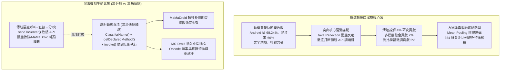

# 🎓 DRAVILaMA 口試全真預演與指導教授逐頁指導精華

> **會議場次**：沈柏寧碩士學位論文口試（會前全真彩排與投影片逐頁精修）  
> **指導教授**：陳奕明博士  
> **報告研究生**：沈柏寧（資安所碩士候選人）  
> **核心主題**：動機簡報精簡心法、Java Reflection 反射動態混淆機制剖析（三分球 vs 三角傳球）、4% 效能貢獻拆解（多模態 2% ＋ 對比學習 2%）、BHS 行為子圖與 CodeLlama 對比學習、消融實驗答辯防禦  
> **完整逐字**：詳見 [完整原話逐字稿](./20260713-03-DRAVILaMA口試全真預演與指導教授逐頁指導.full.md)

---

## 🎯 簡報論述重構與口試答辯攻防架構

---

## 🔬 指導教授逐頁關鍵指導與論述修正

### 1. 動機與背景投影片之收斂（P.1 ~ P.10）
* **精簡原則**：口試委員對 Android 資安背景與市場佔比已非常熟悉，**背景介紹務必在 2～3 分鐘內俐落交代**。
* **圖文指引與數據交付**：
  * 指著柱狀圖時，必須先清楚定義**橫軸（混淆技術分類：不動 Bytecode 之加殼重打包 vs 改動 Bytecode 之 Reflection）**與**縱軸（偵測準確率，乾淨約 90%，混淆後普遍暴跌）**。
  * 投影片上的文字與數據是給口委看的佐證，演講者應將目光望向委員與投影幕，以自信口吻串聯前後脈絡，切忌低頭自顧自讀稿。

### 2. Java 反射混淆機制之「三分球 vs 三角傳球」生動論述
* **核心比喻**：
  * **未混淆（直傳三分球）**：惡意程式直接呼叫敏感 API（如 `sendToServer`），防禦工具（MaMaDroid）能精準在控制流中抓出敏感呼叫並阻斷。
  * **反射混淆（三角傳球繞過）**：攻擊者不再直球對決，而是透過 `Class.forName()` 建立物件、以 `getDeclaredMethod()` 取得方法參照，最後藉由 `invoke()` 動態觸發。
* **對現有防禦架構之毀滅性打擊**：
  * **MaMaDroid（API 調用轉移圖）**：原始 API 轉移鏈被徹底打斷，轉移機率矩陣完全失真，防禦徹底被「閃過攔截」。
  * **MS-Droid（基於 GNN 之行為子圖）**：反射呼叫引入了大量額外物件操作指令，導致節點的 Opcode 頻率、權限關聯等特徵向量發生嚴重偏移。

### 3. 研究貢獻拆解：4% 提升的因果邏輯定位
* 指導教授特別糾正研究貢獻的寫作邏輯，不可將綜合數據含糊帶過：
  * **總提升幅度**：在嚴苛混淆情境下，DRAVILaMA 相比基準模型取得 **約 4% 的 F1-Score 綜合提升**（從 88% 躍升至 92.7%~97.9%）。
  * **因果因素拆分**：
    1. **多模態特徵融合貢獻 2%**：結合 GIN 的區域圖結構拓撲與 LLM 的全域原始碼語意嵌入。
    2. **CodeLlama 對比學習貢獻 2%**：透過 NT-Xent Loss 微調，強制拉近混淆前後同源 APK 的空間距離（歐幾里得距離縮小 46.3%）。

---

## 🛠️ 架構實作與消融實驗之答辯準備

| 模組與設計 | 實作規格與參數 | 指導教授審查叮嚀與應對對策 |
| :--- | :--- | :--- |
| **行為子圖 (BHS) 擷取** | 參考 PScout 與 Axplorer 表，以敏感 API 為中心展開 $k=2$ 層 | 投影片上務必將 **BHS** 粗體強調，並清楚交代為何展開 2 層為兼顧局部上下文與雜訊的最佳折衷。 |
| **CodeLlama 語意嵌入** | 提取最後一層 Hidden State，經 Mean Pooling 聚合 | 準備備用投影片說明為何取最後一層 Hidden State，以及如何從 Token 級聚合至 BHS 級再到 APK 級。 |
| **Pooling 策略對比** | Mean Pooling vs Attention Pooling | 清楚回答委員：Attention Pooling 會被表層未混淆的無害 UI 代碼帶偏，導致 Recall 驟降至 79%；Mean Pooling 無偏且最抗干擾。 |
| **特徵維度拼接** | GIN (128D) ＋ CodeLlama (256D) = 384D | 強調 2:1 的黃金平衡比，避免 LLM 原生 4096 維全面稀釋 GIN 圖結構資訊。 |
| **未知混淆工具泛化** | 面對 AML 工具（隨機 Wrapper 混淆） | MS-Droid 因節點圖結構被 Wrapper 破壞導致 Recall 崩跌至 0.19%，DRAVILaMA 靠語意脈絡維持優勢。 |

---

## 💡 指導教授口試臨場總評
1. **整體評語**：預演表現較前一日大幅躍進，邏輯鏈條已具備完整說服力。
2. **答辯防守核心**：口委質疑時「切莫慌張與自言自語」，一切回歸**實驗數據、因果分析與圖表數據對應**，展現扎實的研究深度。
