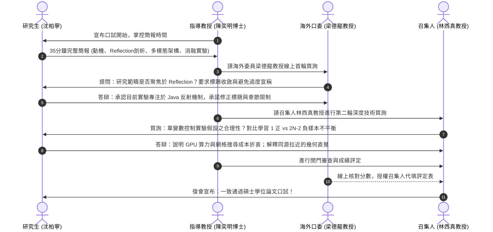

# 🎓 DRAVILaMA 正式碩士學位口試答辯與委員質詢攻防精華

> **會議場次**：沈柏寧碩士學位論文口試審查會（正式答辯與委員審查質詢）  
> **受審研究生**：沈柏寧（碩士候選人）  
> **指導教授**：陳奕明博士  
> **口試委員會**：林西真教授（校外口委兼召集人）、梁德龍教授（海外線上連線審查）、郭主任  
> **審查結果**：**全體委員一致評定通過碩士學位口試**  
> **完整逐字**：詳見 [完整原話逐字稿](./20260714-01-DRAVILaMA正式學位論文口試與口委質詢攻防.full.md)

---

## 🏛️ 口試答辯程序與委員審查時序

---

## ⚔️ 口試委員核心質詢與答辯精華

### 1. 梁德龍教授質詢：研究範圍收斂與避免過度宣稱（Overclaiming）
* **委員質疑**：
  > 「審查意見肯定這是一篇高品質的碩士論文。但你的實驗全部專注在 Java Reflection（反射混淆）。混淆技術百百種，Reflection 只是其中一種。如果你論文宣稱 DRAVILaMA 能解決所有混淆，那你必須提出能對付其他所有混淆的證據；若沒有，論文 Title 與研究限制必須收斂，明確寫出『以 Java Reflection 混淆為例』，不要造成讀者誤解。」
* **研究生答辯與修正**：
  * 沈柏寧同意委員意見，承認本篇論文核心解決的是最棘手、直接打斷控制流的反射機制。
  * **修正承諾**：修改論文題目副標與研究限制章節，明確框定實驗範疇為 Java Reflection 混淆抗性，避免過度宣稱泛化能力。

### 2. 林西真召集人質詢一：單一變數控制（One-at-a-time）之實驗假設
* **委員質疑**：
  > 「系統架構圖中包含了多個維度與變數（Pooling 方式、LLM 嵌入維度、GIN 圖層數等）。你在做實驗時，皆假設其他變數固定不變，僅改變單一變數。但這是一個高維複雜系統，各變數之間可能存在耦合效應。為什麼不做全面的網格包裹式（Full-factorial）交叉實驗？」
* **研究生答辯**：
  * **算力與時間成本限制**：CodeLlama 7B 模型即使使用 LoRA 微調，單次訓練與特徵提取仍極為耗時，全面網格搜尋在有限硬體資源下開銷無法負荷。
  * **委員指示**：研究生在論文中必須明確寫出「基於運算資源限制之探索假設」，交代序列式單變數調整的工程考量，使論文論述更具學術說服力。

### 3. 林西真召集人質詢二：對比學習正負樣本極度不平衡（1 vs $2N-2$）
* **委員質疑**：
  > 「在 Batch 內有 $2N$ 個樣本，對特定 APK 而言，正樣本只有混淆後同源的 1 個，其餘 $2N-2$ 個全部被當作負樣本。這種一對多的極端不對等，是否會對模型特徵空間造成過度排斥？為什麼不引入監督式對比學習（如將同家族惡意程式納入正樣本）？」
* **答辯與討論**：
  * 沈柏寧說明初期設計是為了最純粹地迫使模型「無視混淆干擾、專注同源對齊」。
  * 林老師點出這是極具價值的學術切入點，建議將「家族層級軟正樣本擴展」列為未來研究（Future Work）第一要務。

---

## 📝 口試通過決議與現場行政程序

1. **成績評定**：四位口試委員對沈柏寧之研究深度給予高度評價，梁德龍教授線上確認分數，召集人林西真教授完成成績登錄與代簽。
2. **宣布通過與視訊合影**：沈同學返回試場，全體委員共同宣布通過碩士學位口試，並與投影幕上的海外委員梁教授完成歷史性合影。
