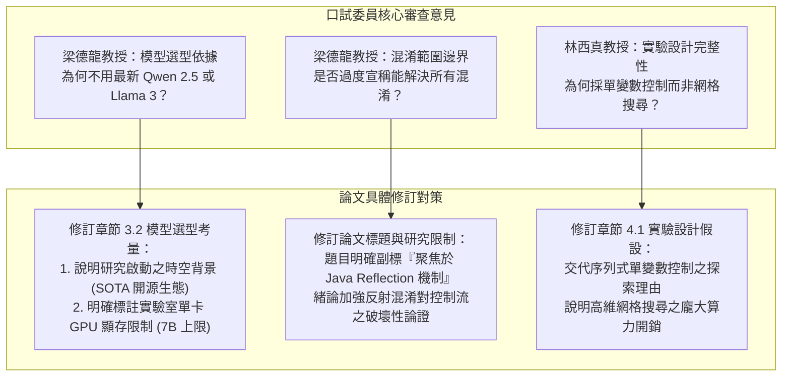
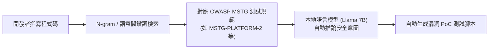

# 📝 DRAVILaMA 口試通過閉門覆盤與論文修訂指示精華

> **會議場次**：沈柏寧碩士學位論文口試（會後閉門覆盤與論文修訂工作會議）  
> **指導教授**：陳奕明博士  
> **與會成員**：研究生 沈柏寧、實驗室學妹 又萍  
> **覆盤主軸**：口試委員審查意見逐項回應清單、CodeLlama 7B 語言模型選型依據、Java Reflection 範圍收斂、警察與法官分工比喻、實驗室研究傳承（OWASP MSTG 漏洞意圖檢測）  
> **完整逐字**：詳見 [完整原話逐字稿](20260714-02-DRAVILaMA口試通過閉門覆盤與論文修訂指示.full.md)

---

## 🛠️ 口試審查意見修改行動計畫

---

## 🔍 審查核心議題深度解析與修訂方向

### 1. 為什麼選擇 CodeLlama 7B 而非 Qwen 2.5 Coder 或 Llama 3？
* **陳奕明教授指導要點**：
  1. **研究時空背景（Temporal Validity）**：本項學位研究啟動於一年多前，當時 CodeLlama 7B 是開源軟體工程與程式碼理解領域最具公信力與完整文獻支撐之基準模型。
  2. **硬體設備與顯存限制（Hardware Constraints）**：實驗室本地運算資源有限，7B 參數量為單卡進行 LoRA 微調與全量程式碼批次 Embedding 推論之最佳平衡點；過大模型（如 70B）在現實部署上不具備即時邊緣端與輕量防護可行性。
  3. **研究可重複性與社群生態**：CodeLlama 具備成熟的 HuggingFace 與 Transformers 生態，易於跨平台部署與同儕驗證。

### 2. 論文範疇聚焦：Java Reflection 反射機制收斂
* **問題根源**：緒論（Introduction）開頭大量引用廣義混淆普遍性（66% 佔比），但未及時點出 Reflection 才是打斷靜態呼叫圖的「致命元兇」，導致委員產生預期落差。
* **修訂落實**：
  * 修改論文副標題，精確界定為抗反射混淆研究。
  * 緒論重寫：以「惡意程式廣泛採用動態反射破壞靜態控制流」為主軸，明確區隔加殼（Repackaging）與動態反射（Reflection），說明為何攻克 Reflection 即具備重大技術突破。

### 3. 「警察與法官」的比喻：對比學習特徵提取 vs 下游分類器判決
* **深層學術辯證**：
  * **對比學習（警察職責）**：負責提供真實、無偏、不受偽裝欺騙的證據線索。藉由 NT-Xent Loss 將混淆前後同源 APK 在 Embedding 空間中緊密拉近，讓混淆的外衣「現出原形」。
  * **分類器（法官職責）**：根據警察提供的線索，綜合判定是良性還是惡意。
* **結論**：對比學習並非直接做善惡二元分類，而是為下游 MLP 分類器掃除特徵迷霧。若無足夠穩定的特徵線索，法官根本無從判決。

---

## 👩‍💻 實驗室研究傳承與交接：OWASP MSTG 漏洞意圖檢測

* **學妹（又萍）成果展示**：
  * 開發結合 OWASP MSTG 與 MASVS 行動資安檢測規範之檢索原型。
  * 藉由輸入程式碼片段，自動定位所屬之平台資安漏洞分類（如區塊鏈儲存、憑證暴露）。
* **指導教授與沈柏寧學長建議**：
  * 核心價值在於「從意圖推論自動生成可執行的安全測試腳本（PoC）」。
  * 建議善用本地 Llama 7B 語言模型進行推理，將沈同學累積的微調與推論管線完整傳承。
