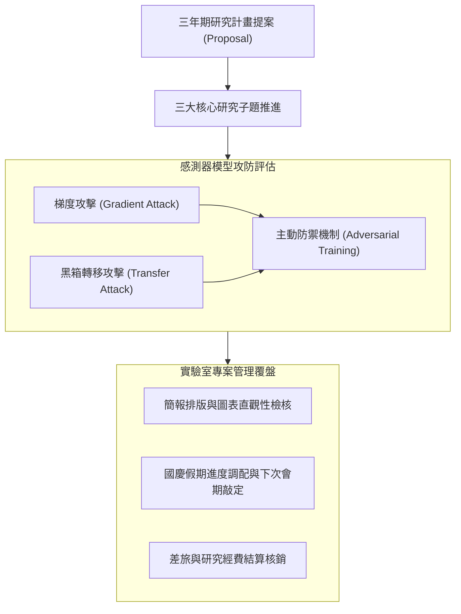

# 📋 實驗室跨組別研究進度彙報與多專案時程覆盤 — 執行摘要

- **活動場次**：網路與系統實驗室 全體定期進度彙報大會
- **錄音日期**：2026-10-08
- **發言講者**：指導教授 / 各組報告代表 / 實驗室全體成員
- **對應完整逐字稿**：[`20261008-跨組別研究進度彙報與多專案時程覆盤.full.md`](./20261008-跨組別研究進度彙報與多專案時程覆盤.full.md)

---

## 📌 核心議題與會議提要

本場大會由指導教授親自主持，全面覆盤實驗室各研究小組（包含 PNS 計畫組、資安模型攻防組與各專案小組）的年度進度與時程規劃。會議開場包含正式英文全三年研究構想提案（Three-Year Proposal Plan）之彩排與簡報，隨後逐組檢驗模型攻防實驗數據、投影片排版及多專案資源配置。

會中針對梯度攻擊（Gradient-based Attack）、黑箱轉移攻擊（Transfer Attack）以及模仿學習（Mimicry Attack）在智慧型手機感測器行為防禦中的效能差異展開了深入技術論證。

---

## 🏛️ 模型攻防評估與專案管理覆盤架構

---

## 🔑 關鍵重點整理 (Key Takeaways)

### 1. 三年計畫 Proposal 架構確認
- 全英文報告開場，確立未來三年研究主軸，涵蓋感測器隱私防護、資訊隱藏（Information Hiding）與金鑰交換機制的整合。

### 2. 攻防實證發現：梯度攻擊之主導性
- 初步實驗顯示梯度攻擊（Gradient-based）在白箱環境下威脅顯著高於純模仿攻擊；若要防禦梯度攻擊，必須透過轉移攻擊驗證黑箱模型魯棒性。

### 3. 實驗室行政與下次會期敲定
- 教授確認各項報帳、差旅補助等管理事項，並敲定國慶假期過後的下次正式實驗室 Meeting 日期。
