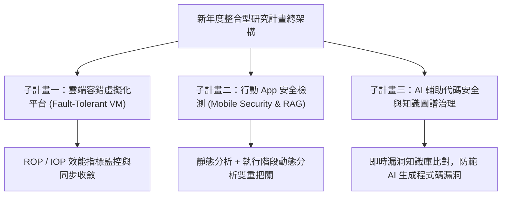

# 🛡️ 實驗室專案會議：新年度整合型產學研究計畫提案、容錯平台架構與資安模組整合

> **會議主題**：新年度整合型產學研究計畫架構討論、行動資安檢測、知識圖譜 RAG 與 VM 容錯效能指標  
> **主持人 / 指導教授**：指導教授、陳教授、全體碩博士研究團隊  
> **核心模組**：Integrated Research Project, Mobile Security, Fault-Tolerant Cloud, RAG & Knowledge Graph  
> **學習目標**：協同三大子計畫模組、統一跨系統資料格式與 VM 同步度量評估標準  
> **關聯文件**：[📄 完整原話逐字稿 (2025-10-03-整合型研究計畫與平台架構規劃-proofread.md)](./20251003-整合型研究計畫與平台架構規劃.full.md)

---

## 🏛️ 核心架構與概念流轉圖

---

## 🔑 重點提要 (Key Takeaways)

1. **整合型計畫三大核心支柱**：容錯雲端底座、行動資安防護與 AI 程式碼安全稽核。確保各子計畫研發成果能無縫介接在統一的開放平台上。
2. **AI 工具輔助開發之風險防範**：針對開發人員日漸仰賴 AI 生成程式碼的趨勢，引入知識圖譜與動態 RAG 技術，在 Unit Test 階段即時阻斷未經修補之安全漏洞。
3. **VM 效能衡量統一化**：利用 IOP/ROP 度量指標量化虛擬機器的資源活躍度與同步延遲，確保容錯切換（Fault Tolerance）時業務不中斷。

---

## 📊 各子計畫模組架構、技術瓶頸與跨組介接矩陣

| 子計畫組別 | 核心技術與工具鏈 | 現存挑戰與研究瓶頸 | 指導教授／共同主持裁示與修正決策 |
| :--- | :--- | :--- | :--- |
| **總計畫（開放容錯平台）** | 智慧型手機行為監控、使用者真實性連續認證、安全 App 沙箱執行環境 | 傳統單點防禦無法同時兼顧端點身分認證與應用程式內嵌弱點 | 將「使用者行為連續認證」與「App/Server 漏洞檢測」串聯為四階段整合防線 |
| **行動安全與程式碼檢測組** | 靜態分析工具（MSS）、知識圖譜（Entity-Relation）、動態 RAG 與 CodeLlama（無微調原生推理） | 若僅將文獻拼湊並交由 LLM 判斷，將被國科會審查委員質疑「缺乏學術挑戰性」 | 強調每月新增數百個惡意樣本下之**動態知識庫即時更新（Dynamic RAG Revision）**，取代專家手動撰寫規則 |
| **前後端複合式漏洞組** | 單元測試（Unit Test）、客戶端與伺服器端雙向狀態機（State Machine）檢查 | 許多邏輯漏洞並非單純存在於 App 或 Server，而是跨端點互動時狀態不同步所致 | 區分「第一階段單端靜態弱點」與「第二階段 App 啟動後跨 Server API 狀態聯動漏洞」 |
| **虛擬化平台與容錯子計畫** | VM 忙碌度指標（ROP / IOP）、Dirty Read 抑制、i7-670 舊世代與新世代 CPU 補償函式 | Epoch 週期過長導致後端回應延遲、Dirty Read 惡化；週期過短則引發頻繁中斷 | 導入補償函式動態調節 Delay Percentage，在 i7-670 環境成功將傳輸時間自 253 秒大幅壓降，並於 12 月前定稿申請 |

---

## 🎓 指導教授與共同主持人（陳教授／王教授）關鍵決策與行動項目

1. **凸顯 LLM 研究的不可替代性與技術深度**：計畫主持人嚴格提醒，國科會計畫書切忌寫成「把資料丟給 LLM 就解決問題」的工程報告，必須明確界定**不微調（Training-free）前提下如何透過知識圖譜實體關係（Entity-Relation）與動態 RAG 克服幻覺與定位不完美（Imperfect Localization）**。
2. **排除純單機（Standalone）App 樣本**：針對行動安全資料集收集，要求團隊過濾掉無後端連線之單機小工具（如計算機、手電筒），聚焦於具備完整前後端 API 狀態交互之真實商業與校園應用程式。
3. **跨模組一二三四階段閉環驗證**：確立第一、二模組負責環境建構與弱點探測，第三模組執行模擬攻擊，第四模組驗證修補與防禦成效，各組需於 12 月計畫書送出前統一實驗數據與介面格式。

