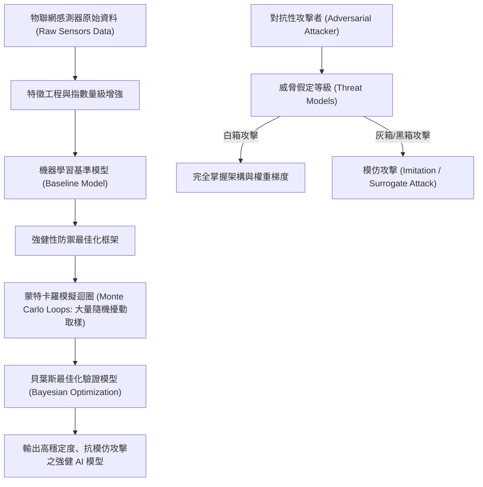

# 🛡️ 實驗室專案會議：對抗性模仿學習（AdMIL）與感測器模型黑白箱防禦

> **研討主題**：對抗性模仿學習（AdMIL）架構、物聯網感測器模型與黑箱／白箱威脅防禦  
> **主講與對談**：國際研究學員、指導教授、王教授、楊威教授  
> **所屬場合**：實驗室專案進度與學術研討會  
> **關聯文件**：[📄 完整原話逐字稿 (20260226-01-對抗性模仿學習與感測器模型防禦.full.md)](./20260226-01-對抗性模仿學習與感測器模型防禦.full.md)

---

## 🏛️ 核心架構與概念流轉圖

---

## 🔑 重點提要 (Key Takeaways)

1. **不能盲目依賴黑箱防禦假設**：現實攻防中，攻擊者可藉由查詢輸出訓練代理模型（Surrogate Model）實施高效的遷移性模仿攻擊，模型必須在數學架構上具備內生抗性。
2. **蒙特卡羅與貝葉斯聯手**：透過 Monte Carlo 迴圈生成海量擾動樣本，搭配貝葉斯機率架構動態調整模型超參數，能在有限算力下找到抵禦攻擊之全局最優防護解。
3. **多位教授指導要點**：強調實驗設計必須明確定義威脅模型假設邊界，防止因過度簡化黑箱條件而高估模型之實際強健性。

---

## 📊 威脅模型分級（Black-box / Gray-box / White-box）與感測器可觀測性對比

| 威脅等級與攻擊模式 | 攻擊者知識與觀測能力假設 | 物理感測器特徵暴露風險 | AdMIL 防禦機制與實驗表現（EER 指標） |
| :--- | :--- | :--- | :--- |
| **Black-box（Zero-effort Attack）** | 完全未觀測受害者操作手機行為，僅以自身習慣或隨機數據嘗試解鎖（王教授界定之零努力攻擊） | 攻擊者不具備受害者之螢幕觸控（Touch）或姿態旋轉（Orientation）分佈 | Baseline 模型與本方法皆可維持極低錯誤接受率 |
| **Gray-box（Mimicry / 窺視模仿攻擊）** | 攻擊者可肉眼觀察受害者握持姿勢與旋轉角度（Pitch / Roll），並隨機挑選易觀察特徵進行替換生成 | **Orientation（旋轉角度）極易被肉眼觀察模仿**；相對地，微細觸控壓力與滑動加速度較難被外部窺視複製 | Baseline 模型在遭受攻擊時 EER 飆升至近 **30%**；導入本團隊特徵增強與難模仿特徵加權後，較 SOTA 提升 **13%** |
| **White-box（Surrogate / 內部梯度攻擊）** | 掌握模型架構或透過大量查詢訓練代理模型（Surrogate Model），計算餘弦相似度（Cosine Similarity $\to 1$）逼近決策邊界 | 針對模型高權重特徵進行精準合成擾動，將正樣本邊界向負樣本推移 | 結合深度學習引導特徵選擇（Deep Learning Guided Feature Selection）與對抗樣本共同訓練，壓制遷移攻擊成功率 |

---

## 🎓 三位教授（指導教授、王教授、楊威教授）聯合質詢與修訂指示

1. **釐清 Black-box 與 Zero-effort Attack 之嚴格定義（王教授 & 指導教授）**：
   - 學員原先口頭回答將 Black-box 視為「弱模仿能力」，王教授與指導教授當場糾正：在行為生物辨識領域，標準 Black-box 應對應 **Zero-effort Attack（完全未看過受害者操作）**，而有窺視行為即屬 Mimicry / Gray-box 範疇，口試答辯時絕對不可混淆定義。
2. **補齊「生成對抗資料強化 Baseline 模型」之消融實驗（指導教授）**：
   - 指導教授指出，學員利用 Anchor 錨點與合成演算法產出之模仿攻擊負樣本（Data Augmentation），除了用於訓練自身的新模型外，**必須同步拿去訓練 Baseline 模型並比較 EER 改善幅度**，才能證明貢獻究竟來自「合成資料品質」抑或「網路架構創新」。
3. **強化物理直覺解釋與簡報精簡度（楊威教授）**：
   - 要求在簡報開場直接以真實智慧型手機為例，直觀說明為何 Pitch/Roll 屬於可觀測特徵（Observable Features），並移除投影片上冗長的完整英文句子，改以結構化圖表呈現五組箱形圖（Boxplot）之受害者樣本數差異。

