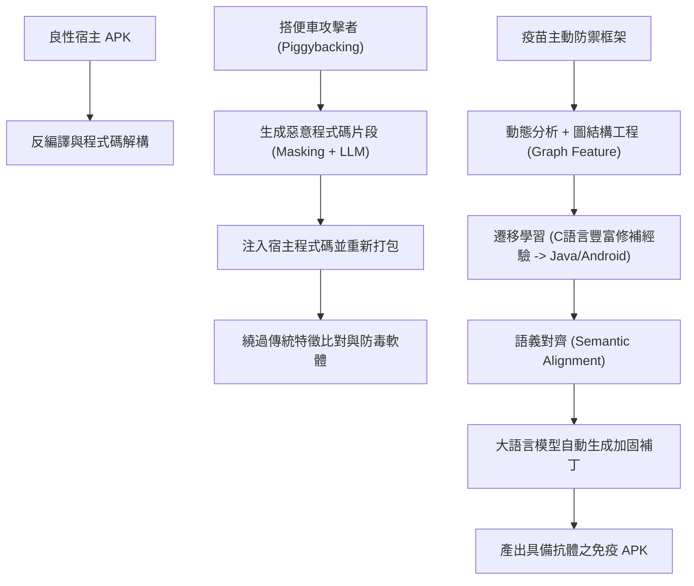

# 🛡️ 實驗室專案會議：APK搭便車攻擊防禦、免疫疫苗機制與程式碼自動修補

> **研討主題**：Android APK 搭便車攻擊（Piggybacking）、疫苗防禦機制、遷移學習程式碼自動修補與紅藍隊演練  
> **主講與對談**：S組專案報告研究生、指導教授、楊威教授、王教授  
> **所屬場合**：實驗室專案進度與學術研討會  
> **關聯文件**：[📄 完整原話逐字稿 (20260226-02-APK免疫疫苗與程式碼自動修補.full.md)](./20260226-02-APK免疫疫苗與程式碼自動修補.full.md)

---

## 🏛️ 核心架構與概念流轉圖

---

## 🔑 重點提要 (Key Takeaways)

1. **Piggybacking 攻擊的本質與破口**：攻擊者解開良性 APK 後僅注入少數惡意程式行並重新簽名，傳統靜態偵測與 Hash 驗證在特定分發場景下容易失效。
2. **疫苗與程式碼自動修補創新**：結合圖神經結構工程提取跨家族惡意特徵，並運用遷移學習將 C/C++ 巨量漏洞修復經驗遷移至 Android Java 生態，自動補強 APK 防禦圍牆。
3. **指導教授核心評語與修正方向**：
   - **問題定義收斂**：楊威老師與王老師指出，報告必須精確定義「為何傳統 Hash Code 或基礎防火牆無法防禦 Piggybacking」，釐清技術假設與限制條件。
   - **避免概念發散**：避免同時堆疊過多龐大術語，應將核心故事線聚焦於「語言模型語義對齊與自動程式碼補強」的實質可行性。

---

## 📊 APK 搭便車攻擊（Piggybacking）防禦與跨語言自動修補技術拆解

| 模組階段 | 採行技術與過往文獻基準 | 現有方法缺陷（Gap） | S 組新計畫提案之改良設計 |
| :--- | :--- | :--- | :--- |
| **惡意片段定位（Fault / Malicious Localization）** | 延續實驗室前期計畫之 **DRAVILaMA** 敏感 API 行為子圖與多模態檢測模型 | 傳統方法僅停留於二元分類（判定 APK 是否為惡意），無法精準指出惡意邏輯注入之具體區塊 | 從已確認之被感染 APK 中逆向剝離出純粹的惡意重打包程式碼片段（Malicious Payload Snippet） |
| **跨語言漏洞修補知識遷移** | 參考 2010 年代既有 PDAP 漏洞資料集與 C/C++ 自動化程式修補（APR）模型 | Android Java 領域缺乏大規模配對之「漏洞 vs. 修補後」真實資料集；直接跨語言套用會產生嚴重語意斷裂 | 引入**跨語言遷移學習（Transfer Learning）與語意對齊（Semantic Alignment）**，將 C 語言成熟修補模式映射至 Android Java/Smali 層級 |
| **多層次 APK 免疫疫苗（Vaccination）** | 靜態雜湊校驗（Hash Verification）或傳統藍隊邊界封鎖 | 楊威教授質疑：若攻擊者已能反編譯 APK 並任意增刪程式碼，單純注入防禦碼極易被一併拔除 | 重新收斂「免疫疫苗」定義：聚焦於開發端與發佈前之**脆弱呼叫點主動加固與權限邏輯自檢**，提高攻擊者重打包與繞過之成本 |

---

## 🎓 指導教授與審查教授群（楊威教授、王教授）攻防質詢紀要

1. **「擁有原始碼控制權的攻擊者為何拆不掉疫苗？」之核心拷問（楊威教授）**：
   - 楊威教授一針見血指出：Piggybacking 攻擊者既然能將良性 APK 解包（Decompile）、插入惡意呼叫並重新打包簽名，代表其具備完整程式碼修改能力；若所謂「疫苗」只是在 APK 內加一段檢查碼，攻擊者大可將該檢查一併刪除。要求團隊必須釐清疫苗作用的信任邊界（如結合伺服器端驗證或混淆保護）。
2. **紅藍隊防禦目標與傳統防火牆之差異界定（指導教授）**：
   - 指導教授提醒，報告開頭必須先回答「為何傳統防禦方法擋不住 Piggybacking？」，明確區分網路層封鎖與應用程式內生邏輯修補的差異，讓跨領域評審在三分鐘內聽懂研究價值。

