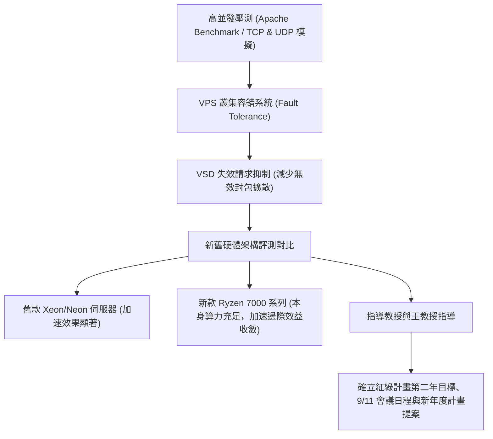

# 🛡️ 實驗室專案會議：跨校整合型計畫（容錯VPS評測、新舊伺服器效能驗證與年度日程）

> **研討主題**：整合型計畫高並發評測（High Concurrency）、VPS 容錯切換、新舊硬體架構加速驗證與年度日程規劃  
> **主講與對談**：發表研究生、計畫主持人／指導教授、王教授  
> **所屬場合**：跨校整合型計畫進度研討會  
> **關聯文件**：[📄 完整原話逐字稿 (20260430-整合型計畫-容錯系統VPS評測與進度研討.full.md)](./20260430-整合型計畫-容錯系統VPS評測與進度研討.full.md)

---

## 🏛️ 核心架構與概念流轉圖

---

## 🔑 重點提要 (Key Takeaways)

1. **高並發環境下的 VPS 容錯**：以 Apache Benchmark 模擬海量並發請求，結合 VSD 機制主動攔截與丟棄已過期或失效的請求，防止容錯切換時引發雪崩效應。
2. **硬體架構對優化演算法之敏感度**：
   - 整合錦城與凱捷的方法進行驗證：在 2015 舊款 Xeon 伺服器上具備顯著加速提升。
   - 在新架構（AMD Ryzen 7000 系列）上，因原生 CPU 運算與記憶體吞吐大幅強化，優化演算法帶來的相對邊際提升趨緩。
3. **整合型計畫年度日程推進**：確認「紅綠計畫第二年」進度匯報節點、9/11 跨校研討日程，以及年底前新年度計畫書架構之預備工作。

---

## 📊 新舊世代伺服器硬體規格與容錯記憶體同步（Dirtying / Auto-pair）評測對照

| 評估維度 | 舊世代測試平台（2015 Xeon / Intel i7-670） | 新世代測試平台（4 vCPU / 8GB RAM 新架構處理器） | 跨硬體架構實證結論與物理成因 |
| :--- | :--- | :--- | :--- |
| **硬體資源與原生吞吐限制** | 早期 CPU 缺乏硬體級加速指令支援，記憶體複製與網路 I/O 易成為系統瓶頸 | 原生多核頻率與記憶體頻寬大幅提升，基礎運算延遲極低 | 硬體世代差距直接影響軟體層最佳化演算法之邊際效益顯著性 |
| **Dirtying 與 VSC 加速機制表現** | 在高 CPU 負載與高開發壓力情境下，結合錦城之 Dirtying 演算法可顯著縮短記憶體同步時間 | 在一般負載下與原版 ACM 差異縮小，需在極高壓力測試（High Stress）下才顯現優勢 | 證明錦城與王碩之 Auto-pair 工作負載預測方法在資源受限或高負載環境更具關鍵價值 |
| **跨校整合型計畫子組分工** | A 組聚焦於三種容錯情境定義與歸納式（Inductive）實驗驗證 | B 組採用 Overview 架構統一表達報告目的、實驗結果與口頭講稿修訂 | 確立每周四中午固定例會與 9 月 11 日跨校聯合進度審查時程 |

