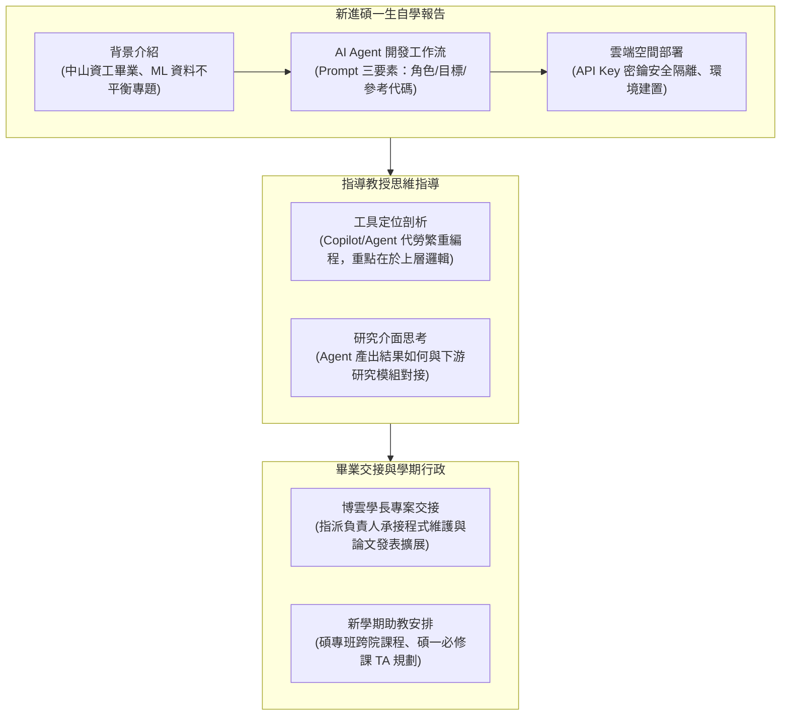

# 🔬 實驗室暑期例會：新進碩一生 AI 代理工作流初報、畢業學長程式交接與課程助教規劃

> **會議主題**：實驗室暑期例會（新進研究生報告、系統程式碼交接與新學期助教職務分配）  
> **會議日期**：2026-07-16  
> **與會人員**：指導教授、新進碩一研究生（中山資工畢業）、博雲（即將畢業碩二學長）、實驗室全體研究生  
> **研討核心**：新進碩一學弟暑期自學成效報告（利用 AI Agent 建立對話式應用、提示詞 Prompt Engineering 結構設計、Hugging Face/AWS 雲端 API 部署與 Key 防護機制）；指導教授解析 AI 輔助開發在軟體工程研究中的邊界與價值；博雲學長畢業離校前之核心程式碼與論文實驗專案交接責任人指派；新學年碩專班與碩一核心課程教學助教（TA）排班與行政叮嚀  
> **完整逐字**：詳見 [完整原話逐字稿](./20260716-實驗室暑期例會-新進碩一生AI開發實作與研究交接.full.md)

---

## 🗺️ 實驗室暑期例會議程與工作流架構

---

## 📋 例會關鍵討論精要彙整表

| 主題向度 | 核心內容與報告要點 | 討論細節與指引 | 後續行動與責任人 |
| :--- | :--- | :--- | :--- |
| **新進研究生自學成果** | • 透過 AI 工具輔助快速產出完整對話機器人 • 提示詞工程三要素：明確角色設定、任務目標、參考程式碼 | 建立本地虛擬環境與 `app.py` 測試檔，上傳至雲端空間，透過環境變數保護 API Key 避免資安外洩。 | 建立清晰的代碼註解與規格文件，作為後續專題與研究開發基線。 |
| **指導教授對 AI 開發工具點評** | • 肯定利用 Copilot 與 Agentic 流程提升開發速度 • 強調做研究不能只停留在「跟 AI 聊天產生聊天機器人」的玩具範例 | 指出研究的關鍵在於：**如何將 AI Agent 產出的特定結構化意圖或特徵，精準對接進後續的分析流水線（Pipeline）**。 | 將 AI 協同生成之自動化代碼，深入整合至實驗室的軟體工程與漏洞挖掘專案。 |
| **博雲學長專案交接** | • 碩二博雲即將辦理畢業離校手續 • 其碩士論文開發之核心程式碼與資料集需有專人承接 | 指導教授強調「不能隨便大家都會就好」，必須明確指派一位固定研究生作為專案維護與後續論文修改之主負責人。 | 確認交接負責名單，安排專屬 Code Review 與 Git Repository 權限移轉。 |
| **新學年助教（TA）規劃** | • 配合新學期課程規劃，安排實驗室碩一、碩二 TA 名單 • 涵蓋與其他教授合開之碩士在職專班（碩專班）及碩一必修課 | 回顧歷年助教擔任經驗（如國立等學長），平衡研究生的研究進度與助教教學負擔。 | 依繫所行政時程送出正式助教名冊，並確認開學前之課堂準備。 |

---

## 💡 指導教授重要指導心法

1. **善用 AI 外包，聚焦核心研究價值（Outsource Routine, Focus on Core）**：
   * 寫程式的底層繁重細節能外包給 AI 就大膽外包，但研究生必須清楚自己要什麼。研究者的價值在於「定義問題架構」與「驗證下游結果」，而非機械性手刻每一行樣板代碼。
2. **交接必須權責到人（Accountability in Handover）**：
   * 實驗室專案如果由「全體所有人」負責，往往等於「沒有人負責」。畢業學長的資產必須建立正式交付清單與唯一責任人，確保後續擴展或論文發表時不致中斷。
