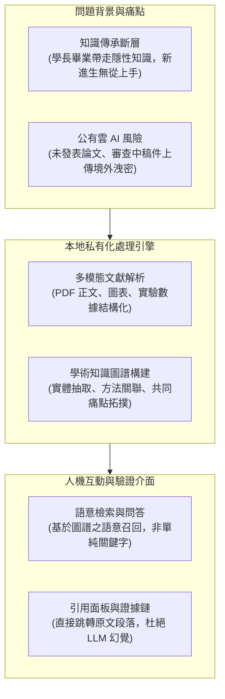

# 📚 實驗室專案會議：私有化 AI 文獻管理與知識圖譜系統架構設計（防資料外洩、文獻語意檢索與人機問答）

> **專案主題**：實驗室自研私有化 AI 文獻管理與知識圖譜系統架構設計  
> **會議日期**：2026-07-20  
> **與會人員**：指導教授、專案負責研究生、實驗室全體研究團隊  
> **系統核心**：解決實驗室畢業生知識資產隨人員流動而斷層之痛點；公有雲 LLM 工具之資安合規與機密論文外洩風險（未發表稿件、專利與實驗數據）；本地私有化部署架構；基於知識圖譜（Knowledge Graph）與多模態解析（圖表、公式提取）之深度文獻關聯；消除生成式 AI 幻覺之「證據鏈回溯與引用面板（Citation Panel）」介面設計  
> **完整逐字**：詳見 [完整原話逐字稿](./20260720-實驗室AI文獻管理與知識圖譜系統架構設計.full.md)

---

## 🗺️ 私有化 AI 文獻管理與知識圖譜系統架構

---

## 📋 系統架構與設計審查精要彙整表

| 主題向度 | 現狀限制與需求痛點 | 系統創新架構與解法 | 指導教授審查意見與改善指標 |
| :--- | :--- | :--- | :--- |
| **實驗室文獻資產流失** | • 每篇論文參考數十篇文獻，讀完即散落個人筆記 • 學長畢業後實驗思維與選題脈絡斷層，後人重新摸索 | 建立實驗室集中式文獻資料庫，自動提取研究方法、評估指標與實證結論，形成集體資產。 | 系統必須能支援跨課題比對，自動匯總散落在不同論文中的共同瓶頸。 |
| **公有雲工具洩密風險** | • 主流商業 AI 伺服器設於境外，合規與智財風險高 • 服務條款多保留「利用使用者內容改進模型」條款 | 堅持**全本地私有化部署（On-Premise）**，模型權重與向量資料庫完全運行於實驗室內網伺服器。 | 嚴格隔離未發表草稿與審查中稿件，確保零外網流量洩漏。 |
| **多模態文獻解析瓶頸** | • 傳統檢索工具僅能對齊文字，遺失關鍵圖表與數據 • 人工閱讀容易看漏核心參數與升溫/訓練條件 | 開發專用 PDF 解析管線，將圖表標題、實驗數據矩陣與核心公式結構化為可查詢節點。 | 提高特徵提取精確度，避免數值錯位導致實驗設計被誤導。 |
| **知識圖譜（KG）建構** | • 孤立的文獻節點無法呈現研究典範轉移脈絡 • 關鍵字匹配無法跨語意識別相似技術 | 構建以「研究問題—技術方案—評估基準」為邊的學術知識圖譜，支援實體關聯跳躍查詢。 | 圖譜節點密度需動態分層，避免展示數百篇文獻時介面過載崩潰。 |
| **消除幻覺之證據鏈面板** | • 生成式問答若無原文依據，易產生誤導性答案 • 研究者需要精確核對原文以確認真實性 | 設計**專用引用面板（Citation Panel）**，問答結果中的每條論點皆附帶一鍵高亮跳轉原文出處功能。 | 教授強調：介面字型與排版必須放大清晰；跳轉延遲需控制在 1 秒內。 |

---

## 💡 指導教授重要指導原則

1. **做科研必須基於真憑實據（Ground Truth Matters）**：
   * 任何 AI 產生的摘要都不能取代原始論文的權威性。系統的價值不在於「替學生讀論文」，而在於「幫學生以十倍速度精確定位關鍵實驗與數據證據鏈」。
2. **私有化是學術獨立的護城河**：
   * 核心創新在未正式發表與取得專利前，絕不可貪圖公有雲便利而冒險上傳。實驗室專屬模型與私有化環境是長期研究競爭力的基石。

## 💬 指導教授提問質詢與知識圖譜設計指引

| 設計構面 | 指導教授質詢重點與關鍵概念 | 團隊回應與架構對齊 |
| :--- | :--- | :--- |
| **品質中心直心對比與回答排程** | 指導教授解析：「我們今天用的是直心（品質中心），對比當前外部進來的論文向量；整合視覺分析模型與自動排程模型做整體回答。」 | 說明已建立品質重心對比算法，結合自動排程流水線輸出高置信度回答。 |
| **專業術語改寫 (Ramp Rate / Heating)** | 舉例說明使用者提問常包含口語化概念，系統需自動改寫為專業術語（例如將升溫速率轉換為 ramp rate 或 heating rate）。 | 知識圖譜檢索模組已整合同義詞本體，自動完成使用者提問之術語標準化擴展。 |
| **系統展演與文獻定位細節** | 指導教授要求精簡架構圖中的 hyperlink 超連結標示；系統處理 wash dock 等特定主題時之回應時間與含機率評估；PDF 雙軌頁碼（檔案頁與出版頁）同步顯示機制；核心特色三與研究驗證例子需在一開始就講清楚第一步與第二步的區分。 | 系統已實作 PDF 雙軌頁碼自動提取與高亮對齊，並依據教授指示將核心驗證例子提前至引言階段展示，條列第一步與第二步具體執行指標。 |
