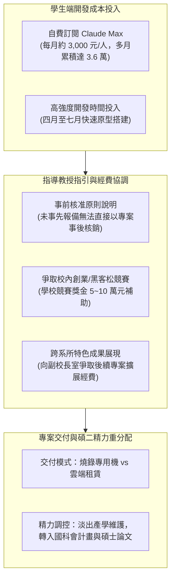

# 💼 實驗室專案會議：跨系所產學專案交付交接、AI 訂閱開發成本核銷與國科會額度調控協調

> **會議主題**：跨系所產學專案交付階段覆盤（開發成本核銷、經費來源爭取與後續精力調配）  
> **會議日期**：2026-07-23  
> **與會人員**：專案核心研究生（碩二開發團隊）、指導教授、實驗室全體成員  
> **討論核心**：研究生團隊自費訂閱進階 AI 工具（Claude Max 每月每人 3,000 元，累積代墊達數萬元）之經費核銷爭議；產學案委託方（校內中文系與副校長室特色專案）經費動支與報帳法規邊界；專案交付形式（雲端遠端服務 vs 燒錄本地專用機交付）；碩二學生進入下學期後之精力分配（由產學案轉向國科會多年期計畫與核心學位論文）；校內創新創業與黑客松競賽獎金爭取管道  
> **完整逐字**：詳見 [完整原話逐字稿](./20260723-產學合作專案成本核銷與AI開發工具補助協調.full.md)

---

## 🗺️ 專案開發成本與經費協調決策圖

---

## 📋 專案成本與行政協調核心要點表

| 討論維度 | 學生提出之現況與訴求 | 指導教授回覆與法規實務 | 解決方案與後續行動 |
| :--- | :--- | :--- | :--- |
| **AI 訂閱代墊成本** | • 團隊 3 人自費訂閱高階 Claude Max，四個月累計代墊約 3.6 萬元。 • 透過 AI 工具輔助才得以在極短時間內完成系統交付。 | 教授事先不知情；強調公款報帳必須**事前編列或報備**，無法在無對應預算科目的情況下直接報銷個人訂閱費。 | 未來任何需要專案付費之 SaaS 工具必須事前提出；本次將協助透過其他競賽獎金或專案勞務費形式彌補。 |
| **委託方經費性質** | • 專案源於中文系與副校長室之校園特色系統需求。 • 學生詢問交付驗收時對方是否會額外發放開發津貼。 | 該案屬於校內合作支援性專案，對方並非營利企業，不會直接發放額外獎金。 | 將成果包裝為具備示範意義的學校特色成果，向校方爭取第二期正式專案經費。 |
| **交付形式技術決策** | • 討論系統是否應持續提供雲端遠端連線服務（需持續負擔雲端租賃費用）。 | 長期雲端租賃將產生日後維護成本與責任綁定；若委託方無持續維護經費，將造成實驗室負擔。 | **傾向燒錄成封閉式專用機（Kiosk / Appliance）**交付對方系所自行運作，乾淨結案。 |
| **碩二研究重心轉移** | • 團隊成員即將升上碩二，面臨學位論文選題與國科會多年期計畫第一年結案壓力。 | 教授高度支持碩二同學收斂外部雜務，必須將 80% 以上精力回歸核心學術研究。 | 確立本產學案於 7 月底完成正式點交，8 月起全員專注投入國科會計畫與學位研究。 |

---

## 💡 實驗室專案管理指導心法

1. **研發成本必須事前預算化（Budgeting Discipline）**：
   * 在學術與產學環境中，任何商業工具的訂閱（如 AWS、Claude、OpenAI API）都必須先找到對應的計畫會計科目，獲得核准後再動支，避免熱心學生自行代墊卻面臨法規無法核銷的窘境。
2. **學位論文永遠是最高優先級（Thesis First）**：
   * 產學專案與外部技術委託是很好的實戰磨練，但不可本末倒置。升上碩二後必須果斷設立「交付停損點」，將精力聚焦於足以支撐畢業口試之核心研究成果。
