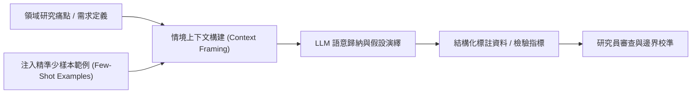

# 📋 語言模型 Context 上下文學習與研究資料假設建立方法論 — 執行摘要

> **活動場次**：產學合作整合型研究計畫 專案研討會議
> **錄音日期**：2026-10-07
> **發言講者**：計畫主持教授 / 核心研究生 / 研究團隊成員
> **對應完整逐字稿**：[`20261007-語言模型Context上下文學習與研究資料假設建立.full.md`](./20261007-語言模型Context上下文學習與研究資料假設建立.full.md)

---

## 📌 核心議題與會議提要

本場專案會議聚焦於如何利用大型語言模型（LLM）的上下文學習（In-Context Learning）能力，革新傳統學術研究與專案中的「資料收集」與「假設建立」流程。主持教授對比了手動發放問卷、填表的舊式資料收集痛點，強調透過精確的 Prompt 上下文引導與 Few-Shot 少樣本範例，能讓模型模擬目標情境並產出高質量的假設驗證結構。

會議同時深入探討了研究人員在使用 AI 工具時的本質思維：「不能只是工具的操作者，更要理解工具背後的抽象邏輯，並學會自製符合研究需求的客製化流程」。

---

## 🏛️ In-Context Learning 輔助研究假設流程

---

## 🔑 關鍵重點整理 (Key Takeaways)

### 1. 兩種上下文驅動模式
- 單純背景提示：給定特定真實業務環境與角色設定，約束模型在該脈絡下解釋現象。
- Few-Shot 範例引導：給出正確對齊的「輸入-輸出」標準範例，教導模型識別隱晦的標註規則。

### 2. 工具使用者的心態轉變
- 教授強調，用現成工具（如剪輯軟體或通用 Chatbot）只能解決表面問題；學術專案的核心競爭力在於「拆解問題根因，並利用程式碼或 API 建構專屬的分析管線」。

### 3. 專案時程與執行要求
- 要求團隊成員於近期確立各自子模組的提示詞範本與驗證集，並準時提交期中評估成果。

---

## 📊 序列模型演進、認知錯覺防範與 IDE Agent 協作開發規範

| 核心教學維度 | 技術內涵與底層機制 | 常見研究誤區與 AI 認知陷阱 | 主持教授要求之標準實踐工作流 |
| :--- | :--- | :--- | :--- |
| **序列模型至 Transformer 演進** | 從早期 RNN、CNN、LSTM 演進至 2022 年後全面主導之 Transformer 自注意力機制與 ReAct 推理框架 | 學生常僅把 LLM 當成聊天黑盒，不理解 Context Window、Memory 狀態與 Token 權重分佈 | 要求使用 Python Harness 開發庫與結構化 Prompt，將任務拆解為可追蹤之上下文推理步驟 |
| **大型語言模型之認知錯覺（Illusion of Competence）** | LLM 具備極強之語言流暢度與表面說服力，容易讓研究者誤以為模型「已經完全理解領域問題」 | 未經查證即全盤接受 AI 產出之研究假設或程式碼，導致實驗設計偏離真實物理與商務邏輯 | 建立嚴謹批判力（Critical Thinking）：每項由 AI 協助歸納之假設皆須對照原始文獻與真實資料分佈進行人工校準 |
| **IDE 內嵌代理（Inline / Sub-agent）與 Git 版控** | 區分當前畫面即時修改（Inline Agent）與多步驟背景任務排程（Sub-agent），搭配模型等級切換（架構設計選用高階推理模型） | 學校課程較少系統性教授 Git 版本控制，導致多人協作或多輪 AI 修改後程式碼覆蓋混亂 | 強制全員自學免費開源 Git 教材落實版本控制，並以專案目錄規範檔（Compass / Rules）約束 AI 代理之讀取與修改邊界 |

